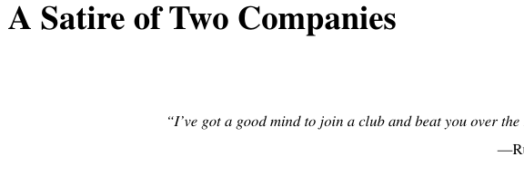

# 附录 C 两家公司的讽刺剧

 

> “我真想加入一个俱乐部，然后拿它敲你的脑袋！”
> 
——Rufus T. Firefly

> 译注：原书本附录采用双拦对照排版——左拦 Rufus, Inc.（反面案例），右拦 Rupert Industries（正面案例），两拦事件平行推进。Markdown 无法真正呈现双拦，故本节按原书段落节拍逐段交替，以加粗的栏名分隔；原书用 `* * *` 标记的时间跳跃，本节用水平线表示。

## 项目启动 · 2001 年 1 月 3 日

**Rufus, Inc.**

你叫 Bob。
今天是 2001 年 1 月 3 日，你的脑袋还因为不久前的千禧年狂欢而隐隐作痛。
你正和几位经理以及一群同事坐在一间会议室里。
你是一名项目组长。
你的老板也在，他还带来了他手下所有的组长。
会议是他老板召集的。

**Rupert Industries**
**项目：~Alpha~**

你叫 Robert。
今天是 2001 年 1 月 3 日。
这个假期里与家人共度的安静时光让你恢复了精力，准备好工作了。
你正和你的专业团队坐在一间会议室里。
会议是部门经理召集的。

**Rufus, Inc.**

“我们有一个新项目要开发。”你老板的老板说。就叫他 BB。
他头上的尖角长得那么长，都蹭到天花板了。
你老板的尖角才刚开始长，但他热切地盼着有一天能在吸音天花板上留下百利发乳的印子。
BB 描述了他们所发现的新市场的要点，以及他们想要开发来占领这个市场的产品。

**Rupert Industries**

“我们对一个新项目有一些想法。”部门经理说。就叫他 Russ。
他是个神经紧绷的英国佬，精力比聚变反应堆还足。
他有雄心、有干劲，但他懂得团队的价值。

Russ 描述了公司所发现的这个新市场机会的要点，并把负责定义应对该市场之产品的市场经理 Jay 介绍给你。

**Rufus, Inc.**

“这个新项目必须在第四季度、十月一日之前上线运行。”BB 命令道，“没有比这更要紧的事了；所以我们要取消你们当前的项目。”

会议室里的反应是一片惊愕的沉默。
几个月的工作就这么要被扔掉。
渐渐地，一阵反对的嗡嗡声开始在会议桌周围流转。

**Rupert Industries**

Jay 对你说：“我们希望尽快开始定义我们的第一个产品。你和你的团队什么时候能跟我碰个面？”

你回答：“我们这个项目的当前迭代这周五就做完了。在那之前我们可以给你匀出几个小时。之后，我们会从团队里抽几个人专门给你用。我们会立刻开始招人补他们的位置，再加上你团队需要的新人。”

**Rufus, Inc.**

BB 与屋里每个人目光相接时，他头上的尖角散发出邪恶的绿光。
那阴森的一瞥把每个与会者一个接一个地变成了一团颤抖的原生质。
很清楚，他绝不会容忍就这件事进行任何讨论。

沉默恢复之后，BB 说：“我们必须马上开始。你做分析需要多久？”

**Rupert Industries**

“太好了。”Russ 说，“不过我要你明白，我们在今年七月有个贸易展，届时必须有点东西可展。如果我们拿不出什么像样的东西去那里，机会就丢了。”

“我明白。”你回答，“我目前还不知道你心里想的是什么，但我确信到七月我们能做出点东西来。只是我现在没法告诉你那个东西具体是什么。不管怎样，你和 Jay 将完全掌控我们开发人员做什么，所以你可以放心，到七月你们会有一批在那段时间内所能完成的最重要的事情，可以拿去展示。”

**Rufus, Inc.**

你举起手。
你老板想拦住你，但他那团口水没打中你，你根本不知道他试过。

“先生，在拿到一些需求之前，我们没法告诉你分析要多久。”

“需求文档还要三四个星期才能好。”BB 说，他的尖角因挫败而颤动着，“那就假装你现在手上就有需求。你做分析需要多久？”

没人呼吸。
每个人都环视四周，看别人有没有什么主意。

“如果分析超过四月一日，我们就有麻烦了。你能在那之前完成分析吗？”

你老板明显地在鼓足勇气，憋出这么一句：“我们会想办法的，先生！”
他的尖角长长了 3 毫米，而你的头痛多了两片泰诺。

**Rupert Industries**

Russ 满意地点了点头。
他知道这一套是怎么运转的。
你的团队一直让他知情，一直让他来掌舵开发。
他有十足的信心：你的团队会先做最重要的事情，并产出高质量的产品。

**Rufus, Inc.**

“很好。”BB 笑道，“那么，做设计需要多久？”

“先生，”你说。你老板明显脸色发白。他显然担心他那 3 毫米有风险。“没有分析，就没法告诉你设计要多久。”

BB 的表情变得比严峻更严峻。“**假装**你已经有分析了！”他说着，用那双空洞的、珠子似的小眼睛盯住你，“你做设计需要多久？”

两片泰诺已经不够用了。
你老板为了保住他新长出来的尖角，绝望地胡言乱语：“嗯，先生，项目只剩六个月了，设计最好别超过三个月。”

“我很高兴你同意，Smithers！”BB 满面春风地说。

你老板松了一口气。
他知道自己的尖角保住了。
过了一会儿，他开始轻轻哼起百利发乳的广告曲。

BB 继续说：“那么，分析四月一日完成，设计七月一日完成，这样你们就有三个月来实现这个项目。这次会议就是我们新的共识与授权政策运作得多好的一个例证。现在，出去开始干活吧。下星期我要在我桌上看到 TQM 计划和 QIT 任务分配。哦，别忘了下个月质量审核需要你们的跨职能团队会议与报告。”

“别提泰诺了，”你一边走回自己的工位一边想，“我需要威士忌。”

**Rupert Industries**

---

**Rufus, Inc.**

你老板过来找你，脸上明显很兴奋，说：“天啊，多棒的会。我觉得我们要靠这个项目震动世界了。”
你点头同意，心里厌恶到做不出别的反应。

“哦，”你老板继续说，“我差点忘了。”他递给你一份 30 页的文件。“记住，SEI 下星期要来评估。这是评估指南。你需要通读它、背下来，然后把它碎掉。它告诉你如何回答 SEI 审计员问你的任何问题。它还告诉你哪些部分的大楼可以带他们去、哪些部分要避开。我们决心在六月之前成为 CMM 三级组织！”

**Rupert Industries**

---

**Rufus, Inc.**

你和同事们开始做这个新项目的分析。
这很难，因为你们没有需求。
但从 BB 在那个决定命运的早晨所做的那 10 分钟介绍里，你对这个产品该做什么有了点概念。

公司流程要求你们从创建一份用例文档开始。
你和团队开始枚举用例，画椭圆和火柴人。

团队里爆发了哲学争论。
对于某些用例应当用 `<<extends>>` 还是 `<<includes>>` 关系连接，意见不一。
竞争性的模型被造出来，但没人知道如何评价它们。
争论持续着，实际上让进展瘫痪了。

**Rupert Industries**

“那么 Robert，”Jay 在第一次会议上说，“你的团队对被拆开这件事怎么看？”

“我们会想念彼此一起工作的。”你回答，“不过我们中有几个人对上一个项目已经相当厌倦了，正盼着换个环境。那么，你们在琢磨什么？”

Jay 眉开眼笑。“你知道我们客户目前有多大麻烦……”然后他花了大约半小时描述这个问题和可能的解法。

“好，等一下。”你回应道，“这一点我需要弄清楚。”
于是你和 Jay 讨论这个系统可能如何工作。
Jay 的一些想法还不成熟。
你提出一些可能的解法。
他喜欢其中一些。
你们继续讨论。

**Rufus, Inc.**

一周后，有人在 iceberg.com 网站上找到一份建议：彻底弃用 `<<extends>>` 和 `<<includes>>`，代之以 `<<precedes>>` 和 `<<uses>>`。
这个网站上的文档由 Don Sengroiux 撰写，描述了一种称为 Stalwart 分析的方法，号称是把用例翻译成设计图的分步方法。

更多竞争性的用例模型用这套新方案造了出来；但同样，没人同意该如何评价它们。
折腾继续着。

越来越多的用例会议是由情绪而非理性驱动的。
要不是因为你们没有需求，你们大概会对自己进展之匮乏感到相当不安。

**Rupert Industries**

讨论过程中，每涉及一个新话题，Jay 就写下用户故事卡。
每张卡代表新系统必须做的一件事。
卡片在桌上积起来，在你们面前摊开。
你和 Jay 都指着它们、拿起它们、在讨论的同时在上面做笔记。
卡片是强有力的记忆装置，你可以用它们来表示那些几乎还没成形复杂想法。

会议结束时你说：“好，我大概明白你想要什么了。我要去跟团队谈谈。我想他们会想用各种数据库结构和呈现格式做一些实验。下次我们见面就作为团队一起，开始识别这个系统最重要的特性。”

**Rufus, Inc.**

需求文档在二月十五日到达。
然后在二十日、二十五日，以及之后每个星期，都来一版。
每个新版本都与前一版矛盾。
显然，写需求的那些市场人员虽然被赋了权，却拿不出共识。

与此同时，各团队成员提出了若干新的竞争性用例模板。
每一个都以自己特别有创意的方式延迟进展。
争论激烈进行。

三月一日，流程巡察员 Percival Putrigence 成功地把所有竞争性的用例表单和模板整合成单一、无所不包的表单。
光是空表单就有 15 页长。
他设法把出现在所有竞争模板上的每一个字段都包含了进去。
他还提交了一份 159 页的文档，说明如何填写这份用例表单。
当前所有用例都必须按新标准重写。

你暗自惊叹：如今要回答“当用户按下回车时系统应当做什么？”这个问题，竟然需要 15 页的填空和论述题。

公司流程（由 L. E. Ott 撰写，他是《整体分析：面向软件工程师的渐进辩证法》一书的著名作者）坚持：在完成分析并进入设计阶段之前，你们必须发现所有主要用例、87% 的所有次要用例，以及 36.274% 的所有三级用例。
你们根本不知道三级用例是什么。
于是，为了满足这条要求，你们试着让市场部评审你们的用例文档。
也许他们知道三级用例是什么。

**Rupert Industries**

一周后，你的新生团队与 Jay 见面。
他们把现有的用户故事卡摊在桌上，开始深入系统的一些细节。

会议非常活跃。
Jay 按重要性顺序呈现各个故事。
每一个都引来大量讨论。
开发人员关心的是把故事拆得足够小，以便估算和测试。
所以他们不断请 Jay 把一个故事拆成几个更小的故事。
Jay 关心的是每个故事都有清晰的商业价值和优先级，所以他拆分时确保这一点不变。

卡片在桌上积起来。
Jay 写卡片，但开发人员按需要在上面做笔记。
没有人试图记录说过的每一句话。
卡片不是用来捕捉一切的；它们只是对话的提醒。

随着开发人员对故事越来越熟悉，他们开始在卡片上写估算。
这些估算粗糙、只用于预算，但它们让 Jay 对每个故事的成本有了概念。

会议结束时，很清楚还有多得多的故事可以讨论。
同样清楚的是，最重要的那些故事已经谈过了，它们代表着几个月的工作量。
Jay 带着卡片结束会议，并承诺第二天早上给出第一个发布的提案。

**Rufus, Inc.**

不幸的是，市场人员忙于销售支持，没空见你们。
事实上，自项目开始以来，你们一次都没能跟市场部开成会。
他们能做到的最好的事，就是源源不断地提供不断变化、自相矛盾的需求文档。

一个团队在用例文档上无休止地打转时，另一个团队在推导领域模型。
无穷无尽的 UML 文档变体从这个团队涌出。
每个星期，模型都被重做。
团队成员无法决定模型里该用 `<<interfaces>>` 还是 `<<types>>`。
关于 OCL 的正确语法和应用，一场巨大的分歧正在激烈进行。
团队里另一些人刚参加完一个为期五天的“分解代谢”课程回来，一直在产出别人谁也看不懂的、极其详尽而玄奥的图。

三月二十七日，距分析应当完成还有一周，你们产出了一片文档与图的海洋，但你们对问题的清晰分析，并不比一月三日时更接近。

**Rupert Industries**

---

**Rufus, Inc.**

然后，奇迹发生了。

**Rupert Industries**

第二天早上，你们重新开会。
Jay 挑了五张卡放在桌上。

“根据你们的估算，这些卡片代表大约五十点的工作量。上一个项目的上一个迭代在三周内完成了五十点。如果我们能在三周内把这五个故事做完，我们就能向 Russ 演示它们。那会让他对我们的进展非常放心。”

Jay 这是在硬撑。
他脸上那副难为情的样子让你知道他心里也清楚。
你回答：“Jay，这是一个新团队，做的是一个新项目。指望我们的速度跟上一个团队一样，有点自以为是了。不过，我昨天下午跟团队碰过，我们都同意我们的初始速度确实应当定为每三周五十个故事点。所以这一回你运气不错。”

“只是记住，”你继续说，“故事估算和速度在目前阶段都是非常初步的。我们规划迭代时会了解得更多，实现时还会了解更多。”

Jay 从眼镜上方看着你，仿佛在说：“这儿到底谁说了算？”然后他笑了，说：“是啊，别担心，这套路数我现在已经很熟了。”

然后 Jay 又在桌上放了 15 张卡。
他说：“如果我们能在三月底之前把这些卡全做完，我们就能把系统交给 beta 测试客户。我们会从他们那里得到很好的反馈。”

你回答：“好，那我们第一个迭代定了，而且我们有了之后三个迭代的故事。这四个迭代将构成我们的第一个发布。”

“那么，”Jay 说，“你真能在接下来三周里做完这五个故事？”

“我没法确定，Jay。”你回答，“我们把它们拆成任务看看能得到什么。”

于是 Jay、你和你的团队花了几个小时，把 Jay 为第一个迭代挑的那五个故事逐一拆成小任务。
开发人员很快意识到，有些任务可以在故事之间共享，另一些任务则有可以加以利用的共同之处。
很清楚，潜在的设计正在开发人员脑子里冒出来。
时不时地，他们凑成小讨论圈，在卡片上涂画 UML 图。

很快，白板上就写满了任务——这些任务一旦完成，就能实现本迭代的五个故事。
你以这句话开始认领流程：“好，我们来认领这些任务。”

**Rufus, Inc.**

星期六，四月一日，你在家里查邮件。
你看到一份你老板发给 BB 的备忘录。
它明确声明：你们的分析已经完成！

你打电话给老板，抱怨道：“你怎么能跟 BB 说我们的分析做完了？”

“你最近看过日历吗？”他回答，“今天是四月一日！”

那个日期的讽刺意味没逃过你。“可是我们还有那么多要考虑的！还有那么多要分析的！我们连该用 `<<extends>>` 还是 `<<precedes>>` 都还没决定！”

“你有什么证据证明你没做完？”你老板不耐烦地问。

“什……么……”

但他打断你：“分析可以永远做下去，它必须在某个时刻被停止。既然这本来就是预定停止的日期，那它现在就已经停止了。星期一，我要你把所有现有的分析材料收集起来，放进一个公共文件夹。把那个文件夹发布给 Percival，好让他在星期一下午之前把它登记进 CM 系统。然后赶紧忙起来，开始设计。”

挂上电话时，你开始考虑在办公桌最下面那个抽屉里备一瓶威士忌的好处。

**Rupert Industries**

“我来做初始的数据库生成。”Pete 说，“上一个项目我就是做这个的，这个看起来没什么不同。我估计两天。”

“好，那我来做登录屏幕。”Joe 说。

“哎呀。”团队里资历最浅的 Elmo 说，“我从没做过 GUI，我还挺想试试那个的。”

“啊，年轻人的急躁。”Joe 老成地说，朝你使了个眼色，“你可以来协助我，年轻绝地武士。”他对 Jay 说：“我想我大概需要三天。”

开发人员一个接一个认领任务并做估算。
你和 Jay 都知道，让开发人员自愿认领任务比把任务指派给他们要好。
你也完全清楚，你不敢去质疑开发人员的任何估算。
你了解这些人，你信任他们。
你知道他们会尽力而为。

开发人员知道，他们认领的任务量不能超过他们在上一个迭代中完成的量。
一旦每个开发人员填满了他本迭代的日程，他就停止认领任务。

最终，所有开发人员都停止认领任务。
但当然，板上还剩着任务。

“我担心过会这样。”你说，“好，只有一件事可做，Jay。这个迭代我们的事太多了。我们能去掉哪些故事或任务？”

Jay 叹了口气。
他知道这是唯一的选择。
在项目开始时加班是疯狂的，而他试过这么做的项目都没有好下场。

于是 Jay 开始移除最不重要的功能。“嗯，我们暂时真的不需要登录屏幕。我们可以让系统直接以已登录状态启动。”

“糟糕！”Elmo 喊道，“我真的很想做那个。”

“耐心点，蚱蜢。”Joe 说，“等待蜜蜂离开蜂巢的人，嘴唇不会肿得尝不出蜂蜜。”

Elmo 一脸困惑。
所有人都一脸困惑。

“那么……”Jay 继续说，“我想我们也可以去掉……”

**Rufus, Inc.**

他们办了一场聚会，庆祝分析阶段按时完成。
BB 发表了一场令人翻肠倒肚的、关于授权的演讲。
而你老板，又长高了 3 毫米，祝贺他的团队展现了不可思议的团结与团队精神。
最后，CIO 登台告诉所有人，SEI 审计进展非常顺利，他感谢大家通读并碎掉了发下来的评估指南。
三级现在看来稳了，将于六月授予。

（有小道消息说，BB 及以上级别的经理们，一旦 SEI 授予三级，将获得可观的奖金。）

**Rupert Industries**

就这样，一点一点，任务清单缩短了。
丢掉任务的开发人员改去认领剩下的某个任务。

这场协商并非毫无痛感。
有几次，Jay 表现出明显的挫败和急躁。
有一次，在气氛特别紧张时，Elmo 自告奋勇说“加把劲把缺的时间补回来”。
你正要纠正他，幸亏 Joe 直视着他的眼睛说：“一旦你踏上了黑暗之路，它将永远支配你的命运。”

最终，达成了一个 Jay 可以接受的迭代。
那不是 Jay 想要的。
事实上，它要少得多。
但它是团队觉得在接下来三周内能够达成的东西。
而且，它仍然处理了 Jay 在本迭代中最想要的那些最重要的事。

“那么，Jay，”等事情稍微平静下来之后你说，“我们什么时候能拿到你的验收测试？”

Jay 叹了口气。
这是硬币的另一面。
开发团队每实现一个故事，Jay 就必须提供一套验收测试，证明它们能工作。
而团队需要在迭代结束之前很久就拿到这些测试，因为它们肯定会指出 Jay 与开发人员对系统行为设想之间的差异。

“我今天就给你们一些示例测试脚本。”Jay 承诺，“之后我每天往里加。迭代中期你们会拿到整套。”

**Rufus, Inc.**

随着一周周过去，你和你的团队做系统的设计。
当然，你发现设计所依据的那份分析是有缺陷的……不，是没用的……不，是比没用更糟。
但当你告诉老板，你需要回去在分析上再做些工作以支撑它薄弱的那些部分时，他只是说：“分析阶段结束了。唯一被允许的活动是设计。现在回去干活。”

于是，你和你的团队尽己所能地硬凑设计，不确定需求是否被恰当分析过。
当然这其实关系不大，因为需求文档仍在每周翻腾，而市场部仍然拒绝见你们。

设计是一场噩梦。
你老板最近误读了一本叫 The Finish Line 的书，作者 Mark DeThomaso 在书里轻快地建议：设计文档应当写到代码级的细节。

“如果我们要在那种细节层次上工作，”你问，“那我们为什么不直接写代码？”

“因为那样你就不是在设计了，当然。而设计阶段唯一被允许的活动就是设计！”

“再说，”他继续道，“我们刚买了一份 Dandelion 的全公司许可证！这个工具能实现‘环城工程’（round-the-horn engineering）！你要把所有设计图导进这个工具。它会自动为我们生成代码！它还会让设计图与代码保持同步！”

你老板递给你一个色彩鲜艳的、塑封包装的盒子，里面是 Dandelion 发行版。
你麻木地接过，拖着步子回到工位。
十二小时、八次崩溃、一次磁盘重格式化、八杯 151 之后，你终于把工具装到了服务器上。
你想着团队参加 Dandelion 培训要损失的那一周。
然后你笑了，心想：“我不在的任何一周都是好的一周。”

一张又一张设计图由你的团队画出来。
Dandelion 让画这些图变得非常困难。
有几十几十个深度嵌套的对话框，带着滑稽的文本框和复选框，必须全部正确填写。
然后还有在包之间移动类的问题……

起初，这些图纸是由用例驱动的。
但需求变化得太频繁，用例很快变得毫无意义。

关于该用 VISITOR 还是 DECORATOR 设计模式，争论激烈。
一名开发人员拒绝以任何形式使用 VISITOR，声称它不是一种正当的面向对象构造。
另一名拒绝使用多重继承，因为那是魔鬼的产物。

**Rupert Industries**

---

**Rufus, Inc.**

评审会议迅速退化成关于面向对象含义、关于分析与设计之定义、关于何时用聚合何时用关联的辩论。

设计周期进行到中途，市场部宣布他们重新考虑了这个系统的重点。
他们的新需求文档被彻底重构。
他们删掉了几个主要功能领域，换成了他们预计客户调查会显示为更合适的那些功能领域。

你告诉老板，这些改动意味着你需要重新分析和重新设计系统的大部分。
但他说：“分析阶段结束了。唯一被允许的活动是设计。现在回去干活。”

你建议，也许更好的做法是做一个简单的原型给市场部看，甚至给一些潜在客户看。
但你老板说：“分析阶段结束了。唯一被允许的活动是设计。现在回去干活。”

砍、砍、砍、砍。
你试图做出一份也许真能反映新需求文档的设计文档。
然而，需求的革命并没有让它们停止翻腾。
事实上，需求文档的狂野振荡在频率和幅度上只是有增无减。
你在其中艰难跋涉。

**Rupert Industries**

迭代在星期一早上以一连串 CRC 会议开始。
到上午过半时，所有开发人员都已结成对，正在飞快地写代码。

“而现在，我的年轻学徒，”Joe 对 Elmo 说，“你将学习测试优先设计的奥秘！”

“哇，听起来挺酷的。”Elmo 回答，“你怎么做？”

Joe 满面笑容。
显然他一直在等这一刻。“小伙子，代码现在做什么？”

“啊？”Elmo 回答，“它什么都不做啊，根本没有代码。”

“那么，想想我们的任务。你能想出代码应该做的一件事吗？”

“当然。”Elmo 带着年轻人的笃定说，“首先，它应该连接到数据库。”

“那么，要连接数据库，都需要些什么？”

“你说话真怪。”Elmo 笑道，“我想我们得从某个注册表里拿到数据库对象，然后调用 `Connect()` 方法。”

“啊。敏锐的年轻巫师。你正确地察觉到，我们需要一个能把数据库对象缓存于其中的对象。”

“‘缓存于’（cacheth）真的是个词吗？”

“我说它是，它就是！那么，我们能写什么测试，来证明数据库注册表应当通过？”

Elmo 叹了口气。
他知道自己只能配合下去。“我们应当能够创建一个数据库对象，并用 `Store()` 方法把它传给注册表。然后我们应当能够用 `Get()` 方法把它从注册表里取出来，并确认是同一个对象。”

“哦，说得好，我那未成年的精灵！”

“喂！”

“那么，现在我们来写一个测试函数，证明你的论断。”

“可我们不该先写数据库对象和注册表对象吗？”

“啊，你要学的还多着呢，我那年轻又没耐心的家伙。先写测试就行。”

“可它根本编译不过！”

“你确定吗？万一编译得过呢？”

“呃……”

“写测试就行，Elmo。相信我。”

于是 Joe、Elmo 和所有其他开发人员开始编码他们的任务，一次一个测试用例。
他们工作的房间里嗡嗡响着结对之间的对话。
这阵嗡鸣时不时被击掌声打断——某一对完成了某个任务或某个棘手的测试用例。

随着开发推进，开发人员一天换一两次搭档。
每个开发人员都能看到其他所有人在做什么，于是关于代码的知识在整个团队中普遍传播开来。

每当某一对完成了某件重要的东西（无论是整个任务还是任务的某个重要部分），他们就把自己做的东西与系统其余部分集成。
于是，代码库逐日增长，集成困难被降到最低。

开发人员每天与 Jay 沟通。
凡是关于系统功能或验收测试用例解释的问题，他们都去找他。

Jay 说到做到，为团队提供源源不断的验收测试脚本。
团队仔细阅读这些脚本，从而对 Jay 期望系统做什么有了好得多的理解。

**Rufus, Inc.**

六月十五日，Dandelion 数据库损坏了。
显然，这种损坏是渐进性的。
数据库中的小错误在数月间积累成越来越大的错误。
最终，CASE 工具干脆停止工作。
当然，那些缓慢蔓延的损坏也存在于所有备份上。

打给 Dandelion 技术支持线的电话连续几天无人应答。
最后你收到 Dandelion 一封简短的电子邮件，告知你这是一个已知问题，解决办法是购买新版本（他们承诺下个季度某个时候就绪），然后手工重新录入所有图纸。

**Rupert Industries**

到第二周开始时，已有足够的功能可以向 Jay 演示。
Jay 热切地看着演示一个接一个地通过测试用例。

“这真不错。”演示终于结束时 Jay 说，“但这看起来不像三分之一的任务啊。你们的速度比预期的慢吗？”

你做了个鬼脸。
你一直在等一个好时机向 Jay 提这件事，现在 Jay 逼着你摊牌了。

“是的，很不幸我们比预期走得慢。我们正在用的新应用服务器配起来很麻烦。而且它重启要花很久，我们哪怕只改一点点配置都得重启它。”

Jay 用怀疑的眼光看你。
上个星期一那场协商的压力还没有完全消散。
他说：“那这对我们的进度意味着什么？我们不能再推迟了，真的不能。Russ 会大发雷霆！他会把我们全叫进小树林狠狠训一顿。”

你直视 Jay 的眼睛。
给别人讲这种消息，从来没有什么好方式。
所以你干脆脱口而出：“你看，如果一直照这样下去，到下周五我们肯定什么都做不完！当然，有可能我们会想出办法加快。但老实说，我不会指望那个。你应该开始考虑可以在这个迭代里去掉的一两个任务，而又不破坏给 Russ 的演示。不管天塌地陷，我们周五都要做那场演示，而我觉得你不会想让我们来挑去掉哪些任务。”

“唉，看在老天的份上！”Jay 勉强把最后一个词咽了回去，摇着头大步走开。

这已经不是第一次了，你对自己说：“从来没人向我保证过项目管理是件容易事。”
你很确定这也不会是最后一次。

**Rufus, Inc.**

然后，在七月一日，又一个奇迹发生了！你的设计做完了！

你没有去找老板抱怨，而是往办公桌中间那个抽屉里备了些伏特加。

**Rupert Industries**

---

**Rufus, Inc.**

他们办了一场聚会，庆祝设计阶段按时完成，以及他们晋级 CMM 三级。
这一次，BB 的演讲如此令人动容，以至于你得在它开始前先去一趟洗手间。

你的工作场所到处是新横幅和铭牌。
上面画着鹰和登山者，谈着团队精神与授权。
喝了几杯苏格兰威士忌之后，它们读起来顺一些了。
这提醒你得清理一下文件柜，给白兰地腾地方。

你和你的团队开始写代码。
但你们很快发现，设计在一些重要方面有所欠缺。
其实，它根本谈不上有任何重要性。
你在一间会议室里召集了一次设计会，想攻克一些更棘手的问题。
但你老板撞见了，解散了会议，说：“设计阶段结束了。唯一被允许的活动是编码。现在回去干活。”

Dandelion 生成的代码真是丑得可怕。
事实证明，你和你的团队当初确实把关联和聚合用错了。
所有生成的代码都必须编辑修正这些缺陷。
编辑这些代码极其困难，因为它被插入了丑陋的注释块，带有 Dandelion 与代码保持同步所需的特殊语法。
如果你不小心改动了其中一条注释，图纸就会被错误地重新生成。
事实证明，“环城工程”需要付出太多太多的努力。

你越是努力让代码与 Dandelion 保持兼容，Dandelion 生成的错误就越多。
最后，你放弃了，决定手工维护图纸。
一秒钟后，你决定完全没有必要维护图纸。
再说，谁有那个时间？

你老板雇了一名顾问来构建统计所产出代码行数的工具。
他在墙上挂了一张大温度计图，顶端写着 1,000,000。
每天他把红线往上延长，显示已经加了多少行。

温度计出现在墙上三天后，你老板在走廊里拦住你。“那张图长得不够快。我们必须在十月一日之前做完一百万行。”

“我们甚至都不……不……确定这个项目需要一百万行。”你语无伦次。

“我们必须在十月一日之前做完一百万行。”你老板重申。
他的尖角又长长了，他抹在上面的希腊染发剂营造出一种权威与能力的氛围。“你确信你的注释块够大吗？”

然后，一阵管理上的灵光闪现，他说：“有了！我要你在工程师当中推行一项新政策。任何代码行都不得超过 20 个字符。凡是这样的行都必须拆成两行或更多——最好是更多。所有现有代码都要按这个标准重做。这会把我们的行数提上去！”

你决定不告诉他，这需要两个计划外的人月。
你决定什么都不告诉他。
你决定静脉注射纯乙醇是唯一的解法。
你做了相应的安排。

**Rupert Industries**

**迭代余波 · 实际情况比预想的稍好一些**

其实，事情比你希望的要好一些。
团队确实不得不从迭代中去掉一个任务，但 Jay 选得很明智，给 Russ 的演示顺利进行。

Russ 对进展并不满意，但也不沮丧。
他只是说：“这相当不错。但记住，我们必须在七月的贸易展上演示这个系统，而按这个速度，看起来你们不会有太多可展示的。”

Jay 的态度随着迭代的完成已大为改善，他回应 Russ 说：“Russ，这个团队工作努力、干得好。到七月时，我确信我们会有些像样的东西可以演示。不会是什么都完整，其中一部分可能只是障眼法，但我们会有东西。”

**Rufus, Inc.**

砍、砍、砍、砍。
你和团队疯狂地写代码。
到八月一日，你老板皱着眉头看着墙上的温度计，推行了每周 50 小时的强制工作周。

砍、砍、砍、砍。
到九月一日，温度计显示 120 万行，你老板要你写一份报告，说明为什么你把编码预算超出了 20%。
他推行强制周六上班，并要求把项目砍回到一百万行。
你开始了一场重新合并代码行的运动。

砍、砍、砍、砍。
情绪在爆发；有人在辞职；QA 把故障报告像雨一样砸向你。
客户在索要安装手册和用户手册；销售在索要给特殊客户的提前演示；需求文档仍在翻腾；市场部在抱怨产品完全不像他们规定的样子；而酒类专卖店不再收你的信用卡了。
总得有个东西让步。

九月十五日，BB 召集会议。

他进房间时，尖角喷着蒸汽。
他开口说话时，那刻意修饰过的声音中的低音泛音，让你的胃翻了个个儿。“QA 经理告诉我，这个项目实现的功能不到要求的 50%。他还告诉我，系统一直在崩溃、产出错误结果，而且慢得可怕。他还抱怨他跟不上每天连续不断的发布——一次比一次更多 bug！”

他停了几秒钟，明显在努力让自己平静下来。“QA 经理估计，按这个开发速度，我们在十二月之前没法发货！”

其实，你觉得更可能是三月，但你没说。

“十二月！”BB 带着如此强烈的嘲弄吼道，以至于人们缩起了头，仿佛他正用一把突击步枪指着他们，“十二月绝对不可能。各位组长，明天早上我要在我桌上看到新的估算。我在此下令，每周工作 65 小时，直到这个项目完成。而且最好在十一月一日之前完成。”

他离开会议室时，有人听到他嘟囔：“授权——呸！”

**Rupert Industries**

最后一个迭代虽然痛苦，却校准了你的速度数字。
下一个迭代顺利得多。
不是因为你的团队完成得更多，而只是因为他们不必在迭代中途去掉任何任务或故事。

到第四个迭代开始时，一种自然的节奏建立了起来。
Jay、你和团队都确切知道可以从彼此那里期待什么。
团队在全力奔跑，但节奏是可持续的。
你有信心团队能把这个节奏保持一年甚至更久。

进度上的意外减少到接近零；然而，需求上的意外没有。
Jay 和 Russ 经常审视这个不断成长的系统，对现有功能提出建议或改动。
但各方都认识到这些改动需要时间、必须排期。
于是这些改动没有让任何人的预期落空。

**Rufus, Inc.**

你老板秃了；他的尖角被装裱在 BB 的墙上。
日光灯照在他光头上的反光一时晃花了你的眼。

“你有喝的吗？”他问。
你刚喝完最后一瓶 Boone's Farm，于是从书架上抽出一瓶 Thunderbird 倒进他的咖啡杯。
“要把这个项目做完，需要什么？”他问。

“我们需要冻结需求、分析它们、设计它们，然后实现它们。”你冷酷地说。

“在十一月一日之前？”你老板难以置信地惊呼，“不可能！回去把那个鬼东西继续编码。”

他冲了出去，挠着他那空空的脑袋。

几天后，你发现你老板被调到了公司研究部。
人员流动率飞涨。
客户在最后一刻才被告知订单无法按时履约，已经开始取消订单。
市场部在重新评估这个产品是否与公司的总体目标一致，等等等等。
备忘录飞来飞去，人头落地，政策变来变去，总体上，局面相当严峻。

最后，到了三月，在经历了太多太多个 65 小时工作周之后，一个摇摇晃晃的软件版本准备好了。
在现场，bug 发现率很高，技术支持人员绞尽脑汁应付愤怒客户的抱怨和要求。
没人高兴。

四月，BB 决定用钱摆脱问题：授权使用 Rupert Industries 生产的产品，并重新分发它。
客户被安抚了，市场部的人得意洋洋，而你被解雇了。

**Rupert Industries**

三月，有一次向董事会的重大系统演示。
系统非常有限，尚未达到可以带去贸易展的程度，但进展是稳定的，董事会印象相当不错。

第二次发布比第一次还要顺利。
到现在，团队已想出办法自动化 Jay 的验收测试脚本。
他们还把系统的设计重构到这样的程度：添加新特性、修改旧特性都变得非常容易。

第二次发布在六月底完成，并被带去贸易展。
它包含的内容比 Jay 和 Russ 希望的要少，但它确实展示了系统最重要的特性。
尽管贸易展上的客户注意到某些特性缺失，总体上他们印象深刻。
你、Russ 和 Jay 都面带笑容地从贸易展回来。
你们都觉得自己是这个项目的赢家。

事实上，许多个月之后，Rufus, Inc. 联系了你。
他们一直在为他们内部运营开发一个类似的系统。
在一次死亡行军式的项目之后，他们取消了那套系统的开发，正在谈判授权你的技术用于他们的环境。

确实，情况在好转！
