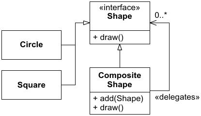
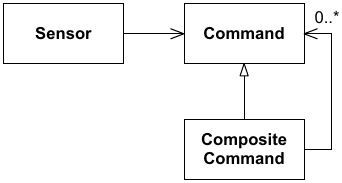

# 23 COMPOSITE
<!-- markdownlint-disable MD033 -->
<!-- markdownlint-disable MD045 -->
<center></center><br/>

COMPOSITE 模式非常简单，却影响深远。
COMPOSITE 模式的基本结构如 Fig 23-1 所示。
这里我们看到一个基于形状的层次结构。
`Shape` 基类有两个派生形状，分别叫 `Circle` 和 `Square`。
第三个派生类是组合类。
`CompositeShape` 保存着许多 `Shape` 实例的列表。
当对 `CompositeShape` 调用 `draw()` 时，它把该方法委托给列表中的所有 `Shape` 实例。

<br/>
*Fig 23-1 COMPOSITE 模式*

因此，`CompositeShape` 的实例在系统看来就是一个单独的 `Shape`。
它可以被传给任何接受 `Shape` 的函数或对象，行为也像一个 `Shape`。
然而，它实际上是一组 `Shape` 实例的代理。¹

¹ 注意，其结构与 PROXY 模式相似。

Listing 23-1 和 Listing 23-2 给出了 `CompositeShape` 的一种可能实现。

Listing 23-1 Shape.java

```java
public interface Shape
{
    public void draw();
}
```

Listing 23-2 CompositeShape.java

```java
import java.util.Vector;

public class CompositeShape implements Shape
{
    private Vector itsShapes = new Vector();
    public void add(Shape s)
    {
        itsShapes.add(s);
    }

    public void draw()
    {
        for (int i = 0; i < itsShapes.size(); i++)
        {
            Shape shape = (Shape) itsShapes.elementAt(i);
            shape.draw();
        }
    }
}
```

## 组合命令示例

回到[第 152 页](./ch13.md)，我们讨论过 `Sensor` 和 `Command` 对象。
Fig 13-3 展示了一个使用 `Command` 类的 `Sensor` 类。
当 `Sensor` 检测到触发它的事件时，就会调用 `Command` 的 `do()`。

在那次讨论中我没有提到的是：很多时候，一个 `Sensor` 不得不执行不止一个 `Command`。
例如，当纸张行进到纸路中的某个位置时，就会挡住一个光学传感器的光路。
该传感器随即停下某个电机、启动另一个电机，并接合某个特定的离合器。

起初我们把这理解为：每个 `Sensor` 类都得维护一个 `Command` 对象的列表。（见 Fig 23-2。）
然而我们很快发现：每当一个 `Sensor` 需要执行多个 `Command` 时，它对待这些 `Command` 对象的方式总是完全一致的。
也就是说，它只是在列表上迭代，并对每个 `Command` 调用 `do()`。
这正适合 COMPOSITE 模式。

<br/>
*Fig 23-2 包含多个 Command 的 Sensor*

于是我们不去改动 `Sensor` 类，另外创建一个 `CompositeCommand`，如 Fig 23-3 所示。

<br/>
*Fig 23-3 组合 Command*

这意味着我们既不必改动 `Sensor`，也不必改动 `Command`。
我们能在两者都不改动的前提下，给一个 `Sensor` 加上多个 `Command`。
这是 OCP 的一次应用。

## 多重性还是不多重性

这就引出一个有趣的问题。
我们能让 `Sensor` 表现得好像包含许多 `Command`，却不必修改 `Sensor` 本身。
在常规的软件设计中，一定还有许多类似的情形。
一定会有一些时候，你可以用 COMPOSITE，而不是去构建对象的列表或向量。

换个说法。
`Sensor` 与 `Command` 之间的关联是一对一的。
我们本来想把这个关联改为一对多。
但我们反而找到了一种办法：在不建立一对多关系的前提下，获得一对多的行为。
一对一关系比一对多关系更容易理解、编码和维护，所以这显然是正确的设计取舍。
你当前项目中有多少一对多关系，在用上 COMPOSITE 之后可以变回一对一？

<ins>当然，并非所有一对多关系都能靠 COMPOSITE 退回一对一。
只有那些 “列表中的每个对象都被一视同仁” 的关系才是候选。</ins>
例如，如果你维护一个员工列表，并从中查找发薪日就是今天的员工，那你大概不该用 COMPOSITE 模式，因为你并没有把全体员工作同等对待。

尽管如此，仍有相当多的一对多关系有资格转换为 COMPOSITE。
而且好处十分显著。
列表管理和迭代的代码不必在每个客户端里重复，只需在组合类里出现一次。
<!-- markdownlint-disable MD033 -->
