# 24 OBSERVER：演化出模式

<center></center><br/>

本章有其特殊目的。
我会描述 OBSERVER¹ 模式，但那只是次要目标。
本章的主要目标是向你演示：你的设计和代码如何演化，最终用上一个模式。

¹ [GOF95]，第 293 页。

在前面的章节中，我们使用了许多模式。
我们常常把它们当作既成事实呈现，却不展示代码是如何演化到使用该模式的。
这可能让你以为，模式不过是在完成态下插入代码与设计中的现成物件。
我并不这样建议。
相反，我更愿意让手头的代码朝着它所需要的方向演化。
当我通过重构来解决耦合、简洁性和表达力方面的问题时，我可能会发现代码已经接近某个模式了。
一旦如此，我就把类和变量改名为该模式所用的名字，并把代码结构调整成更规范的形式。
于是，代码就是这样 “倒着” 走进了模式。

本章先提出一个简单的问题，然后展示设计与代码如何演化来解决它。
演化的结果恰好就是 OBSERVER 模式。
在演化的每一步，我都会说明自己正试图解决什么问题，然后给出解决这些问题的步骤。

## 数字时钟

我们有一个时钟对象。
该对象捕获操作系统产生的毫秒中断（称为 tic），并把它们转换成当日时间。
它知道如何从毫秒算出秒、从秒算出分、从分算出小时、从小时算出天，等等。
它知道一个月有多少天，一年有多少个月。
它对闰年无所不知：何时该有、何时不该有。
它懂得时间。（见 Fig 24-1。）

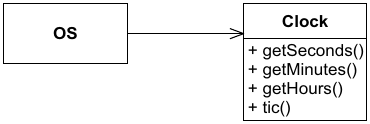<br/>
*Fig 24-1 Clock*

我们想造一个数字时钟，摆在桌面上，持续显示当日时间。
最简单的方式是什么？
我们也许会写出下面这样的代码：

```java
public void DisplayTime
{
  while(1)
  {
    int sec = clock.getSeconds();
    int min = clock.getMinutes();
    int hour = clock.getHours();
    showTime(hour,min,sec);
  }
}
```

显然，这并不理想。
它占用所有可用的 CPU 周期来反复显示时间。
其中大多数显示都是白费，因为时间根本没变。
在数字手表或数字挂钟里，这种方案或许够用，因为这类系统并不在乎节省 CPU 周期。
然而，我们不希望自己桌面上跑着这么个 CPU 吞噬者。

根本问题在于：如何高效地把数据从 `Clock` 送到 `DigitalClock`。
我假定 `Clock` 对象和 `DigitalClock` 对象都已存在。
我关心的是如何把它们连接起来。
要测试这个连接，只需确认从 `Clock` 得到的数据与送给 `DigitalClock` 的数据一致。

编写这个测试的一个简单办法是：创建一个假装是 `Clock` 的接口，再创建一个假装是 `DigitalClock` 的接口。
然后我可以写出实现这些接口的特殊测试对象，并验证它们之间的连接是否如预期工作。（见 Fig 24-2。）

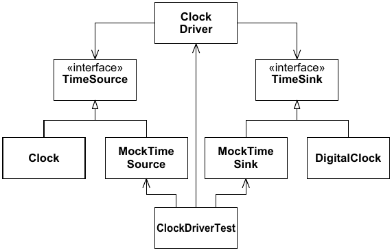<br/>
*Fig 24-2 测试数字时钟*

`ClockDriverTest` 对象会通过 `TimeSource` 和 `TimeSink` 接口，把 `ClockDriver` 与两个 mock 对象连接起来。
随后它检查每个 mock 对象，以确认 `ClockDriver` 确实把时间从源搬到了接收端。
如有必要，`ClockDriverTest` 还会确保效率得到了保持。

我觉得有趣的是：仅仅因为考虑如何测试，我们就给设计加上了接口。
要测试一个模块，你必须能把它与系统中的其他模块隔离开，正如我们把 `ClockDriver` 与 `Clock`、`DigitalClock` 隔离开一样。
先考虑测试，有助于我们在设计中把耦合降到最低。

好，`ClockDriver` 是怎么工作的？
显然，为了高效，`ClockDriver` 必须检测到 `TimeSource` 对象中的时间何时发生了变化。
然后——也只有在那时——它才应把时间搬到 `TimeSink` 对象。
`ClockDriver` 怎么知道时间变了？
它可以轮询 `TimeSource`，但那不过是重新制造了 CPU 吞噬问题。

让 `ClockDriver` 知道时间已变的最简单办法，是由 `Clock` 对象告诉它。
我们可以通过 `TimeSource` 接口把 `ClockDriver` 传给 `Clock`，然后当时间变化时，`Clock` 就可以更新 `ClockDriver`。
`ClockDriver` 再反过来在 `ClockSink` 上设置时间。（见 Fig 24-3。）

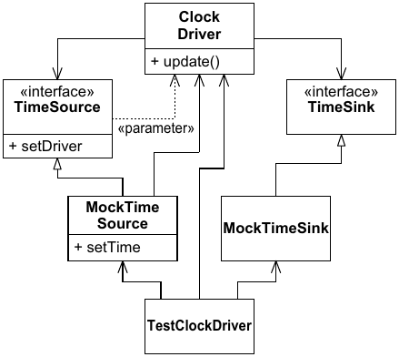<br/>
*Fig 24-3 让 TimeSource 去更新 ClockDriver*

注意从 `TimeSource` 到 `ClockDriver` 的依赖。
它之所以存在，是因为 `setDriver` 方法的参数是一个 `ClockDriver`。
我对此并不满意，因为这意味着 `TimeSource` 对象在任何情况下都必须使用 `ClockDriver` 对象。
不过，在这个程序能跑起来之前，我先不动这个依赖。

Listing 24-1 展示了 `ClockDriver` 的测试用例。
注意它创建了一个 `ClockDriver`，并给它绑定一个 `MockTimeSource` 和一个 `MockTimeSink`。
然后在源中设置时间，并期望时间神奇地出现在接收端。
其余代码见 Listing 24-2 至 24-6。

Listing 24-1 ClockDriverTest.java

```java
import junit.framework.*;
public class ClockDriverTest extends TestCase
{
    public ClockDriverTest(String name)
    {
        super(name);
    }

    public void testTimeChange()
    {
        MockTimeSource source = new MockTimeSource();
        MockTimeSink sink = new MockTimeSink();
        ClockDriver driver = new ClockDriver(source,sink);
        source.setTime(3,4,5);
        assertEquals(3, sink.getHours());
        assertEquals(4, sink.getMinutes());
        assertEquals(5, sink.getSeconds());

        source.setTime(7,8,9);
        assertEquals(7, sink.getHours());
        assertEquals(8, sink.getMinutes());
        assertEquals(9, sink.getSeconds());
    }
}
```

Listing 24-2 TimeSource.java

```java
public interface TimeSource
{
    public void setDriver(ClockDriver driver);
}
```

Listing 24-3 TimeSink.java

```java
public interface TimeSink
{
    public void setTime(int hours, int minutes, int seconds);
}
```

Listing 24-4 ClockDriver.java

```java
public class ClockDriver
{
    private TimeSink itsSink;

    public ClockDriver(TimeSource source, TimeSink sink)
    {
        source.setDriver(this);
        itsSink = sink;
    }

    public void update(int hours, int minutes, int seconds)
    {
        itsSink.setTime(hours, minutes, seconds);
    }
}
```

Listing 24-5 MockTimeSource.java

```java
public class MockTimeSource implements TimeSource
{
    private ClockDriver itsDriver;

    public void setTime(int hours, int minutes, int seconds)
    {
        itsDriver.update(hours, minutes, seconds);
    }

    public void setDriver(ClockDriver driver)
    {
        itsDriver = driver;
    }
}
```

Listing 24-6 MockTimeSink.java

```java
public class MockTimeSink implements TimeSink
{
    private int itsHours;
    private int itsMinutes;
    private int itsSeconds;

    public int getSeconds()
    {
        return itsSeconds;
    }

    public int getMinutes()
    {
        return itsMinutes;
    }

    public int getHours()
    {
        return itsHours;
    }

    public void setTime(int hours, int minutes, int seconds)
    {
        itsHours = hours;
        itsMinutes = minutes;
        itsSeconds = seconds;
    }
}
```

好，既然它能工作了，我就可以考虑清理它了。
我不喜欢从 `TimeSource` 到 `ClockDriver` 的依赖，因为我希望 `TimeSource` 接口能被任何对象使用，而不只是 `ClockDriver` 对象。
我们可以这样修正：创建一个 `TimeSource` 能使用、`ClockDriver` 能实现的接口。
我们称这个接口为 `ClockObserver`。
见 Listing 24-7 至 24-10。
其中改动过的代码，在原书中以粗体标出。

> 译注：Markdown 代码块无法呈现粗体，故此处一律照原文照录，不另标注哪些行有改动。

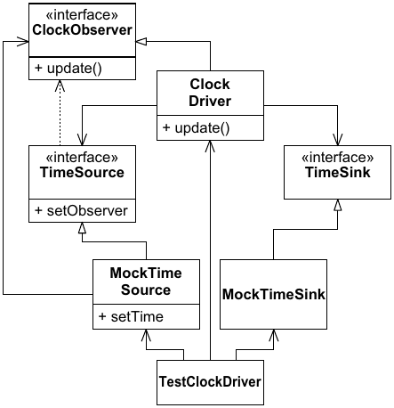<br/>
*Fig 24-4 打破 TimeSource 对 ClockDriver 的依赖*

Listing 24-7 ClockObserver.java

```java
public interface ClockObserver
{
    public void update(int hours, int minutes, int seconds);
}
```

Listing 24-8 ClockDriver.java

```java
public class ClockDriver implements ClockObserver
{
    private TimeSink itsSink;

    public ClockDriver(TimeSource source, TimeSink sink)
    {
        source.setObserver(this);
        itsSink = sink;
    }

    public void update(int hours, int minutes, int seconds)
    {
        itsSink.setTime(hours, minutes, seconds);
    }
}
```

Listing 24-9 TimeSource.java

```java
public interface TimeSource
{
    public void setObserver(ClockObserver observer);
}
```

Listing 24-10 MockTimeSource.java

```java
public class MockTimeSource implements TimeSource
{
    private ClockObserver itsObserver;

    public void setTime(int hours, int minutes, int seconds)
    {
        itsObserver.update(hours, minutes, seconds);
    }

    public void setObserver(ClockObserver observer)
    {
        itsObserver = observer;
    }
}
```

这好多了。
现在任何人都能使用 `TimeSource`。
他们只需实现 `ClockObserver`，并调用 `setObserver`，把自己作为参数传进去。

我希望能有不止一个 `TimeSink` 获得时间。
一个可能实现数字时钟，另一个可能把时间提供给提醒服务，还有一个可能启动我每晚的备份。
简而言之，我希望单个 `TimeSource` 能把时间提供给多个 `TimeSink` 对象。

于是我把 `ClockDriver` 的构造函数改为只接受 `TimeSource`，再加一个名为 `addTimeSink` 的方法，让你随时添加 `TimeSink` 实例。

我不喜欢的是：现在有了两层间接。
我既要调用 `setObserver` 告诉 `TimeSource` 谁是 `ClockObserver`，又要告诉 `ClockDriver` 哪些是 `TimeSink` 实例。
这双重间接真的必要吗？

看看 `ClockObserver` 和 `TimeSink`，我发现它们都有 `setTime` 方法。
看起来可以让 `TimeSink` 实现 `ClockObserver`。
如果这样做，我的测试程序就可以创建一个 `MockTimeSink`，并在 `TimeSource` 上调用 `setObserver`。
我可以把 `ClockDriver`（连同 `TimeSink`）整个去掉！
Listing 24-11 展示了 `ClockDriverTest` 的变化。

Listing 24-11 ClockDriverTest.java

```java
import junit.framework.*;

public class ClockDriverTest extends TestCase
{
    public ClockDriverTest(String name)
    {
        super(name);
    }

    public void testTimeChange()
    {
        MockTimeSource source = new MockTimeSource();
        MockTimeSink sink = new MockTimeSink();
        source.setObserver(sink);

        source.setTime(3,4,5);
        assertEquals(3, sink.getHours());
        assertEquals(4, sink.getMinutes());
        assertEquals(5, sink.getSeconds());

        source.setTime(7,8,9);
        assertEquals(7, sink.getHours());
        assertEquals(8, sink.getMinutes());
        assertEquals(9, sink.getSeconds());
    }
}
```

这意味着 `MockTimeSink` 应当实现 `ClockObserver`，而不是 `TimeSink`。见 Listing 24-12。
这些改动工作正常。
当初我为什么会觉得自己需要一个 `ClockDriver` 呢？
Fig 24-5 展示了相应的 UML。

Listing 24-12 MockTimeSink.java

```java
public class MockTimeSink implements ClockObserver
{
    private int itsHours;
    private int itsMinutes;
    private int itsSeconds;

    public int getSeconds()
    {
        return itsSeconds;
    }

    public int getMinutes()
    {
        return itsMinutes;
    }

    public int getHours()
    {
        return itsHours;
    }

    public void update(int hours, int minutes, int seconds)
    {
        itsHours = hours;
        itsMinutes = minutes;
        itsSeconds = seconds;
    }
}
```

显然，这简单多了。

好，现在我们可以处理多个 `TimeSink` 对象了：把 `setObserver` 函数改为 `registerObserver`，并确保所有已注册的 `ClockObserver` 实例都保存在一个列表里，被适当地更新。
这需要再改动一次测试程序。
Listing 24-13 展示了这些改动。
我还对测试程序做了一点重构，使它更小、更易读。

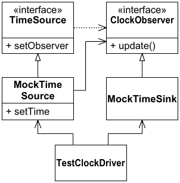<br/>
*Fig 24-5 去掉 ClockDriver 与 TimeSink*

Listing 24-13 ClockDriverTest.java

```java
import junit.framework.*;

public class ClockDriverTest extends TestCase
{
    private MockTimeSource source;
    private MockTimeSink sink;

    public ClockDriverTest(String name)
    {
        super(name);
    }

    public void setUp()
    {
        source = new MockTimeSource();
        sink = new MockTimeSink();
        source.registerObserver(sink);
    }

    private void assertSinkEquals(
        MockTimeSink sink, int hours, int minutes, int seconds)
    {
        assertEquals(hours, sink.getHours());
        assertEquals(minutes, sink.getMinutes());
        assertEquals(seconds, sink.getSeconds());
    }

    public void testTimeChange()
    {
        source.setTime(3,4,5);
        assertSinkEquals(sink, 3,4,5);

        source.setTime(7,8,9);
        assertSinkEquals(sink, 7,8,9);
    }

    public void testMultipleSinks()
    {
        MockTimeSink sink2 = new MockTimeSink();
        source.registerObserver(sink2);

        source.setTime(12,13,14);
        assertSinkEquals(sink, 12,13,14);
        assertSinkEquals(sink2, 12,13,14);
    }
}
```

要让它工作，所需的改动相当简单。
我们把 `MockTimeSource` 改成用一个 `Vector` 保存所有已注册的观察者。
当时间变化时，我们遍历这个 `Vector`，对所有已注册的 `ClockObserver` 调用 `update`。
Listing 24-14 和 24-15 展示了这些改动。
Fig 24-6 展示了相应的 UML。

Listing 24-14 TimeSource.java

```java
public interface TimeSource
{
    public void registerObserver(ClockObserver observer);
}
```

Listing 24-15 MockTimeSource.java

```java
import java.util.*;

public class MockTimeSource implements TimeSource
{
    private Vector itsObservers = new Vector();

    public void setTime(int hours, int minutes, int seconds)
    {
        Iterator i = itsObservers.iterator();
        while (i.hasNext())
        {
            ClockObserver observer = (ClockObserver) i.next();
            observer.update(hours, minutes, seconds);
    }

    public void registerObserver(ClockObserver observer)
    {
        itsObservers.add(observer);
    }
}
```

> 译注：原书 Listing 24-15 中，`while` 循环块缺少一个右花括号（纸书排版即如此），此处照录，未作补全。

这挺不错，但我不喜欢 `MockTimeSource` 不得不处理注册与更新这件事。
这意味着 `Clock` 以及 `TimeSource` 的其他每个派生类，都得重复那段注册与更新的代码。
我认为 `Clock` 不该管注册和更新。
我也不喜欢重复代码。
所以我想把这一整套东西搬进 `TimeSource` 里。
当然，这意味着 `TimeSource` 必须从接口变成类，也意味着 `MockTimeSource` 会缩到几乎什么都没有。
Listing 24-16 和 24-17 以及 Fig 24-7 展示了这些改动。

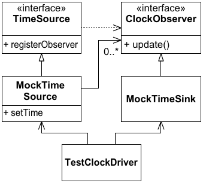<br/>
*Fig 24-6 处理多个 TimeSink 对象*

Listing 24-16 TimeSource.java

```java
import java.util.*;

public class TimeSource
{
    private Vector itsObservers = new Vector();

    protected void notify(int hours, int minutes, int seconds)
    {
        Iterator i = itsObservers.iterator();
        while (i.hasNext())
        {
            ClockObserver observer = (ClockObserver) i.next();
            observer.update(hours, minutes, seconds);
        }
    }

    public void registerObserver(ClockObserver observer)
    {
        itsObservers.add(observer);
    }
}
```

Listing 24-17 MockTimeSource.java

```java
public class MockTimeSource extends TimeSource
{
    public void setTime(int hours, int minutes, int seconds)
    {
        notify(hours, minutes, seconds);
    }
}
```

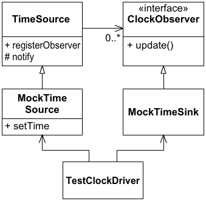<br/>
*Fig 24-7 把注册与更新搬进 TimeSource*

这相当酷。
现在任何人都可以从 `TimeSource` 派生。
要让观察者得到更新，他们只需调用 `notify`。
但这里仍有我不喜欢的地方。
`MockTimeSource` 直接继承自 `TimeSource`。
这意味着 `Clock` 也必须继承自 `TimeSource`。
`Clock` 为什么非得依赖注册与更新？
`Clock` 只是一个懂得时间的类。
让它依赖 `TimeSource` 似乎是必要的，却又不可取。

我知道在 C++ 里我会怎么解决。
我会创建一个同时继承 `TimeSource` 和 `Clock` 的子类，叫 `ObservableClock`。
我会在 `ObservableClock` 中覆盖 `tic` 和 `setTime`，在方法里调用 `Clock` 的 `tic` 或 `setTime`，然后调用 `TimeSource` 的 `notify`。见 Listing 24-18 和 Fig 24-8。

Listing 24-18 ObservableClock.cc (C++)

```cpp
class ObservableClock : public Clock, public TimeSource
{
    public:
        virtual void tic()
        {
            Clock::tic();
            TimeSource::notify(getHours(), getMinutes(), getSeconds());
        }

        virtual void setTime(int hours, int minutes, int seconds)
        {
            Clock::setTime(hours, minutes, seconds);
            TimeSource::notify(hours, minutes, seconds);
        }
};
```

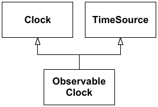<br/>
*Fig 24-8 用 C++ 的多重继承把 Clock 与 TimeSource 分开*

不幸的是，在 Java 里没有这个选项，因为该语言无法处理类的多重继承。
所以在 Java 里，我们要么保持现状，要么用一个委托的变通办法。
这个委托变通办法如 Listing 24-19 至 24-21 和 Fig 24-9 所示。

Listing 24-19 TimeSource.java

```java
public interface TimeSource
{
    public void registerObserver(ClockObserver observer);
}
```

Listing 24-20 TimeSourceImplementation.java

```java
import java.util.*;

public class TimeSourceImplementation
{
    private Vector itsObservers = new Vector();

    public void notify(int hours, int minutes, int seconds)
    {
        Iterator i = itsObservers.iterator();
        while (i.hasNext())
        {
            ClockObserver observer = (ClockObserver) i.next();
            observer.update(hours, minutes, seconds);
        }
    }

    public void registerObserver(ClockObserver observer)
    {
        itsObservers.add(observer);
    }
}
```

Listing 24-21 MockTimeSource.java

```java
public class MockTimeSource implements TimeSource
{
    TimeSourceImplementation tsImp =
        new TimeSourceImplementation();

    public void registerObserver(ClockObserver observer)
    {
        tsImp.registerObserver(observer);
    }

    public void setTime(int hours, int minutes, int seconds)
    {
        tsImp.notify(hours, minutes, seconds);
    }
}
```

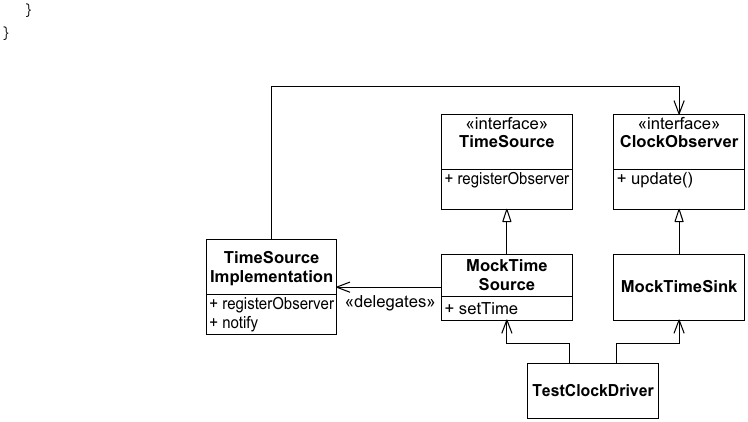<br/>
*Fig 24-9 Java 中的观察者委托变通办法*

注意，`MockTimeSource` 类实现了 `TimeSource`，并持有一个 `TimeSourceImplementation` 实例的引用。
还要注意，对 `MockTimeSource` 的 `registerObserver` 方法的所有调用，都被委托给了那个 `TimeSourceImplementation` 对象。
同样，`MockTimeSource.setTime` 也在 `TimeSourceImplementation` 实例上调用 `notify`。

这很难看，但它的好处是 `MockTimeSource` 不再继承某个类。
这意味着，如果我们去创建 `ObservableClock`，它可以继承 `Clock`、实现 `TimeSource`，并委托给 `TimeSourceImplementation`。（见 Fig 24-10。）
这就解决了 `Clock` 依赖注册与更新那套东西的问题，但代价不小。

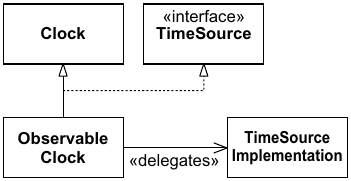<br/>
*Fig 24-10 ObservableClock 的委托变通办法*

那么，让我们回到 Fig 24-7 的样子，回到掉进这个兔子洞之前。
我们就接受这个事实：`Clock` 不得不依赖那整套注册与更新的东西。

对 `TimeSource` 这个类所做的事来说，`TimeSource` 是个很笨的名字。
在我们还有 `ClockDriver` 的年代，它一开始还不错。
但自那以后，情况变化太大了。
我们应该改名，改成能暗示注册与更新的名字。
OBSERVER 模式称这个类为 `Subject`。
我们这个类似乎专用于时间，所以可以叫 `TimeSubject`，但那不是个很直观的名字。
我们也可以用 Java 的老绰号 `Observable`，但那也不合我的口味。
`TimeObservable`？——不行。

也许问题就出在 “推模型” 观察者的专用性上。²
如果改用 “拉模型”，我们就能让这个类通用化。
那样我们就可以把 `TimeSource` 改名为 `Subject`，而所有熟悉 OBSERVER 模式的人都会明白它的意思。

这是个不错的选项。
与其在 `notify` 和 `update` 方法里传递时间，我们可以让 `TimeSink` 向 `MockTimeSource` 索取时间。
我们不希望 `MockTimeSink` 了解 `MockTimeSource`，所以我们要创建一个接口，供 `MockTimeSink` 用来获取时间。
`MockTimeSource`（以及 `Clock`）将实现这个接口。
我们称这个接口为——呃——`TimeSource`。

代码和 UML 的最终状态见 Fig 24-11 和 Listing 24-22 至 24-27。

² “推模型” 观察者在 `notify` 和 `update` 方法中把数据从主题推给观察者。“拉模型” 观察者在 `notify` 和 `update` 方法中什么也不传，而是依赖观察者在收到更新后去查询被观察的对象。见 [GOF95]。

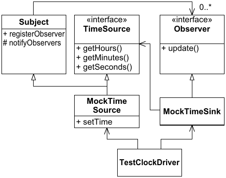<br/>
*Fig 24-11 OBSERVER 应用于 MockTimeSource 与 MockTimeSink 的最终版本*

Listing 24-22 ObserverTest.java

```java
import junit.framework.*;

public class ObserverTest extends TestCase
{
    private MockTimeSource source;
    private MockTimeSink sink;

    public ObserverTest(String name)
    {
        super(name);
    }

    public void setUp()
    {
        source = new MockTimeSource();
        sink = new MockTimeSink(source);
        source.registerObserver(sinkprivate void assertSinkEquals(
    }

    private void assertSinkEquals(
        MockTimeSink sink, int hours, int minutes, int seconds)
    {
        assertEquals(hours, sink.getHours());
        assertEquals(minutes, sink.getMinutes());
        assertEquals(seconds, sink.getSeconds());
    }

    public void testTimeChange()
    {
        source.setTime(3,4,5);
        assertSinkEquals(sink, 3,4,5);

        source.setTime(7,8,9);
        assertSinkEquals(sink, 7,8,9);
    }

    public void testMultipleSinks()
    {
        MockTimeSink sink2 = new MockTimeSink(source);
        source.registerObserver(sink2);

        source.setTime(12,13,14);
        assertSinkEquals(sink, 12,13,14);
        assertSinkEquals(sink2, 12,13,14);
    }
}
```

> 译注：纸书第 311 页此处排版错乱，`setUp` 方法末尾被压成一行 `source.registerObserver(sinkprivate void assertSinkEquals(`，丢掉了 `sink` 之后应有的 `);`、`setUp` 的右花括号，以及 `private void assertSinkEquals(` 之前的换行。此处照录原书。

Listing 24-23 Observer.java

```java
public interface Observer
{
    public void update();
}
```

Listing 24-24 Subject.java

```java
import java.util.*;

public class Subject
{
    private Vector itsObservers = new Vector();

    protected void notifyObservers()
    {
        Iterator i = itsObservers.iterator();
        while (i.hasNext())
        {
            Observer observer = (Observer) i.next();
            observer.update();
        }
    }

    public void registerObserver(Observer observer)
    {
        itsObservers.add(observer);
    }
}
```

Listing 24-25 TimeSource.java

```java
public interface TimeSource
{
    public int getHours();
    public int getMinutes();
    public int getSeconds();
}
```

Listing 24-26 MockTimeSource.java

```java
public class MockTimeSource extends Subject
                            implements TimeSource
{
    private int itsHours;
    private int itsMinutes;
    private int itsSeconds;

    public void setTime(int hours, int minutes, int seconds)
    {
        itsHours = hours;
        itsMinutes = minutes;
        itsSeconds = seconds;
        notifyObservers();
    }

    public int getHours()
    {
        return itsHours;
    }

    public int getMinutes()
    {
        return itsMinutes;
    }

    public int getSeconds()
    {
        return itsSeconds;
    }
}
```

Listing 24-27 MockTimeSink.java

```java
public class MockTimeSink implements Observer
{
    private int itsHours;
    private int itsMinutes;
    private int itsSeconds;
    private TimeSource itsSource;

    public MockTimeSink(TimeSource source)
    {
        itsSource = source;
    }

    public int getSeconds()
    {
        return itsSeconds;
    }

    public int getMinutes()
    {
        return itsMinutes;
    }

    public int getHours()
    {
        return itsHours;
    }

    public void update()
    {
        itsHours = itsSource.getHours();
        itsMinutes = itsSource.getMinutes();
        itsSeconds = itsSource.getSeconds();
    }
}
```

## 结论

那么，我们到达了终点。
我们从一个设计问题出发，通过合理的演化，最终抵达了 OBSERVER 的规范形式。
你可能会抱怨：既然我早就知道想抵达 OBSERVER，那我不过是把过程安排成那样罢了。
我不否认。
但这并不是问题所在。

如果你熟悉设计模式，那么在面对一个设计问题时，很可能会有某个模式蹦进你脑海。
接下来的问题就是：是直接实现那个模式，还是继续通过一系列小步骤来演化代码。
本章展示的就是第二种选择是什么样子。
我没有直接跳到 “OBSERVER 模式是当前问题的最佳选择” 这个结论，而是继续一个一个地解决问题。
最终，代码明显是在朝 OBSERVER 的方向走，于是我才改名字，并把代码整理成规范形式。

在那次演化中的任何一个时刻，我都可能发现自己的问题已经解决，从而停止演化。
或者，我可能发现换一个方向、改走另一条路就能解决问题。

## 本章中图表的用途

有些图是我为你画的。
我认为用一个图给你一个总体概览，会让你更容易跟上我在做什么。
如果我不是想展示和阐述，我就不会画它们。
然而，有几张图是为我自己画的。
有些时候，我需要盯着自己刚搭出来的结构，才能看清下一步该往哪儿走。

如果不写这本书，我会把这些图画在一张废纸或白板上。
我不会花时间去用绘图工具。
据我所知，在任何情况下，用绘图工具都不比用餐巾纸更快。

用这些图帮助自己演化代码之后，我不会保留它们。
为我而画的那几张，无一例外都只是中间步骤。

保留这种详细程度的图有价值吗？
显然，如果你想展示自己的推理过程，就像我在本书中所做的那样，它们相当有用。
但通常我们并不是想记录几个小时编码的演化路径。
通常，这些图是转瞬即逝的，扔掉更好。
在这个详细程度上，代码本身通常就足以充当文档。
而在更高的层次上，这就不总是成立了。

## OBSERVER 模式

好，既然我们已经走完这个例子，并把代码演化成了 OBSERVER 模式，那么来研究一下 OBSERVER 模式究竟是什么，也许会很有意思。
OBSERVER 的规范形式如 Fig 24-12 所示。
在这个例子里，`Clock` 被 `DigitalClock` 观察。
`DigitalClock` 向 `Clock` 的 `Subject` 接口注册。
每当时间因任何原因发生变化，`Clock` 就调用 `Subject` 的 `notify` 方法。
`Subject` 的 `notify` 方法会调用每个已注册 `Observer` 的 `update` 方法。
于是，只要时间变化，`DigitalClock` 就会收到一条 `update` 消息。
它利用这个机会向 `Clock` 询问时间，然后显示出来。

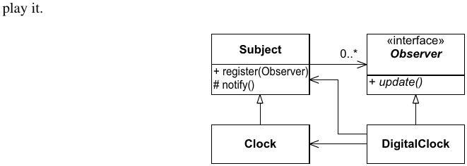<br/>
*Fig 24-12 规范的拉模型 OBSERVER*

OBSERVER 是那种一旦你懂了，就会到处看到用处的模式。
这种间接非常酷。
你可以把观察者注册到各种各样的对象上，而不必让那些对象显式地调用你。
虽然这种间接是管理依赖的好办法，但它很容易被用过头。
过度使用 OBSERVER 往往会让系统变得非常难以理解和追踪。

推我拉你。
OBSERVER 模式有两种主要模型。
Fig 24-13 展示了拉模型 OBSERVER。
它得名于这一事实：`DigitalClock` 在收到 `update` 消息之后，必须从 `Clock` 对象那里拉取时间信息。

> 译注：疑为原书笔误——拉模型的规范形式实为 Fig 24-12（其图题即 “规范的拉模型 OBSERVER”），Fig 24-13 才是推模型。此处照录原文。

拉模型的优点是实现简单，而且 `Subject` 和 `Observer` 这两个类可以成为库中标准的可复用元素。
然而，设想你正在观察一条有一千个字段的员工记录，而你刚刚收到一条 `update` 消息。
一千个字段里，哪个变了？

当 `ClockObserver` 上的 `update` 被调用时，响应是显然的。
`ClockObserver` 需要从 `Clock` 拉取时间并显示它。
但当 `EmployeeObserver` 上的 `update` 被调用时，响应就不那么显然了。
我们不知道发生了什么。
我们不知道该做什么。
也许是员工的名字变了，也许是他的薪水变了。
也许他换了新老板，也许他的银行账户变了。
我们需要帮助。

这种帮助可以由 OBSERVER 模式的推模型形式提供。
推模型观察者的结构如 Fig 24-13 所示。
注意，`notify` 和 `update` 方法都接受一个参数。
这个参数是一条提示，它通过 `notify` 和 `update` 方法从 `Employee` 传给 `SalaryObserver`。
这条提示告诉 `SalaryObserver`：`Employee` 记录经历了哪一类变化。

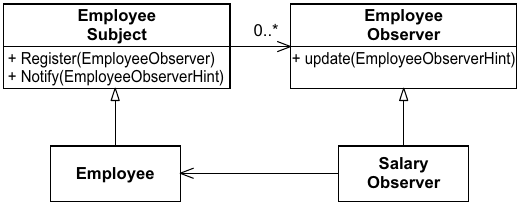<br/>
*Fig 24-13 推模型 OBSERVER*

`notify` 和 `update` 的 `EmployeeObserverHint` 参数，可能是某种枚举、一个字符串，或一个更复杂的数据结构，其中装着某个字段的旧值和新值。
无论它是什么，它的值都在被推向观察者。

在两种 OBSERVER 模型之间做选择，不过是看被观察对象的复杂度。
如果被观察对象很复杂，而观察者需要一条提示，那就适合用推模型。
如果被观察对象很简单，拉模型就够用了。

## OBSERVER 如何落实 OOD 原则

最推动 OBSERVER 模式的原则是开闭原则（OCP）。
使用该模式的动机，是让你能在不改动被观察对象的前提下添加新的观察对象。
于是被观察对象保持封闭。

回看 Fig 24-12，应当清楚：`Clock` 可以替换 `Subject`，`DigitalClock` 可以替换 `Observer`。
因此，里氏替换原则（LSP）得到了应用。

`Observer` 是抽象类，具体的 `DigitalClock` 依赖它。
`Subject` 的具体方法也依赖它。
因此，本例中应用了依赖倒置原则（DIP）。
你可能会想：既然 `Subject` 没有抽象方法，那么 `Clock` 与 `Subject` 之间的依赖就违反了 DIP。
然而，`Subject` 是一个本不该被实例化的类。
它只有在派生类的上下文中才有意义。
所以，尽管 `Subject` 没有抽象方法，它在逻辑上仍是抽象的。
我们可以通过在 C++ 中给它一个纯虚析构函数，或把它的构造函数设为 protected，来强制 `Subject` 的抽象性。

Fig 24-11 中还有接口隔离原则（ISP）的痕迹。
`Subject` 和 `TimeSource` 两个类隔离了 `MockTimeSource` 的客户端，为每一类客户端提供专门的接口。

## 参考文献

1. Gamma, et al. *Design Patterns*. Addison–Wesley, 1995.
2. Martin, Robert C., et al. *Pattern Languages of Program Design 3*, Addison–Wesley, 1998.
