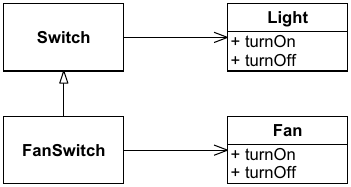
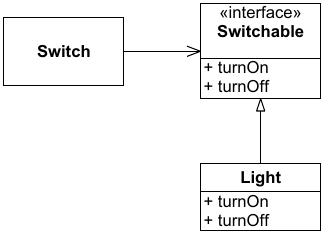
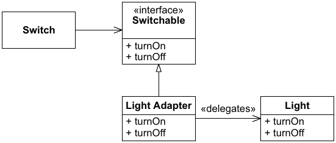
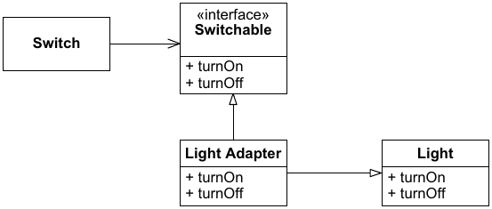
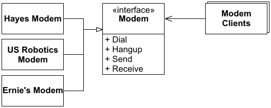
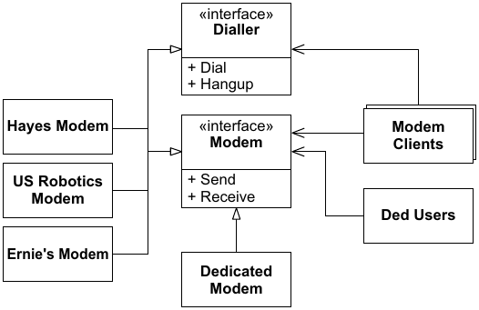
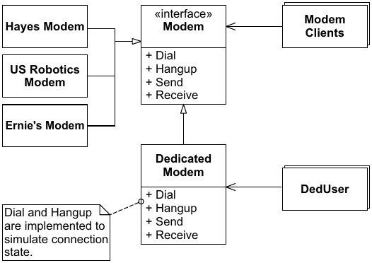
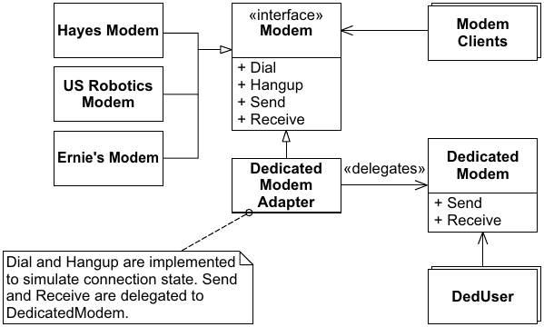
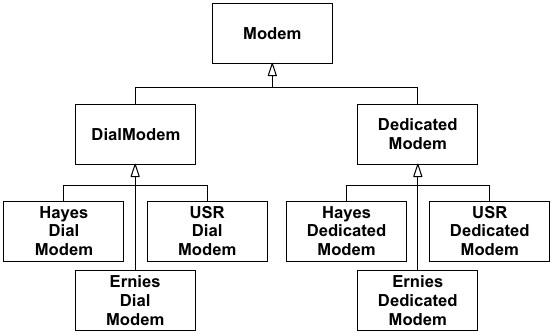
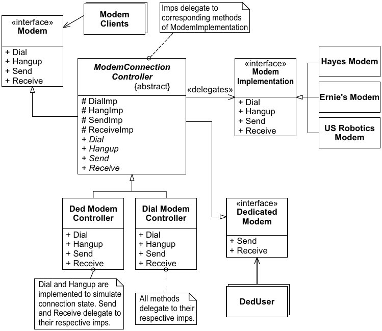

# 25 ABSTRACT SERVER、ADAPTER 与 BRIDGE

<center></center><br/>

> 天下政客一个样。即便没有河，他们也许诺要造一座桥。
> <p align="right">——Nikita Khrushchev</p>

20 世纪 90 年代中期，我深度参与了 comp.object 新闻组里持续进行的讨论。
我们这些在新闻组上发帖的人，为不同的分析与设计策略激烈争吵。
有一次我们决定：用一个具体的例子，会有助于评估彼此的立场。
于是我们挑了一个非常简单的设计问题，然后各自拿出自己最喜欢的解法。

这个设计问题极其简单。
我们要设计的是运行在一盏简单台灯里的软件。
台灯有一个开关和一个灯泡。
你可以问开关它是开着还是关着，也可以让灯泡亮起或熄灭。
一个漂亮又简单的问题。

这场辩论持续了数月。
每个人都坚持自己那套特定的设计风格优于其他所有风格。
有人用最朴素的做法：只有一个开关对象和一个灯泡对象。
有人认为应该有一个灯对象，把开关和灯泡装在里面。
还有人认为电本身应该是个对象。
居然有人提议加一个电源线对象。

尽管这些争论大多荒诞不经，这个设计模型其实挺值得探究。
考虑 Fig 25-1。
我们当然能让这个设计工作起来。
`Switch` 对象可以轮询真实开关的状态，并向 `Light` 发出恰当的 `turnOn` 和 `turnOff` 消息。

<br/>
*Fig 25-1 简单的台灯*

这个设计有什么让我们不满意的地方？

这个设计违反了我们两条设计原则：依赖倒置原则（DIP）和开闭原则（OCP）。
对 DIP 的违反一目了然：从 `Switch` 到 `Light` 的依赖是对具体类的依赖，而 DIP 告诉我们应该倾向于依赖抽象类。
对 OCP 的违反则不那么直接，但更切中要害。
我们不喜欢这个设计，是因为它逼得我们每需要一个 `Switch`，都得把一盏 `Light` 拖上。
`Switch` 无法轻易被扩展去控制 `Light` 以外的对象。

## ABSTRACT SERVER

你也许在想：可以从 `Switch` 派生一个子类，让它控制灯泡以外的东西，如 Fig 25-3 所示。
但这样并不能解决问题，因为 `FanSwitch` 仍然继承了对 `Light` 的依赖。
你把 `FanSwitch` 带到哪里，都得把 `Light` 一起带上。
何况，这条特定的继承关系本身也违反了 DIP。

<br/>
*Fig 25-2 扩展 Switch 的一种糟糕方式*

要解决这个问题，我们动用所有设计模式中最简单的一个：ABSTRACT SERVER。（见 Fig 25-2。）
通过在 `Switch` 和 `Light` 之间引入一个接口，我们让 `Switch` 有可能控制任何实现了该接口的东西。
这就同时满足了 DIP 和 OCP。

<br/>
*Fig 25-3 台灯问题的 ABSTRACT SERVER 解法*

> 译注：上两段原文互换了两处图号——讨论 “从 `Switch` 派生 `FanSwitch`” 时写的是 Fig 25-3，而该场景实为 Fig 25-2；给出 ABSTRACT SERVER 解法时写的是 Fig 25-2，而该图实为 Fig 25-3。此处照录原文。

## 接口归谁所有？

一个有趣的旁注：注意这个接口是照着它的客户端命名的。
它叫 `Switchable`，而不是 `ILight`。
我们以前谈过这一点，以后大概还会再注意到它。
接口属于客户端，而不属于派生类。
客户端与接口之间的逻辑绑定，强于接口与其派生类之间的逻辑绑定。
强到什么程度？不带上 `Switchable` 去部署 `Switch` 毫无意义；而不带上 `Light` 去部署 `Switchable` 却完全说得通。
逻辑绑定的强度与物理绑定的强度并不一致。
继承是比关联强得多的物理绑定。

20 世纪 90 年代初，我们曾认为物理绑定说了算。
当时有些相当权威的书建议把继承层次放在同一个物理包中。
这似乎有道理，因为继承是如此强的物理绑定。
但在过去的十年里我们认识到：继承在物理上的强度具有误导性，继承层次通常不该打在一个包里。
相反，客户端往往与它所控制的接口打在一起。

逻辑绑定与物理绑定在强度上的错位，是 C++ 和 Java 这类静态类型语言的产物。
Smalltalk、Python、Ruby 这类动态类型语言没有这种错位，因为它们不用继承来实现多态行为。

## Adapter

Fig 25-3 中的设计有个问题：它可能违反单一职责原则（SRP）。
我们把 `Light` 和 `Switchable` 这两样东西绑在了一起，而它们未必会因为相同的原因而变化。
要是我们没法给 `Light` 加上继承关系呢？
要是 `Light` 是我们从第三方买来的、拿不到源码呢？
或者，要是还有别的某个类，我们想让 `Switch` 去控制它，却又无法让它从 `Switchable` 派生呢？
ADAPTER 登场。¹

Fig 25-4 展示了如何用 Adapter 模式解决这个问题。
适配器从 `Switchable` 派生，并委托给 `Light`。
这样就干净利落地解决了问题。
现在任何能开能关的对象，都可以由 `Switch` 控制。
我们只需创建相应的适配器。
实际上，那个对象甚至不必拥有与 `Switchable` 相同的 `turnOn` 和 `turnOff` 方法——适配器可以适配到该对象自己的接口上。

<br/>
*Fig 25-4 用 ADAPTER 解决台灯问题*

¹ 我们前面见过 ADAPTER，见 [第 118 页](ch10.md) 起的 Fig 10-2 和 Fig 10-3。

**TANSTAAFL（天下没有免费的午餐）。**
适配器并不便宜。
你得写这个新类，得实例化适配器，并把被适配的对象绑到它上面。
然后，每次调用适配器，你都要为委托所需的时间和空间付出代价。
所以显然，不该动不动就用适配器。
ABSTRACT SERVER 方案在多数情况下都相当合适。
事实上，除非你恰巧知道还有别的对象要让 `Switch` 去控制，连 Fig 25-1 那个最初的方案都挺不错。

## ADAPTER 的类形式

Fig 25-4 中的 `LightAdapter` 类被称为对象形式的适配器。
还有另一种做法，称为类形式适配器，如 Fig 25-5 所示。
在这种形式里，适配器对象同时继承 `Switchable` 接口和 `Light` 类。
这种形式比对象形式效率略高、用起来也略方便，代价是要承受继承带来的高耦合。

<br/>
*Fig 25-5 用 ADAPTER 解决台灯问题*

## 调制解调器问题、ADAPTER 与 LSP

考虑 Fig 25-6 的情形。
我们有大量调制解调器客户端，它们都在使用 `Modem` 接口。
`Modem` 接口由若干个派生类实现，包括 `HayesModem`、`USRoboticsModem` 和 `EarniesModem`。
这是相当常见的情形。
它很好地符合 OCP、LSP 和 DIP：出现新的调制解调器类型时，客户端不受影响。
假设这种局面持续若干年。
假设有几百个客户端都在愉快地使用 `Modem` 接口。

<br/>
*Fig 25-6 调制解调器问题*

现在假设客户给我们提了一个新需求。
有某几类调制解调器是不拨号的。
它们被称为专用调制解调器，因为它们的连接是专线，两端各接一个。²
有若干新应用要使用这些专用调制解调器，而它们懒得拨号。
我们把这些应用称为 DedUser。
然而客户希望所有现有的调制解调器客户端都能使用这些专用调制解调器。
他们告诉我们，不想改动那几百个调制解调器客户端程序，所以那些客户端将被通知去拨 “假” 电话号码。

² 从前所有调制解调器都是专用的。调制解调器获得拨号能力，只是最近这一段地质年代的事。在侏罗纪早期，你从电话公司租一台面包箱大小的调制解调器，用你也从电话公司租来的专线把它连到另一台调制解调器上（侏罗纪时期，电话公司的日子很好过）。如果你想拨号，就再租一个面包箱大小的装置，叫自动拨号器。

要是能由我们做主，我们也许会像 Fig 25-7 那样改造系统。
我们用 ISP 把拨号功能和通信功能拆成两个独立的接口。
老式调制解调器实现两个接口，调制解调器客户端也使用两个接口。
DedUser 只用 `Modem` 接口，而 `DedicatedModem` 只实现 `Modem` 接口。
不幸的是，这要求我们改动所有调制解调器客户端——而客户禁止了这件事。

那我们怎么办？
我们无法如愿地分离接口，却又必须让所有调制解调器客户端都能用上 `DedicatedModem`。
一个可能的解法是让 `DedicatedModem` 从 `Modem` 派生，并把 `dial` 和 `hangup` 实现成什么都不做，如下所示：

<br/>
*Fig 25-7 调制解调器问题的理想解法*

```cpp
class DedicatedModem public : Modem
{
   public:
     virtual void dial(char phoneNumber[10]) {}
     virtual void hangup() {}
     virtual void send(char c)
     {...}
     virtual char receive()
     {...}
};
```

退化函数是可能违反 LSP 的征兆。
基类的使用者可能期望 `dial` 和 `hangup` 显著改变调制解调器的状态。
`DedicatedModem` 中的退化实现可能会违背这些期望。

假设调制解调器客户端当初的写法是：期待调制解调器在 `dial` 被调用之前处于休眠状态，在 `hangup` 被调用之后又回到休眠状态。
换句话说，它们不期待未拨号的调制解调器会吐出任何字符。
`DedicatedModem` 违背了这个期待：它在 `dial` 被调用之前就会返回字符，在 `hangup` 被调用之后还会继续返回字符。
于是 `DedicatedModem` 可能会让某些调制解调器客户端崩溃。

你也许会说：问题出在调制解调器客户端身上，它们连没预料到的输入都会崩，写得不怎么样。
这我同意。
但要说服那些维护调制解调器客户端的人去改他们的软件，理由却是 “我们新增了一种调制解调器”，这很难。
这不仅违反了 OCP，还让人憋屈。
何况，客户已经明确禁止我们改动调制解调器客户端。

**我们可以用临时凑合（kludge）的办法修正它。**
我们可以在 `DedicatedModem` 的 `dial` 和 `hangup` 方法里模拟连接状态。
如果 `dial` 还没被调用，或者 `hangup` 已经被调用，我们就拒绝返回字符。
这样一改，所有调制解调器客户端都会满意，无需改动。
我们只需说服 DedUser 去调用 `dial` 和 `hangup`。（见 Fig 25-8。）

你大概能想象，写 DedUser 的那些人对这事儿相当不满。
他们明明用着 `DedicatedModem`，凭什么还得调用 `dial` 和 `hangup`？
但他们的软件还没写完，所以让他们照办比较容易。

<br/>
*Fig 25-8 以临时凑合让 DedicateModem 模拟连接状态来解决调制解调器问题*

**一张纠缠的依赖之网。**
几个月后，DedUser 也有了数百个，客户又给我们提出了新变更。
原来这么多年来，我们的程序从不需要拨国际电话号码，所以才得以在 `dial` 里一直用 `char[10]` 应付过去。
但现在客户要求我们能拨任意长度的电话号码：他们需要打国际长途、信用卡电话、带 PIN 识别的电话，等等。

显然，所有调制解调器客户端都必须改：它们当初是按 `char[10]` 的电话号码写的。
客户批准了这件事，因为他们别无选择，于是大批程序员被派去做这项任务。
同样显然，调制解调器层次中的各个类也必须改，以适应新的电话号码长度。
我们这个小组能应付。
不幸的是，现在我们必须去找 DedUser 的作者们，告诉他们也得改代码！
你可以想象他们会有多高兴。
他们调用 `dial` 并不是因为需要，而是因为我们叫他们这么做。
如今他们之所以要付出高昂的维护代价，正是因为他们照我们说的做了。

这就是许多项目身陷其中的那种恶劣的依赖纠缠。
系统某处的一个临时凑合，扯出一根恶劣的依赖之线，最终在系统中本该毫无关联的另一处引发了问题。

**ADAPTER 救场。**
假如当初就用一个 ADAPTER 来解决最初的问题，如 Fig 25-9 所示，这场灾难本可以避免。
在这种情况下，`DedicatedModem` 不继承自 `Modem`。
调制解调器客户端通过 `DedicatedModemAdapter` 间接使用 `DedicatedModem`。
这个适配器实现 `dial` 和 `hangup` 来模拟连接状态，并把 `send` 和 `recieve` 调用委托给 `DedicatedModem`。

注意，这消除了我们之前遇到的所有困难。
调制解调器客户端看到的是它们所预期的连接行为，而 DedUser 也不必去摆弄 `dial` 或 `hangup`。
当电话号码的需求发生变化时，DedUser 不会受影响。
于是，通过放置这个适配器，我们同时修正了对 LSP 和 OCP 的违反。

注意，临时凑合依然存在——适配器仍然在模拟连接状态。
你可能觉得这很难看，我当然同意。
然而请注意：所有依赖都从适配器向外指。
临时凑合被隔离在系统之外，塞进一个几乎没人知道的适配器里。
对该适配器唯一的硬依赖，很可能只出现在某个工厂的实现中。³

³ 见 [第 21 章](ch21.md) FACTORY。

<br/>
*Fig 25-9 用 ADAPTER 解决调制解调器问题*

## BRIDGE

看待这个问题还有另一种方式。
专用调制解调器的需求，给 `Modem` 类型层次增加了一个新的自由度。
当初构想 `Modem` 类型时，它不过是针对一组不同硬件设备的接口。
于是我们有 `HayesModem`、`USRModem` 和 `ErniesModem` 派生自基础的 `Modem` 类。
然而现在看起来，还可以从另一个维度来切分 `Modem` 层次：我们可以让 `DialModem` 和 `DedicatedModem` 派生自 `Modem`。

合并这两个彼此独立的层次，可以如 Fig 25-10 所示。
类型层次的每个叶子，都把它所控制的硬件与拨号或专用行为组合在一起。
`DedicatedHayesModem` 对象在专用语境下控制一台 Hayes 调制解调器。

<br/>
*Fig 25-10 通过合并类型层次来解决调制解调器问题*

这不是一个理想的结构。
每当我们新增一件硬件，就必须创建两个新类——一个对应专用情形，一个对应拨号情形。
每当我们新增一种连接类型，就必须创建三个新类，每种硬件各一个。
只要这两个自由度稍微易变一点，用不了多久，我们就会积累出大量派生类。

当类型层次拥有不止一个自由度时，BRIDGE 模式往往能帮上忙。
与其合并层次，不如把它们分开，再用一座桥把它们连起来。

Fig 25-11 展示了这个结构。
我们把调制解调器层次拆成两个层次：一个表示连接方式，另一个表示硬件。

调制解调器的使用者继续使用 `Modem` 接口。
`ModemConnectionController` 实现 `Modem` 接口。
`ModemConnectionController` 的派生类控制连接机制。

<br/>
*Fig 25-11 调制解调器问题的 BRIDGE 解法*

`DialModemController` 只是把 `dial` 和 `hangup` 方法传给基类 `ModemConnectionController` 中的 `dialImp` 和 `hangImp`。
这些方法随后委托给 `ModemImplementation` 类，在那里被部署到相应的硬件控制器上。
`DedModemController` 实现 `dial` 和 `hangup` 来模拟连接状态，并把 `send` 和 `receive` 传给 `sendImp` 和 `receiveImp`，后者照旧委托给 `ModemImplementation` 层次。

注意，`ModemConnectionController` 基类中的四个 imp 函数都是 protected 的。
这是因为它们严格来说只供 `ModemConnectionController` 的派生类使用，不应有别人调用它们。

这个结构很复杂，但也很有趣。
我们能在不影响调制解调器使用者的前提下把它搭起来，而它又让我们把连接策略与硬件实现彻底分开。
`ModemConnectionController` 的每个派生类都代表一种新的连接策略；该策略可以使用 `sendImp`、`receiveImp`、`dialImp` 和 `hangImp` 来实现自己。
新的 imp 函数可以在不影响使用者的情况下添加。
还可以用 ISP 给连接控制器类加上新的接口。
这样就能形成一条迁移路径，让调制解调器客户端慢慢走向一个比 `dial` 和 `hangup` 层次更高的 API。

## 结论

有人可能忍不住要说：调制解调器这个场景的真正问题，在于最初的设计者把设计弄错了。
他们本该知道连接与通信是两个独立的概念。
要是当初多做一些分析，他们就会发现这一点并加以修正。
于是，很容易把问题归咎于分析不足。

胡说八道！
根本不存在 “足够的分析” 这回事。
无论你花多少时间去琢磨完美的软件结构，你总会发现客户会引入一个破坏该结构的变更。

这一点无法逃避。
不存在完美的结构，只有试图平衡当前成本与收益的结构。
随着时间推移，随着系统需求变化，这些结构必须改变。
管理这种变更的诀窍，是让系统尽可能简单、尽可能灵活。

ADAPTER 解法简单而直接。
它让所有依赖都指向正确的方向，而且实现起来非常简单。
BRIDGE 解法则复杂得多。
除非你有非常确凿的证据表明自己需要把连接策略与通信策略彻底分开、并且需要不断添加新的连接策略，否则我不建议你走上这条路。

这里的教训一如既往：模式总是同时带来成本与收益。
你应该让自己去用那些最契合手头问题的模式。

## 参考文献

1. Gamma, et al. *Design Patterns*, Reading, MA: Addison–Wesley, 1995.
