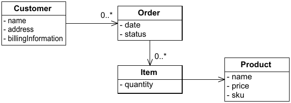
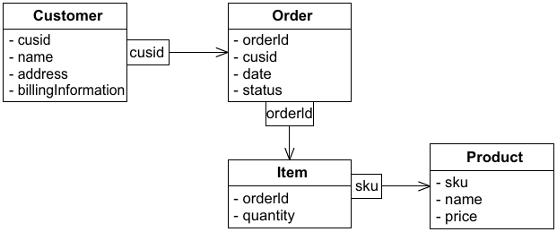
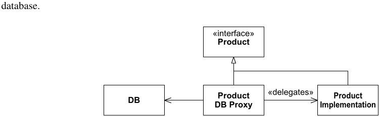
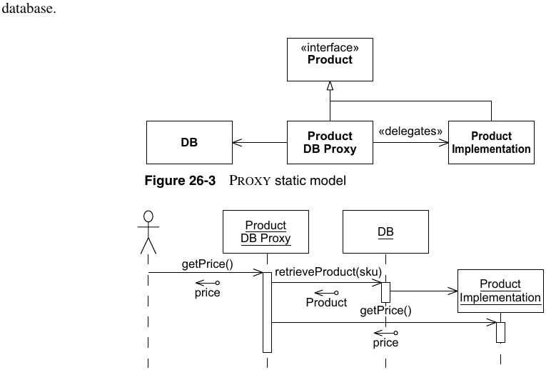
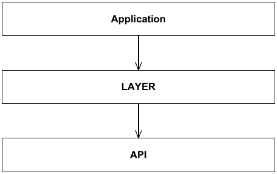
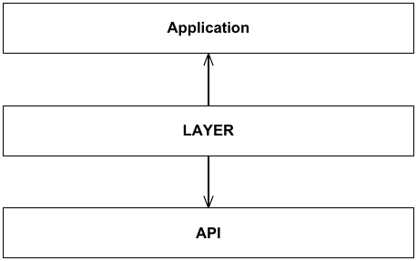
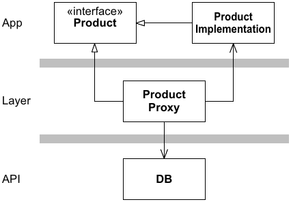
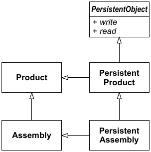
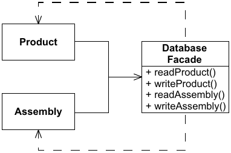

# 26 PROXY 与 STAIRWAY TO HEAVEN：管理第三方 API
<!-- markdownlint-disable MD033 -->
<center></center><br/>

> 有人还记得笑声吗？
> <p align="right">——Robert Plant, The Song Remains the Same</p>

软件系统中存在许多屏障。
当我们把数据从程序搬进数据库时，我们正在跨越数据库屏障。
当我们把消息从一台计算机发到另一台时，我们正在跨越网络屏障。

跨越这些屏障可能很复杂。
一不小心，我们的软件就会变成关于屏障的软件，而不是关于待解决问题的软件。
本章的模式帮助我们跨越这些屏障，同时让程序始终聚焦于待解决的问题。

## PROXY

设想我们正在为一个网站写购物车系统。
这样的系统可能会有客户、订单（购物车）以及订单中的商品等对象。
Fig 26-1 展示了一种可能的结构。
这个结构很简单，但足以说明问题。

<br/>
*Fig 26-1 简单的购物车对象模型*

如果我们考虑 “向订单中添加一个新条目” 这个问题，可能会写出 Listing 26-1 那样的代码。
`Order` 类的 `addItem` 方法只是创建一个 `Item`，持有相应的 `Product` 和数量，
然后把这个 `Item` 加到它内部的 `Item` 向量里。

Listing 26-1 Adding an item to the Object Model.

```java
public class Order
{
    private Vector itsItems = new Vector();
    public void addItem(Product p, int qty)
    {
        Item item = new Item(p, qty);
        itsItems.add(item);
    }
}
```

现在设想这些对象代表的数据保存在一个关系数据库中。
Fig 26-2 展示了可能用来表示这些对象的表和键。
要找出某个客户的订单，你就找出所有带有该客户 `cusid` 的订单。
要找出某个订单中的所有条目，你就找出带有该订单 `orderId` 的所有条目。
要找出条目所引用的产品，你就使用产品的 `sku`。

<br/>
*Fig 26-2 购物车关系数据模型*

如果我们想为某个特定订单添加一行条目，我们会用类似 Listing 26-2 的做法。
这段代码直接调用 JDBC 来操作关系数据模型。

Listing 26-2 Adding an item to the relational model.

```java
public class AddItemTransaction extends Transaction
{
    public void addItem(int orderId, String sku, int qty)
    {
        Statement s = itsConnection.CreateStatement();
        s.executeUpdate("insert into items values(" +
                         orderId + "," + sku + "," +
                         qty + ")");
    }
}
```

这两段代码截然不同，却执行同样的逻辑功能：它们都把条目连接到订单上。
第一段无视数据库的存在，第二段则对数据库大加颂扬。

显然，购物车程序讲的都是订单、条目和产品。
不幸的是，如果我们采用 Listing 26-2 的代码，它讲的就变成了 SQL 语句、数据库连接和拼接查询字符串。
这严重违反了 SRP，也可能违反了 CCP。
Listing 26-2 把两个因不同原因而变化的概念混在了一起：一是条目与订单的概念，二是关系模式与 SQL 的概念。
其中任何一个概念因任何原因改变，另一个概念都会受影响。
Listing 26-2 还违反了 DIP，因为程序的策略依赖于存储机制的细节。

PROXY 模式是医治这些病症的一种方法。
为了探究它，我们搭一个测试程序，演示创建订单并计算总价的行为。
该程序的关键部分如 Listing 26-3 所示。

Listing 26-3 Test program creates order and verifies calculation of price.

```java
public void testOrderPrice()
  {
    Order o = new Order("Bob");
    Product toothpaste = new Product("Toothpaste", 129);
    o.addItem(toothpaste, 1);
    assertEquals(129, o.total());
    Product mouthwash = new Product("Mouthwash", 342);
    o.addItem(mouthwash, 2);
    assertEquals(813, o.total());
  }
```

能通过这个测试的简单代码见 Listing 26-4 至 26-6。
它使用 Fig 26-1 中那个简单的对象模型。
它并不假定任何地方存在数据库。
它在很多方面也不完整——只是刚好够让测试通过。

Listing 26-4 order.java

```java
public class Order
{
    private Vector itsItems = new Vector();

    public Order(String cusid)
    {
    }

    public void addItem(Product p, int qty)
    {
        Item item = new Item(p,qty);
        itsItems.add(item);
    }

    public int total()
    {
        int total = 0;
        for (int i = 0; i < itsItems.size(); i++)
        {
            Item item = (Item) itsItems.elementAt(i);
            Product p = item.getProduct();
            int qty = item.getQuantity();
            total += p.getPrice() * qty;
        }
        return total;
    }
}
```

Listing 26-5 product.java

```java
public class Product
{
    private int itsPrice;

    public Product(String name, int price)
    {
        itsPrice = price;
    }

    public int getPrice()
    {
        return itsPrice;
    }
}
```

Listing 26-6 item.java

```java
public class Item
{
    private Product itsProduct;
    private int itsQuantity;

    public Item(Product p, int qty)
    {
        itsProduct = p;
        itsQuantity = qty;
    }

    public Product getProduct()
    {
        return itsProduct;
    }

    public int getQuantity()
    {
        return itsQuantity;
    }
}
```

Fig 26-3 和 26-4 展示了 PROXY 模式如何工作。
每个要被代理的对象都被拆成三部分。
第一部分是一个接口，声明客户端需要调用的所有方法。
第二部分是一个实现这些方法、但不了解数据库的类。
第三部分是了解数据库的代理。

<br/>
*Fig 26-3 PROXY 静态模型*

<br/>
*Fig 26-4 PROXY 动态模型*

考虑 `Product` 类。
我们用一个接口替换了它，从而把它代理化。
这个接口拥有与 `Product` 相同的全部方法。
`ProductImplementation` 类几乎和以前一样实现这个接口。
`ProductDBProxy` 实现 `Product` 的所有方法，去数据库中取出产品、创建一个 `ProductImplementation` 实例，然后把消息委托给它。

Fig 26-4 中的顺序图展示了这一过程。
客户端把 `getPrice` 消息发给一个它以为是 `Product` 的对象，而实际上那是 `ProductDBProxy`。
`ProductDBProxy` 从数据库中取出 `ProductImplementation`，然后把 `getPrice` 方法委托给它。

无论客户端还是 `ProductImplementation`，都不知道这件事发生过。
数据库就这样被插进了应用，而双方都不知情。
这就是 PROXY 模式之美。
理论上，它可以被插到两个协作对象之间，而这两个对象无需知晓。
于是，它能用来跨越数据库或网络这类屏障，而两个参与者都毫不知情。

现实中，使用代理绝非易事。
要体会其中一些问题，我们试着把 PROXY 模式加到那个简单的购物车应用上。

## 为购物车加代理

最容易创建的是 `Product` 类的代理。
就我们的目的而言，产品表就是一个简单的字典。
它会在某一处被装入所有产品。
这张表没有别的操作，这让代理相对简单。

作为开端，我们需要一个简单的数据库工具，用来存储和取出产品数据。
代理将使用这个接口来操作数据库。
Listing 26-7 展示了我设想的测试程序。
Listing 26-8 和 26-9 让该测试通过。

Listing 26-7 DBTest.java

```java
import junit.framework.*;
import junit.swingui.TestRunner;

public class DBTest extends TestCase
{
    public static void main(String[] args)
    {
        TestRunner.main(new String[]{"DBTest"});
    }

    public DBTest(String name)
    {
        super(name);
    }

    public void setUp() throws Exception
    {
        DB.init();
    }

    public void tearDown() throws Exception
    {
        DB.close();
    }

    public void testStoreProduct() throws Exception
    {
        ProductData storedProduct = new ProductData();
        storedProduct.name = "MyProduct";
        storedProduct.price = 1234;
        storedProduct.sku = "999";
        DB.store(storedProduct);
        ProductData retrievedProduct = DB.getProductData("999");
        DB.deleteProductData("999");
        assertEquals(storedProduct, retrievedProduct);
    }
}
```

Listing 26-8 ProductData.java

```java
public class ProductData
{
    public String name;
    public int price;
    public String sku;

    public ProductData()
    {
    }

    public ProductData(String name, int price, String sku)
    {
        this.name = name;
        this.price = price;
        this.sku = sku;
    }

    public boolean equals(Object o)
    {
        ProductData pd = (ProductData)o;
        return name.equals(pd.name) &&
               sku.equals(pd.sku) &&
               price==pd.price;
    }
}
```

Listing 26-9 DB.java

```java
import java.sql.*;

public class DB
{
    private static Connection con;

    public static void init() throws Exception
    {
        Class.forName("sun.jdbc.odbc.JdbcOdbcDriver");
        con = DriverManager.getConnection(
           "jdbc:odbc:PPP Shopping Cart");
    }

    public static void store(ProductData pd) throws Exception
    {
        PreparedStatement s = buildInsertionStatement(pd);
        executeStatement(s);
    }

    private static PreparedStatement
    buildInsertionStatement(ProductData pd) throws SQLException
    {
        PreparedStatement s = con.prepareStatement(
          "INSERT into Products VALUES (?, ?, ?)");
        s.setString(1, pd.sku);
        s.setString(2, pd.name);
        s.setInt(3, pd.price);
        return s;
    }

    public static ProductData getProductData(String sku) throws Exception
    {
        PreparedStatement s = buildProductQueryStatement(sku);
        ResultSet rs = executeQueryStatement(s);
        ProductData pd = extractProductDataFromResultSet(rs);
        rs.close();
        s.close();
        return pd;
    }

    private static PreparedStatement
    buildProductQueryStatement(String sku) throws SQLException
    {
        PreparedStatement s = con.prepareStatement(
          "SELECT * FROM Products WHERE sku = ?;");
        s.setString(1, sku);
        return s;
    }

    private static ProductData
    extractProductDataFromResultSet(ResultSet rs) throws SQLException
    {
        ProductData pd = new ProductData();
        pd.sku = rs.getString(1);
        pd.name = rs.getString(2);
        pd.price = rs.getInt(3);
        return pd;
    }

    public static void deleteProductData(String sku) throws Exception
    {
        executeStatement(buildProductDeleteStatement(sku));
    }

    private static PreparedStatement
    buildProductDeleteStatement(String sku) throws SQLException
    {
        PreparedStatement s = con.prepareStatement(
          "DELETE from Products where sku = ?");
        s.setString(1, sku);
        return s;
    }

    private static void executeStatement(PreparedStatement s) throws SQLException
    {
        s.execute();
        s.close();
    }

    private static ResultSet
    executeQueryStatement(PreparedStatement s)
    throws SQLException
    {
        ResultSet rs = s.executeQuery();
        rs.next();
        return rs;
    }

    public static void close() throws Exception
    {
        con.close();
    }
}
```

实现代理的下一步，是写一个测试来展示它如何工作。
这个测试先向数据库添加一个产品，然后用已存产品的 `sku` 创建一个 `ProductProxy`，
并试着用 `Product` 的访问器从代理取数据。（见 Listing 26-10。）

Listing 26-10 ProxyTest.java

```java
import junit.framework.*;
import junit.swingui.TestRunner;

public class ProxyTest extends TestCase
{
    public static void main(String[] args)
    {
        TestRunner.main(new String[]{"ProxyTest"});
    }

    public ProxyTest(String name)
    {
        super(name);
    }

    public void setUp() throws Exception
    {
        DB.init();
        ProductData pd = new ProductData();
        pd.sku = "ProxyTest1";
        pd.name = "ProxyTestName1";
        pd.price = 456;
        DB.store(pd);
    }

    public void tearDown() throws Exception
    {
        DB.deleteProductData("ProxyTest1");
        DB.close();
    }

    public void testProductProxy() throws Exception
    {
        Product p = new ProductProxy("ProxyTest1");
        assertEquals(456, p.getPrice());
        assertEquals("ProxyTestName1", p.getName());
        assertEquals("ProxyTest1", p.getSku());
    }
}
```

要让它工作，我们必须把 `Product` 的接口与它的实现分开。
于是我把 `Product` 改成接口，并创建 `ProductImp` 来实现它。（见 Listing 26-11 和 26-12。）

注意，我给 `Product` 接口加上了异常。
这是因为我是在写 `ProductProxy`（Listing 26-13）的同时，也在写 `Product`、`ProductImp` 和 `ProxyTest`。
我一个访问器一个访问器地实现它们。
正如我们将会看到的，`ProductProxy` 类会调用抛出异常的数据库。
我不希望这些异常被代理捕获并藏起来，于是决定让它们从接口逃逸出去。

Listing 26-11 Product.java

```java
public interface Product
{
    public int getPrice() throws Exception;
    public String getName() throws Exception;
    public String getSku() throws Exception;
}
```

Listing 26-12 ProductImp.java

```java
public class ProductImp implements Product
{
    private int itsPrice;
    private String itsName;
    private String itsSku;

    public ProductImp(String sku, String name, int price)
    {
        itsPrice = price;
        itsName = name;
        itsSku = sku;
    }

    public int getPrice()
    {
        return itsPrice;
    }

    public String getName()
    {
        return itsName;
    }

    public String getSku()
    {
        return itsSku;
    }
}
```

Listing 26-13 ProductProxy.java

```java
public class ProductProxy implements Product
{
    private String itsSku;
    public ProductProxy(String sku)
    {
        itsSku = sku;
    }
    public int getPrice() throws Exception
    {
        ProductData pd = DB.getProductData(itsSku);
        return pd.price;
    }

    public String getName() throws Exception
    {
        ProductData pd = DB.getProductData(itsSku);
        return pd.name;
    }

    public String getSku() throws Exception
    {
        return itsSku;
    }
}
```

这个代理的实现微不足道。
事实上，它与 Fig 26-3、26-4 所示的规范形式并不完全吻合。
这是出乎意料的。
我的本意是实现 PROXY 模式。
但实现最终成形时，那种规范形式却讲不通。

如下所示，规范形式会让 `ProductProxy` 在每个方法里创建一个 `ProductImp`，然后把该方法委托给这个 `ProductImp`。

```java
public int getPrice() throws Exception
{
  ProductData pd = DB.getProductData(itsSku);
  ProductImp p = new ProductImp(pd.sku, pd.name, pd.price);
  return p.getPrice();
}
```

创建 `ProductImp` 完全是在浪费程序员和计算机的资源。
`ProductProxy` 已经拥有 `ProductImp` 的访问器会返回的数据。
所以没有必要创建 `ProductImp` 再委托给它。
这又是一个例子：代码会把你带离你所期待的模式和模型。

注意，Listing 26-13 中 `ProductProxy` 的 `getSku` 方法把这一主题推得更远：它甚至连数据库都不去碰。
何必呢？它已经有 `sku` 了。

你可能会想：`ProductProxy` 的实现效率很低，每个访问器都去碰数据库。
如果它把 `ProductData` 缓存起来以避免访问数据库，不是更好吗？

这个改动微不足道，但驱使我们去做它的只有恐惧。
眼下我们没有任何数据表明这个程序有性能问题。
何况我们知道，数据库引擎本身也在做某种缓存。
所以，自己造一个缓存能换来什么，并不清楚。
我们应该等到看见性能问题的迹象之后，再去给自己找麻烦。

**为关系加代理。**
下一步是为 `Order` 创建代理。
每个 `Order` 实例都包含许多 `Item` 实例。
在关系模式（Fig 26-2）中，这个关系被记录在 `Item` 表里：`Item` 表的每一行都包含它所属 `Order` 的键。
然而在对象模型中，这个关系是靠 `Order` 里的一个 `Vector` 实现的。（见 Listing 26-4。）
代理总得想办法在这两种形式之间做转换。

我们先提出一个代理必须通过的测试用例。
这个测试往数据库里放几个假产品，然后取得指向这些产品的代理，
用它们在一个 `OrderProxy` 上调用 `addItem`，最后向 `OrderProxy` 询问总价。（见 Listing 26-14。）
这个测试用例的意图是表明：`OrderProxy` 的行为与 `Order` 完全一样，但它的数据来自数据库而不是内存中的对象。

Listing 26-14 ProxyTest.java

```java
public void testOrderProxyTotal() throws Exception
  {
    DB.store(new ProductData("Wheaties", 349, "wheaties"));
    DB.store(new ProductData("Crest", 258, "crest"));
    ProductProxy wheaties = new ProductProxy("wheaties");
    ProductProxy crest = new ProductProxy("crest");
    OrderData od = DB.newOrder("testOrderProxy");
    OrderProxy order = new OrderProxy(od.orderId);
    order.addItem(crest, 1);
    order.addItem(wheaties, 2);
    assertEquals(956, order.total());
  }
```

要让这个测试用例工作，我们必须实现几个新类和新方法。
首先要处理的是 `DB` 的 `newOrder` 方法。
看起来这个方法返回一个 `OrderData` 的实例。
`OrderData` 与 `ProductData` 一样，是一个简单的数据结构，代表 `Order` 数据库表中的一行。
它如 Listing 26-15 所示。

Listing 26-15 OrderData.java

```java
public class OrderData
{
    public String customerId;
    public int orderId;

    public OrderData()
    {
    }

    public OrderData(int orderId, String customerId)
    {
        this.orderId = orderId;
        this.customerId = customerId;
    }
}
```

不要因为使用了 public 数据成员就感到不适。
这不是真正意义上的对象，只是一个数据容器。
它没有任何需要封装的有趣行为。
把数据变量改成 private 再提供 getter 和 setter，只会是无谓的复杂化。

现在我们需要写 `DB` 的 `newOrder` 函数。
注意，在 Listing 26-14 中调用它时，我们只提供了所属客户的 ID，并没有提供 `orderId`。
每个 `Order` 都需要一个 `orderId` 作为它的键。
而且，在关系模式中，每个 `Item` 都引用这个 `orderId`，以表明它与 `Order` 的关联。
显然，`orderId` 必须唯一。
它怎么被创建出来？写个测试来表达我们的意图。（见 Listing 26-16。）

Listing 26-16 DBTest.java

```java
public void testOrderKeyGeneration() throws Exception
{
  OrderData o1 = DB.newOrder("Bob");
  OrderData o2 = DB.newOrder("Bill");
  int firstOrderId = o1.orderId;
  int secondOrderId = o2.orderId;
  assertEquals(firstOrderId+1, secondOrderId);
}
```

这个测试表明：我们期望每创建一个新 `Order`，`orderId` 就自动加一。
实现起来很容易：先查询数据库中当前使用的最大 `orderId`，然后加一。（见 Listing 26-17。）

Listing 26-17 DB.java

```java
  public static OrderData newOrder(String customerId) throws Exception
  {
    int newMaxOrderId = getMaxOrderId() + 1;
    PreparedStatement s = con.prepareStatement(
      "Insert into Orders(orderId,cusid) Values(?,?);");
    s.setInt(1, newMaxOrderId);
    s.setString(2,customerId);
    executeStatement(s);
    return new OrderData(newMaxOrderId, customerId);
  }

  private static int getMaxOrderId() throws SQLException
  {
    Statement qs = con.createStatement();
    ResultSet rs = qs.executeQuery(
      "Select max(orderId) from Orders;");
    rs.next();
    int maxOrderId = rs.getInt(1);
    rs.close();
    return maxOrderId;
  }
```

现在可以开始写 `OrderProxy` 了。
和 `Product` 一样，我们需要把 `Order` 拆成接口与实现。
于是 `Order` 成为接口，`OrderImp` 成为实现。（见 Listing 26-18 和 26-19。）

Listing 26-18 Order.java

```java
public interface Order
{
    public String getCustomerId();
    public void addItem(Product p, int quantity);
    public int total();
}
```

Listing 26-19 OrderImp.java

```java
import java.util.Vector;

public class OrderImp implements Order
{
    private Vector itsItems = new Vector();
    private String itsCustomerId;

    public String getCustomerId()
    {
        return itsCustomerId;
    }

    public OrderImp(String cusid)
    {
        itsCustomerId = cusid;
    }

    public void addItem(Product p, int qty)
    {
        Item item = new Item(p,qty);
        itsItems.add(item);
    }

    public int total()
    {
        try
        {
            int total = 0;
            for (int i = 0; i < itsItems.size(); i++)
            {
                Item item = (Item) itsItems.elementAt(i);
                Product p = item.getProduct();
                int qty = item.getQuantity();
                total += p.getPrice() * qty;
            }
            return total;
        }
        catch (Exception e)
        {
            throw new Error(e.toString());
        }
    }
}
```

我不得不在 `OrderImp` 里加上一些异常处理，因为 `Product` 接口会抛异常。
我被这一堆异常搞得越来越烦躁。
接口背后的代理实现本不该影响该接口，可代理却在抛异常，并一路传播出接口。
于是我决定把所有 `Exception` 改成 `Error`，这样就不必用 `throws` 子句污染接口、也不必用 `try/catch` 块污染接口的使用者。

那么在代理里如何实现 `addItem`？
显然，代理不能委托给 `OrderImp.addItem`！
代理必须改为在数据库里插入一行 `Item`。
另一方面，我非常希望把 `OrderProxy.total` 委托给 `OrderImp.total`，
因为我想让业务规则（也就是计算总价的策略）封装在 `OrderImp` 里。
构建代理的全部意义，就在于把数据库实现与业务规则分开。

为了委托 `total` 函数，代理必须把完整的 `Order` 对象连同它包含的所有 `Item` 都构造出来。
于是在 `OrderProxy.total` 里，我们必须从数据库读出所有条目，
对找到的每个条目在一个空的 `OrderImp` 上调用 `addItem`，然后再在这个 `OrderImp` 上调用 `total`。
因此，`OrderProxy` 的实现应该像 Listing 26-20 那样。

Listing 26-20 OrderProxy.java

```java
import java.sql.SQLException;

public class OrderProxy implements Order
{
    private int orderId;

    public OrderProxy(int orderId)
    {
        this.orderId = orderId;
    }

    public int total()
    {
        try
        {
            OrderImp imp = new OrderImp(getCustomerId());
            ItemData[] itemDataArray = DB.getItemsForOrder(orderId);
            for (int i = 0; i < itemDataArray.length; i++)
            {
                ItemData item = itemDataArray[i];
                imp.addItem(new ProductProxy(item.sku), item.qty);
            }
            return imp.total();
        }
        catch (Exception e)
        {
            throw new Error(e.toString());
        }
    }

    public String getCustomerId()
    {
        try
        {
            OrderData od = DB.getOrderData(orderId);
            return od.customerId;
        }
        catch (SQLException e)
        {
            throw new Error(e.toString());
        }
    }

    public void addItem(Product p, int quantity)
    {
        try
        {
            ItemData id =
              new ItemData(orderId, quantity, p.getSku());
            DB.store(id);
        }
        catch (Exception e)
        {
            throw new Error(e.toString());
        }
    }

    public int getOrderId()
    {
        return orderId;
    }
}
```

这意味着需要一个 `ItemData` 类，以及几个操作 `ItemData` 行的 DB 函数。
它们如 Listing 26-21 至 26-23 所示。

Listing 26-21 ItemData.java

```java
public class ItemData
{
    public int orderId;
    public int qty;
    public String sku = "junk";

    public ItemData()
    {
    }

    public ItemData(int orderId, int qty, String sku)
    {
        this.orderId = orderId;
        this.qty = qty;
        this.sku = sku;
    }

    public boolean equals(Object o)
    {
        ItemData id = (ItemData)o;
        return orderId == id.orderId &&
               qty == id.qty &&
               sku.equals(id.sku);
    }
}
```

Listing 26-22 DBTest.java

```java
    public void testStoreItem() throws Exception
    {
        ItemData storedItem = new ItemData(1, 3, "sku");
        DB.store(storedItem);
        ItemData[] retrievedItems = DB.getItemsForOrder(1);
        assertEquals(1, retrievedItems.length);
        assertEquals(storedItem, retrievedItems[0]);
    }

    public void testNoItems() throws Exception
    {
        ItemData[] id = DB.getItemsForOrder(42);
        assertEquals(0, id.length);
    }
```

Listing 26-23 DB.java

```java
    public static void store(ItemData id) throws Exception
    {
        PreparedStatement s = buildItemInsersionStatement(id);
        executeStatement(s);
    }

    private static PreparedStatement
    buildItemInsersionStatement(ItemData id) throws SQLException
    {
        PreparedStatement s = con.prepareStatement(
          "Insert into Items(orderId,quantity,sku) " +
          "VALUES (?, ?, ?);");
        s.setInt(1,id.orderId);
        s.setInt(2,id.qty);
        s.setString(3, id.sku);
        return s;
    }

    public static ItemData[] getItemsForOrder(int orderId)
    throws Exception
    {
        PreparedStatement s =
          buildItemsForOrderQueryStatement(orderId);
        ResultSet rs = s.executeQuery();
        ItemData[] id = extractItemDataFromResultSet(rs);
        rs.close();
        s.close();
        return id;
    }

    private static PreparedStatement
    buildItemsForOrderQueryStatement(int orderId)
    throws SQLException
    {
        PreparedStatement s = con.prepareStatement(
          "SELECT * FROM Items WHERE orderid = ?;");
        s.setInt(1, orderId);
        return s;
    }

    private static ItemData[]   extractItemDataFromResultSet(ResultSet rs)
    throws SQLException
    {
        LinkedList l = new LinkedList();
        for (int row = 0; rs.next(); row++)
        {
            ItemData id = new ItemData();
            id.orderId = rs.getInt("orderid");
            id.qty = rs.getInt("quantity");
            id.sku = rs.getString("sku");
            l.add(id);
        }
        return (ItemData[]) l.toArray(new ItemData[l.size()]);
    }

    public static OrderData getOrderData(int orderId)
    throws SQLException
    {
        PreparedStatement s = con.prepareStatement(
          "Select cusid from orders where orderid = ?;");
        s.setInt(1, orderId);
        ResultSet rs = s.executeQuery();
        OrderData od = null;
        if (rs.next())
            od = new OrderData(orderId, rs.getString("cusid"));
        rs.close();
        s.close();
        return od;
    }
```

## PROXY 小结

这个例子应当已经打破了“代理用起来既优雅又简单”的错觉。
代理用起来绝非易事。
规范模式所暗示的那种简单委托模型，很少能如此整齐地出现。
相反，我们会发现自己在为琐碎的 getter 和 setter 短路委托。
对于那些管理 1:N 关系的方法，我们会发现自己在推迟委托，把它挪进别的方法里——正如 `addItem` 的委托被挪进了 `total`。
最后，我们还要面对缓存的幽灵。

本例中我们没有做任何缓存。
所有测试都在不到一秒内跑完，所以没必要过分操心性能。
但在真实应用中，性能问题以及智能缓存的需求很可能会出现。
<ins>我并不建议你不假思索地去实现一套缓存策略，仅仅因为担心不加缓存，性能就会太慢。
事实上我发现，过早加入缓存是降低性能的一个非常好的办法。</ins>
如果你担心性能可能有问题，我建议你做些实验来证明它确实会成为问题。
一旦得到证明——也只有得到证明之后——你才该开始考虑如何提速。

**PROXY 的好处。**
尽管代理有这许多麻烦，它有一个非常强大的好处：关注点分离。
在我们的例子里，业务规则与数据库被彻底分开了。
`OrderImp` 对数据库没有任何依赖。
如果我们想改数据库模式或更换数据库引擎，可以改而不影响 `Order`、`OrderImp` 或任何其他业务领域类。

在那些 “把业务规则与数据库实现分离” 至关重要的场合，PROXY 是个不错的选择。
就此而言，PROXY 可以把业务规则与任何种类的实现问题分开。
它能防止业务规则被 COM、CORBA、EJB 之类的东西污染。
它是让项目的业务规则资产与当下流行的实现机制保持分离的一种办法。

## 应对数据库、中间件及其他第三方接口

第三方 API 是软件工程师必须面对的现实。
我们购买数据库引擎、中间件引擎、类库、线程库，等等。
起初，我们在应用代码里直接调用这些 API。（见 Fig 26-5。）

<br/>
*Fig 26-5 应用程序与第三方 API 之间的初始关系*

然而随着时间推移，我们会发现，这类 API 调用越来越多地渗透到应用代码中。
例如在一个数据库应用中，越来越多的 SQL 字符串会散落在同样承载着业务规则的代码里。

当第三方 API 发生变化时，这就成了问题。
对数据库而言，schema 变化时也会成为问题。
随着 API 或 schema 的新版本发布，越来越多的应用代码必须返工以对齐这些变化。

最终，开发人员认定必须把自己与这些变化隔离开。
于是他们发明了一个层，把应用的业务规则与第三方 API 分开。（见 Fig 26-6。）
他们把使用第三方 API 的所有代码，以及所有与 API 相关（而非与应用业务规则相关）的概念，都集中进这个层里。

<br/>
*Fig 26-6 引入一个隔离层*

这样的层有时可以直接买到：ODBC 或 JDBC 就是这样的层，它们把应用代码与实际数据库引擎分开。
当然，它们本身也是第三方 API，因此应用可能还需要与它们隔离。

注意，这里存在一条从 `Application` 到 `API` 的传递依赖。
在某些应用中，这种间接依赖仍足以造成问题。
例如 JDBC 并不能把应用与模式的细节隔离开。

为了获得更好的隔离，我们需要倒置应用与层之间的依赖。（见 Fig 26-7。）
这使应用对第三方 API 完全一无所知——无论是直接的还是间接的。
就数据库而言，它使应用不再直接了解 schema；
就中间件引擎而言，它使应用不再了解该中间件处理器所使用的数据类型。

<br/>
*Fig 26-7 倒置应用与 Layer 之间的依赖*

这种依赖安排正是 PROXY 模式所达成的。
应用根本不依赖于代理；相反，代理依赖于应用和 API。
这就把应用与 API 之间映射关系的全部知识，都集中到了代理里。

<br/>
*Fig 26-8 PROXY 如何倒置应用与 Layer 之间的依赖*

这种知识的集中意味着代理是噩梦。
API 一改，代理就改；应用一改，代理也改。
代理会变得非常难以应付。

知道你的噩梦住在哪儿是件好事。
若没有代理，这些噩梦就会散布在整个应用代码里。

大多数应用并不需要代理。
代理是非常重量级的方案。
当我看到有人在用代理方案时，我的建议在多数情况下是：拿掉它，改用更简单的东西。
但在某些情况下，代理所提供的应用与 API 之间的那种彻底分离是有益的。
这些情况几乎总是出现在大型系统中——这类系统频繁遭受模式或 API 的剧烈折腾；或者出现在那些能够架在许许多多不同的数据库引擎或中间件引擎之上运行的系统里。

## STAIRWAY TO HEAVEN

STAIRWAY TO HEAVEN¹ 是另一个实现与 PROXY 相同依赖倒置的模式。
它用上了 ADAPTER 模式类形式的一种变体。（见 Fig 26-9。）

¹ [Martin97]。

<br/>
*Fig 26-9 STAIRWAY TO HEAVEN*

`PersistentObject` 是一个了解数据库的抽象类。
它提供两个抽象方法：`read` 和 `write`。
它还提供一组已实现的方法，这些方法提供了实现 `read` 和 `write` 所需的工具。
例如，`PersistentProduct` 就是用这些工具来实现 `read` 和 `write`，把 `Product` 的全部数据字段在数据库与对象之间搬来搬去。
同样，`PersistentAssembly` 实现 `read` 和 `write`，对 `Assembly` 中额外的字段做同样的事。
它从 `PersistentProduct` 继承了读写 `Product` 字段的能力，并把 `read` 与 `write` 方法组织起来以利用这一点。

这个模式只在支持多重继承的语言中有用。
注意，`PersistentProduct` 和 `PersistentAssembly` 都继承自两个已实现的基类。
更麻烦的是，`PersistentAssembly` 发现自己与 `Product` 处在一种菱形继承关系之中。
在 C++ 中，我们用虚继承来防止 `Product` 被重复继承进 `PersistentAssembly`。

需要虚继承（或其他语言中的类似关系），意味着这个模式多少有点侵入性。
它会在 `Product` 层次中留下痕迹，但侵入很小。

这个模式的好处是：它把数据库知识彻底从应用的业务规则中分离出去。
应用中那些需要调用 `read` 和 `write` 的少量代码，可以通过下面这种应急手段来做：

```cpp
PersistentObject* o = dynamic_cast<PersistentObject*>(product);
if (o)
  o->write();
```

换句话说，我们问应用对象是否遵从 `PersistentObject` 接口，若遵从，就调用 `read` 或 `write`。
这就使应用中那些不需要了解读写的那部分，与层次结构中 `PersistentObject` 那一侧彻底独立。

> 译注：在 "隔离业务与持久化" 这一类模式里，DDD 的 Repository 是概念上最简单、语言无关性最好的方案。
> 它的 "简单" 体现在：用依赖倒置 + 集合语义替代了 Stairway to Heaven 的多重继承拼接。
> 但它的简单是设计意图上的简单，实现上仍需认真对待聚合边界和查询职责，否则会退化成臃肿的 DAO。

### STAIRWAY TO HEAVEN 示例

Listing 26-24 至 26-34 展示了一个 C++ 中的 STAIRWAY TO HEAVEN 示例。
和往常一样，最好从测试用例开始。
CppUnit² 完整写出来太啰嗦，所以 Listing 26-24 只包含了测试用例方法。
第一个测试用例验证：`PersistentProduct` 可以作为 `Product` 在系统中传来传去，
然后被转换成 `PersistentObject` 并随意写出。
我们假定 `PersistentProduct` 会以简单的 XML 格式写出自身。
第二个测试用例对 `PersistentAssembly` 做同样的验证，唯一区别是 `Assembly` 对象多了一个字段。

² XUnit 系列单元测试框架之一。更多信息见 <www.junit.org> 和 <www.xprogramming.com>。

Listing 26-24 productPersistenceTestCase.cpp {abridged}

```cpp
void ProductPersistenceTestCase::testWriteProduct()
{
  ostrstream s;
  Product* p = new PersistentProduct("Cheerios");
  PersistentObject* po = dynamic_cast<PersistentObject*>(p);
  assert(po);
  po->write(s);
  char* writtenString = s.str();
  assert(strcmp("<PRODUCT><NAME>Cheerios</NAME></PRODUCT>",
                writtenString) == 0);
}

void ProductPersistenceTestCase::testWriteAssembly()
{
  ostrstream s;
  Assembly* a = new PersistentAssembly("Wheaties", "7734");
  PersistentObject* po = dynamic_cast<PersistentObject*>(a);
  assert(po);
  po->write(s);
  char* writtenString = s.str();
  assert(strcmp("<ASSEMBLY><NAME>Wheaties"
                "</NAME><ASSYCODE>7734</ASSYCODE></ASSEMBLY>",
                 writtenString) == 0);

}
```

接下来，Listing 26-25 至 26-28 给出了 `Product` 与 `Assembly` 的定义和实现。
为了节省篇幅，这两个类几乎是退化的。
在正常应用中，它们会包含实现业务规则的方法。
注意，这两个类里没有丝毫持久化的痕迹。
从业务规则到持久化机制没有任何依赖——这正是这个模式的关键所在。

虽然依赖特性很好，但 Listing 26-27 中出现了一个纯粹因为 STAIRWAY TO HEAVEN
模式而存在的痕迹：`Assembly` 使用 `virtual` 关键字从 `Product` 继承。
这是必要的，以防 `Product` 在 `PersistentAssembly` 中被重复继承。
如果你回看 Fig 26-9，就会发现 `Product` 是涉及 `Assembly`、
`PersistentProduct` 和 `PersistentObject` 的菱形³继承的顶点。
为防止 `Product` 被重复继承，必须虚继承它。

³ 有时被戏称为 “致命的死亡菱形”。

Listing 26-25 product.h

```cpp
#ifndef STAIRWAYTOHEAVENPRODUCT_H
#define STAIRWAYTOHEAVENPRODUCT_H

#include <string>

class Product
{
  public:
   Product(const string& name);
   virtual ~Product();
   const string& getName() const {return itsName;}
  private:
   string itsName;
};

#endif
```

Listing 26-26 product.cpp

```cpp
#include "product.h"

Product::Product(const string& name)
  : itsName(name)
{
}

Product::~Product()
{
}
```

Listing 26-27 assembly.h

```cpp
#ifndef STAIRWAYTOHEAVENASSEMBLY_H
#define STAIRWAYTOHEAVENASSEMBLY_H

#include <string>
#include "product.h"

class Assembly : public virtual Product
{
  public:
   Assembly(const string& name, const string& assyCode);
   virtual ~Assembly();

   const string& getAssyCode() const {return itsAssyCode;}
  private:
   string itsAssyCode;
};

#endif
```

Listing 26-28 assembly.cpp

```cpp
#include "assembly.h"

Assembly::Assembly(const string& name, const string& assyCode)
  :Product(name), itsAssyCode(assyCode)
{
}

Assembly::~Assembly()
{
}
```

Listing 26-29 和 26-30 给出了 `PersistentObject` 的定义与实现。
注意，`PersistentObject` 虽然对 `Product` 层次一无所知，却似乎知道一些写出 XML 的方法。
至少它明白：写对象就是先写头，再写字段，最后写尾。

`PersistentObject` 的 `write` 方法使用了 TEMPLATE METHOD⁴ 模式来控制其所有派生类的写出过程。
于是，STAIRWAY TO HEAVEN 模式中持久化那一侧，享用了 `PersistentObject` 基类提供的设施。

⁴ 见 [第 161 页](./ch14.md) 第 14 章 TEMPLATE METHOD & STRATEGY：继承与委托。

Listing 26-29 persistentObject.h

```cpp
#ifndef STAIRWAYTOHEAVENPERSISTENTOBJECT_H
#define STAIRWAYTOHEAVENPERSISTENTOBJECT_H

#include <iostream>

class PersistentObject
{
  public:
   virtual ~PersistentObject();
   virtual void write(ostream&) const;

 protected:
  virtual void writeFields(ostream&) const = 0;

 private:
   virtual void writeHeader(ostream&) const = 0;
   virtual void writeFooter(ostream&) const = 0;
};

#endif
```

Listing 26-30 persistentObject.cpp

```cpp
#include "persistentObject.h"

PersistentObject::~PersistentObject()
{
}

void PersistentObject::write(ostream& s) const
{
  writeHeader(s);
  writeFields(s);
  writeFooter(s);
  s << ends;
}
```

Listing 26-31 和 26-32 给出了 `PersistentProduct` 的实现。
这个类实现 `writeHeader`、`writeFooter` 和 `writeField` 函数，为 `Product` 造出合适的 XML。
它从 `Product` 继承字段和访问器，并由其基类 `PersistentObject` 的 `write` 方法驱动。

Listing 26-31 persistentProduct.h

```cpp
#ifndef STAIRWAYTOHEAVENPERSISTENTPRODUCT_H
#define STAIRWAYTOHEAVENPERSISTENTPRODUCT_H

#include "product.h"
#include "persistentObject.h"

class PersistentProduct : public virtual Product
                         , public PersistentObject
{
  public:
   PersistentProduct(const string& name);
   virtual ~PersistentProduct();

 protected:
  virtual void writeFields(ostream& s) const;

 private:
   virtual void writeHeader(ostream& s) const;
   virtual void writeFooter(ostream& s) const;
};

#endif
```

Listing 26-32 persistentProduct.cpp

```cpp
#include "persistentProduct.h"

PersistentProduct::PersistentProduct(const string& name)
:Product(name)
{
}

PersistentProduct::~PersistentProduct()
{
}

void PersistentProduct::writeHeader(ostream& s) const
{
  s << "<PRODUCT>";
}

void PersistentProduct::writeFooter(ostream& s) const
{
  s << "</PRODUCT>";
}

void PersistentProduct::writeFields(ostream& s) const
{
  s << "<NAME>" << getName() << "</NAME>";
}
```

最后，Listing 26-33 和 26-34 展示了 `PersistentAssembly`
如何把 `Assembly` 与 `PersistentProduct` 合为一体。
与 `PersistentProduct` 一样，它覆盖 `writeHeader`、`writeFooter` 和 `writeFields`。
不过它的 `writeFields` 会调用 `PersistentProduct::writeFields`。
于是，它从 `PersistentProduct` 继承了写出 `Assembly` 中 `Product` 那部分的能力，
又从 `Assembly` 继承了 `Product` 与 `Assembly` 的字段和访问器。

Listing 26-33 persistentAssembly.h

```cpp
#ifndef STAIRWAYTOHEAVENPERSISTENTASSEMBLY_H
#define STAIRWAYTOHEAVENPERSISTENTASSEMBLY_H

#include "assembly.h"
#include "persistentProduct.h"

class PersistentAssembly : public Assembly, public PersistentProduct
{
  public:
   PersistentAssembly(const string& name,
                      const string& assyCode);
   virtual ~PersistentAssembly();

 protected:
  virtual void writeFields(ostream& s) const;

 private:
   virtual void writeHeader(ostream& s) const;
   virtual void writeFooter(ostream& s) const;
};

#endif
```

Listing 26-34 persistentAssembly.cpp

```cpp
#include "persistentAssembly.h"

PersistentAssembly::PersistentAssembly(const string& name, const string& assyCode)
: Assembly(name, assyCode)
, PersistentProduct(name)
, Product(name)
{
}
PersistentAssembly::~PersistentAssembly()
{
}
void PersistentAssembly::writeHeader(ostream& s) const
{
  s << "<ASSEMBLY>";
}
void PersistentAssembly::writeFooter(ostream& s) const
{
  s << "</ASSEMBLY>";
}
void PersistentAssembly::writeFields(ostream& s) const
{
  PersistentProduct::writeFields(s);
  s << "<ASSYCODE>" << getAssyCode() << "</ASSYCODE>";
}
```

**结论。**
我见过 STAIRWAY TO HEAVEN 在许多不同场景中被成功使用。
这个模式相对容易搭建，对承载业务规则的对象影响极小。
另一方面，它要求语言（如 C++）支持实现的多重继承。

## 数据库上还能用的其他模式

**Extension Object。**
设想一个扩展对象⁵，它知道如何把被扩展的对象写到数据库上。
要写出这样一个对象，你会向它索取一个与 “database” 键匹配的扩展对象，
把它转换成 `DatabaseWriterExtension`，然后调用 `write` 函数。

⁵ 见 [第 408 页](ch28.md) “Extension Object”。

```java
Product p = /* some function that returns a Product */
ExtensionObject e = p.getExtension("Database");
if (e != null)
{
  DatabaseWriterExtension dwe = (DatabaseWriterExtension) e;
  e.write();
}
```

**Visitor。⁶**
设想一个访问者层次，它知道如何把被访问的对象写到数据库上。
要写出一个对象，你就创建适当类型的访问者，然后对要写出的对象调用 `accept`。

```java
Product p = /* some function that returns a Product */
DatabaseWriterVisitor dwv = new DatabaseWriterVisitor();
p.accept(dwv);
```

⁶ 见 [第 388 页](ch28.md) “Visitor”。

**Decorator。⁷**
用装饰器实现数据库有两种方式。
你可以装饰一个业务对象，给它加上 `read` 和 `write` 方法；或者装饰一个自身懂得读写的对象，给它加上业务规则。
使用面向对象数据库时，后一种做法并不罕见：业务规则被挡在 OODB 模式之外，再用装饰器加上去。

⁷ 见 [第 403 页](ch28.md) “Decorator”。

**Facade。**
这是我最喜欢的起点：简单而有效。
不利的一面是，它把业务规则对象与数据库耦合起来。
Fig 26-10 展示了该结构。
`DatabaseFacade` 类只是提供读取和写出所有必要对象的方法。
这就把对象与 `DatabaseFacade` 相互耦合起来：对象知道这个 Facade，
因为往往正是它们去调用 `read` 和 `write` 函数；
Facade 也知道这些对象，因为它必须用它们的访问器和修改器来实现读写函数。

<br/>
*Fig 26-10 Database Facade*

在较大的应用中，这种耦合会引发许多问题；但在较小的应用或刚刚起步的应用里，这是一种相当有效的技术。
如果你先用了门面，后来又决定改用其他模式以降低耦合，门面是很容易重构掉的。

## 结论

人们很容易在需求尚未出现时，就预见到对 PROXY 或 STAIRWAY TO HEAVEN 的需要。
这几乎从来不是个好主意，尤其是 PROXY。
我建议从 FACADE 起步，然后根据需要重构。
这样做能为你省下时间和麻烦。
<!-- markdownlint-disable MD033 -->

## 参考文献

1. Gamma, et al. *Design Patterns*. Reading, MA: Addison–Wesley, 1995.
2. Martin, Robert C. *Design Patterns for Dealing with Dual Inheritance Hierarchies*.
C++ Report (April): 1997.
