# 27 案例研究：气象站

<center>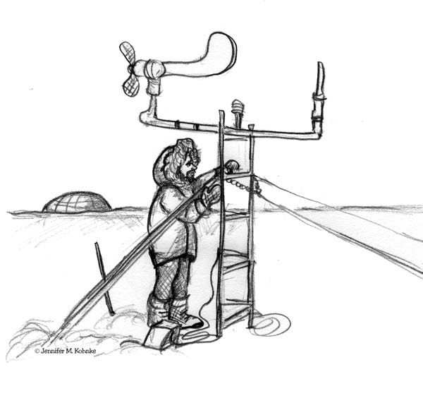</center><br/>

> 本章与 Jim Newkirk 合作撰写

下面这个故事是虚构的，但你也许会从中认出许多自己经历过的元素。

**The Cloud Company。**
Cloud 公司过去几年一直是工业气象监测系统（WMS）领域的领导者。
它的旗舰产品是一套跟踪温度、湿度、气压、风速风向等的 WMS。
系统在显示屏上实时显示这些读数。
它还按小时和按天记录历史信息，用户可以在显示屏上调阅这些历史数据。

Cloud 公司产品的主要客户来自航空、海事、农业和广播电视行业。
对这些行业来说，WMS 是关乎使命的应用。
Cloud 公司以制造高度可靠、可安装在相对不受控环境中的产品而著称。
这使得这些系统价格不菲。

这些系统的高昂价格，把那些既不需要、也负担不起高可靠性系统的客户挡在了门外。
Cloud 公司的管理者认为这是一个巨大的潜在市场，很想切入进去。

**问题。** 一家名为 Microburst 的竞争对手最近发布了一条产品线，从低端起步，可以逐步升级到高可靠性。
这有可能把规模较小但正在成长的客户从 Cloud 公司手里抢走——等这些客户长到能用 Cloud 公司产品的规模时，他们早已在 Microburst 的产品上了。

更可怕的是，Microburst 的产品还号称高端可以互联：高端型号能联网组成广域气象监测系统。
这威胁到 Cloud 公司现有客户群的根基。

**策略。** 尽管 Microburst 已在展会上成功演示了低端机型，但至少六个月内不会提供量产发货。
这说明 Microburst 可能还有未解决的工程或生产问题。
而且，Microburst 承诺的那条产品线中的高可靠性升级件，目前也拿不到。
看来 Microburst 是过早发布了产品。

如果 Cloud 公司能发布一款可升级、可互联的低端产品，并在六个月内开始发货，那么它也许能抓住——或至少拖住——那些本来会去买 Microburst 产品的客户。
通过拖住市场、让 Microburst 拿不到订单，他们也许能削弱 Microburst 解决其工程与制造问题的能力，那将是一个非常理想的结果。

**两难。**
一条全新的低成本、可扩展产品线需要投入大量工程。
硬件工程师断然拒绝承诺六个月的开发期限。
他们认为要十二个月才能看到量产机型。

市场经理则认为，十二个月之后，Microburst 已经在量产出货，并且会夺走 Cloud 公司客户中无法挽回的那一部分。

**计划。**
Cloud 公司管理层决定立即发布新产品线，并开始接受将在六个月之内发货的订单。
他们把新产品命名为 Nimbus-LC 1.0。
计划是把原来昂贵、高可靠的硬件重新装进一个新外壳，配上漂亮的 LCD 触摸面板。
这些机器的制造成本很高，意味着公司每卖一台其实是亏钱的。

与此同时，硬件工程师开始开发真正的低成本硬件，它将在 12 个月后可用。
这个配置的产品被称为 Nimbus-LC 2.0。
等到量产可用时，Nimbus-LC 1.0 就会被淘汰。

当 Nimbus-LC 1.0 的客户想升级到更高服务等级时，他的机器会被免费换成一台 Nimbus-LC 2.0。
于是，公司宁愿在这个产品上亏六个月的钱，也要抓住——或至少拖住——潜在的 Microburst 客户。

## WMS-LC 软件

Nimbus-LC 项目的软件工程很复杂。
开发人员必须做出一个既能在现有硬件上运行、也能在低成本 2.0 硬件上运行的软件产品。
2.0 硬件的原型机要九个月后才会有。
而且，2.0 板上的处理器很可能与 1.0 板上的不同。
但无论用哪套硬件平台，系统都必须表现一致。

硬件工程师将编写最底层的硬件驱动，他们需要应用软件工程师来设计这些驱动的 API。
这个 API 必须在未来四个月内交给硬件工程师。
软件必须在 6 个月内达到可量产状态，并在 12 个月内与 2.0 硬件一同工作。
他们希望 1.0 设备至少有 6 周的 Q/A，所以软件工程师实际上只有 20 周时间把软件跑起来。
由于 2.0 版本的硬件平台是新的，他们需要 8 到 10 周的 Q/A。
这就吃掉了从首个原型到最终发货之间那三个月的大部分时间。
于是，软件工程师让新硬件跑起来的时间会非常少。

**软件规划文档。**
开发人员和市场人员写了几份描述 Nimbus-LC 项目的文档：

1. 第 379 页的 “Nimbus-LC 需求概览”。
   这份文档描述了项目启动时所理解的 Nimbus-LC 系统的运行需求。¹
2. 第 380 页的 “Nimbus-LC 用例”。
   这份文档描述了从需求文档推导出的参与者和用例。
3. 第 381 页的 “Nimbus-LC 发布计划”。
   这份文档描述了软件的发布计划。该计划试图在项目生命周期早期应对主要风险，同时确保软件能在必要的期限内完成。

¹ 我们都知道，需求文档是任何软件项目中最易变的文档。

## 语言选择

对语言最重要的约束是可移植性。
开发时间短，而软件工程师与 2.0 硬件接触的时间更短，这要求 1.0 与 2.0 两个版本使用同一套软件。
也就是说，源代码必须相同，或几乎相同。
如果语言无法满足可移植性约束，那么 2.0 版本在 12 个月节点的发布就会岌岌可危。

幸运的是，其他约束很少。
这个软件并不大，所以空间不是大问题。
没有小于一秒的硬实时期限，所以速度也不是大问题。
其实，实时期限弱到连一种中等速度、带垃圾回收的语言都不算不合适。
可移植性约束加上其他严重约束的缺席，使得选择 Java 相当合适。

## Nimbus-LC 软件设计

按照发布计划，第一阶段的主要目标之一，是创建一个架构，让大部分软件独立于它所控制的硬件。
确实，我们想把气象站的抽象行为与它的具体实现分开。

例如，无论硬件配置如何，软件都必须能显示当前温度。
这意味着 Fig 27-1 所示的设计。

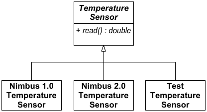<br/>
*Fig 27-1 最初的温度-传感器设计*

一个名为 `TemperatureSensor` 的抽象基类提供了多态的 `read()` 函数。
该基类的派生类允许 `read()` 函数有各自不同的实现。

**测试类。**
注意，两个已知硬件平台各有一个派生类。
此外还有一个特殊的派生类，名为 `TestTemperatureSensor`。
这个类用于在一台不连接 Nimbus 硬件的工作站上测试软件。
这让软件工程师即使拿不到 Nimbus 系统，也能为自己的软件编写单元测试和验收测试。

另外，我们把 Nimbus 2.0 硬件与软件集成起来的时间非常少。
正因为时间短，Nimbus 2.0 版本会面临风险。
让 Nimbus 软件既能跑在 Nimbus 1.0 硬件上、又能跑在测试类上，就等于让 Nimbus 软件在多个平台上执行过。
这降低了 Nimbus 2.0 出现严重可移植性问题的风险。

测试类还让我们有机会测试那些在软件中难以捕捉的特性或状况。
例如，我们可以让测试类产生那些用硬件很难模拟的故障。

**进行周期性的测量。**
Nimbus 系统最常见的模式，是显示当前的气象监测数据。
每个值都按自己特定的频率更新。
温度每分钟更新一次，气压每五分钟更新一次。
显然，我们需要某种调度器来触发这些读数，并把它们传给用户。
Fig 27-2 展示了一种可能的结构。

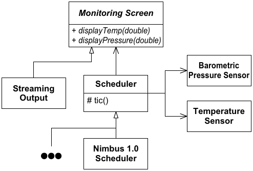<br/>
*Fig 27-2 最初的调度器与显示架构*

我们设想 `Scheduler` 是一个可以有多种实现的基类，每种硬件平台和测试平台各一个实现。
`Scheduler` 有一个 `tic` 函数，它期望该函数每 10 ms 被调用一次。
调用它是派生类的责任。（见 Fig 27-3。）
`Scheduler` 对 `tic()` 调用计数。
每分钟一次，它调用 `TemperatureSensor` 的 `read()` 函数，并把返回的温度传给 `MonitoringScreen`。
在第一阶段，我们不需要在 GUI 里显示温度，所以 `MonitoringScreen` 的派生类只是把结果送到一个输出流。

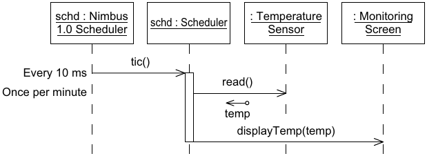<br/>
*Fig 27-3 最初的调度器顺序图*

**气压趋势。**
需求文档说，我们必须报告气压的趋势。
这个值有三种状态：上升、下降、稳定。
我们如何确定这个变量？

按照《联邦气象手册》，² 气压趋势的计算如下：

> 如果气压以每小时至少 0.06 英寸的速率上升或下降，并且在观测时（每三小时观测一次）气压变化累计达到 0.02 英寸或更多，则应报告一条气压变化备注。

这个算法该放在哪儿？
如果把它放进 `BarometricPressureSensor` 类，那么这个类就需要知道每次读数的时间，还得保留回溯三小时的一系列读数。
我们当前的设计不允许这样做。
我们可以通过给 `BarometricPressureSensor` 类的 `Read` 函数增加一个当前时间参数，并保证该函数被定期调用来修正这一点。

然而，这就把趋势计算与用户更新的频率耦合在了一起。
不能排除这样的可能：用户界面更新方案的改动会影响气压趋势算法。
而且，一个传感器要求自己必须被定期读取才能正常工作，这也很不友好。
我们需要一个更好的解法。

我们可以让 `Scheduler` 记录气压历史，在需要时计算趋势。
但这样是不是也要把温度和风速历史放进 `Scheduler` 类？
每增加一种新的传感器或历史需求，都要我们改动 `Scheduler` 类。
这有维护噩梦的苗头。

**重新考虑调度器。**
再看一眼 Fig 27-2。
注意，`Scheduler` 与每个传感器、以及与用户界面都相连。
随着更多传感器和更多用户界面屏幕被加入，它们也不得不被加进 `Scheduler`。
于是，`Scheduler` 对新增传感器或用户界面并不封闭。
这违反了 OCP。
我们想把 `Scheduler` 设计成独立于传感器和用户界面的变化与增加。

**解耦用户界面。**
用户界面是易变的。
它受客户、市场人员以及几乎每个接触该产品的人的心血来潮所左右。
如果系统中真有哪一部分会遭受需求反复折腾，那很可能就是用户界面。
因此，我们应当先把它解耦。

Fig 27-4 和 27-5 展示了一个使用 OBSERVER 模式的新设计。
我们让 UI 成为传感器的依赖者，这样当传感器读数变化时，UI 会自动收到通知。
注意这个依赖是间接的。
真正的观察者是一个名为 `TemperatureObserver` 的 ADAPTER³。
当温度读数变化时，`TemperatureSensor` 会通知这个对象；作为响应，`TemperatureObserver` 调用 `MonitoringScreen` 对象的 `DisplayTemp` 函数。

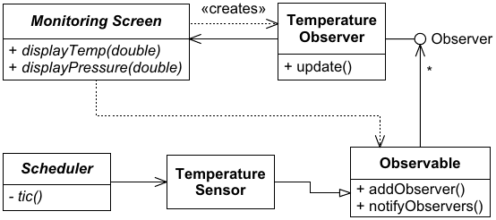<br/>
*Fig 27-4 观察者模式把 UI 与调度器解耦*

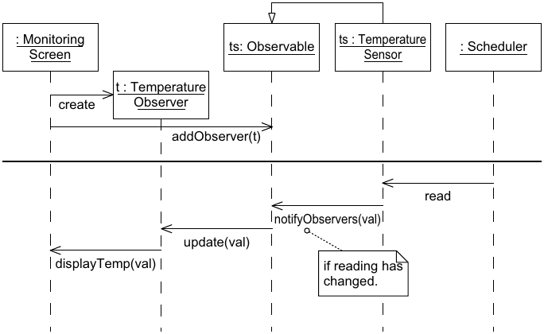<br/>
*Fig 27-5 解耦后的 UI 顺序图*

³ [GOF95]，第 139 页。

这个设计很好地让 UI 与 `Scheduler` 解了耦。
`Scheduler` 现在对 UI 一无所知，可以专注于告诉传感器何时该读数。
UI 把自己绑定到传感器上，期待它们报告任何变化。
然而 UI 并不了解这些传感器本身，它只知道一组实现了 `Observable` 接口的对象。
这将允许我们添加传感器，而不必对 UI 的这一部分做大的改动。

我们也解决了气压趋势的问题。
这个读数现在可以由一个单独的 `BarometricPressureTrendSensor` 来计算，它观察 `BarometricPressureSensor`。（见 Fig 27-6。）

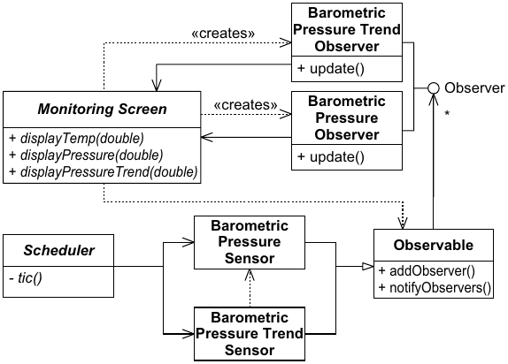<br/>
*Fig 27-6 气压观察者*

**再次反思调度器。**
`Scheduler` 的主要角色，是告诉每个传感器何时该采集一个新值。
然而，如果未来的需求迫使我们添加或删除一个传感器，`Scheduler` 就得改动。
其实，即便我们只是想改变某个传感器的采样频率，`Scheduler` 也得改。
这是对 OCP 的一次不幸的违反。
看来，关于传感器轮询频率的知识应当属于传感器自己，而不属于系统的其他任何部分。

我们可以通过使用 Java 类库中的 Listener⁴ 范式，把 `Scheduler` 与传感器解耦。
它与 OBSERVER 类似：你注册以便被通知某件事；但在这里，我们希望的是在某个事件（时间）发生时被通知。（见 Fig 27-7。）

传感器创建匿名的 ADAPTER 类，实现 `AlarmListener` 接口。
然后传感器把这些适配器注册到 `AlarmClock`（也就是我们以前称为 `Scheduler` 的那个类）上。
在注册时，它们告诉 `AlarmClock` 自己希望多久被唤醒一次（例如每秒或每五十毫秒）。
当该周期到期时，`AlarmClock` 把 `wakeup` 消息发给适配器，适配器再向传感器发出 `read` 消息。

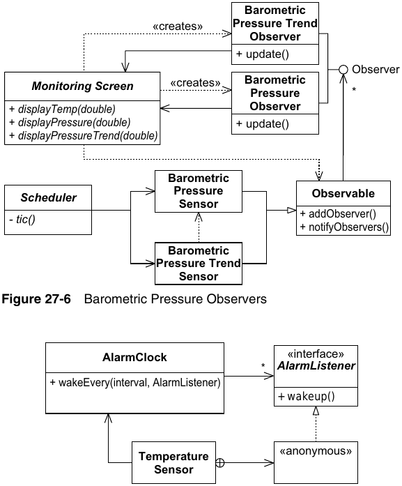<br/>
*Fig 27-7 解耦后的 AlarmClock*

这彻底改变了 `Scheduler` 类的性质。
在 Fig 27-2 中，它处于系统的中心，了解其他大多数构件。
而现在，它只是待在系统的一侧。
它遵从 SRP：只做一件事——调度——而这件事与气象监测毫无关系。
其实，它可以在许多不同种类的应用中被复用。
变化如此之大，我们连名字都改成了 `AlarmClock`。

⁴ [JAVA98]，第 360 页。

**传感器的结构。**
既然已把传感器与系统其余部分解耦，我们该看看它们的内部结构。
传感器现在有三项彼此独立的职责。
第一，它们必须创建并注册 `AlarmListener` 的匿名派生类。
第二，它们必须判断读数是否发生变化，并调用 `Observable` 类的 `notifyObservers` 方法。
第三，它们必须与 Nimbus 硬件交互，以读取相应的值。

Fig 27-1 展示了这些关注点可以如何分离。
Fig 27-8 把那个设计与我们所做的其他改动整合在一起。
`TemperatureSensor` 基类负责前两项职责，因为它们是通用的。
`TemperatureSensor` 的派生类则可以负责与硬件打交道、执行实际的读取。

Fig 27-8 采用 TEMPLATE METHOD，来实现 `TemperatureSensor` 中通用关注点与特定关注点的分离。
你可以在 `TemperatureSensor` 的私有 `check` 和 `read` 函数中看到这个模式。
当 `AlarmClock` 对匿名类调用 `wakeup` 时，匿名类把该调用转给 `TemperatureSensor` 的 `check` 函数。
`check` 函数随即调用 `TemperatureSensor` 的抽象 `read` 函数。
这个函数将由派生类实现，以便与硬件正确交互、取得传感器读数。
然后 `check` 函数判断新读数是否与上次读数不同。
若检测到差异，它就通知等待中的观察者。

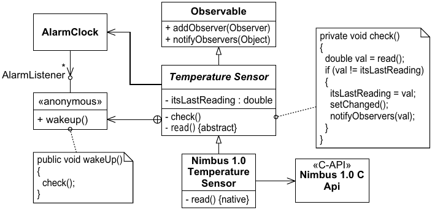<br/>
*Fig 27-8 传感器结构*

这很好地完成了我们需要的关注点分离。
对每一种新的硬件或测试平台，我们都能创建一个与之配合的 `TemperatureSensor` 派生类。
而且，这个派生类只需覆盖一个非常简单的函数：`read()`。
传感器的其余功能仍留在基类里——它本该在那里。

**API 在哪里？**
我们在发布 II 的目标之一，是为 Nimbus 2.0 硬件创建一个新的 API。
这个 API 应当用 Java 编写、可扩展，并提供对 Nimbus 2.0 硬件简单直接的访问。
此外，它还必须同样服务于 Nimbus 1.0 硬件。
没有这个 API，我们为本项目编写的所有简单调试与校准工具，在新板子引入时都得改。
这个 API 在我们当前的设计中在哪里？

结果是：我们迄今创建的东西，都不能充当这样一个简单的 API。
我们想要的是像这样的东西：

```java
public interface TemperatureSensor
{
  public double read();
}
```

我们将要编写工具，直接访问这个 API，而不必去操心注册观察者。
我们也不希望这一层的传感器自动轮询自己，或与 `AlarmClock` 打交道。
我们要的是非常简单、孤立、直接作为硬件接口的东西。

看起来我们像是在推翻前面所有的论证。
毕竟，Fig 27-1 展示的正是我们刚刚要求的东西。
不过，我们在 Fig 27-1 之后所做的改动都有充分的理由。
我们需要的是一个混合体，兼取两种方案之长。

Fig 27-9 采用 BRIDGE 模式，从 `TemperatureSensor` 中提取出真正的 API。
这个模式的意图，是把实现与抽象分开，使两者可以各自独立变化。
在我们的情形里，`TemperatureSensor` 是抽象，`TemperatureSensorImp` 是实现。
注意，这里用 “实现（Imp）” 一词来描述一个抽象接口，而这个 “实现” 本身又由 `Nimbus1.0TemperatureSensor` 类来实现。

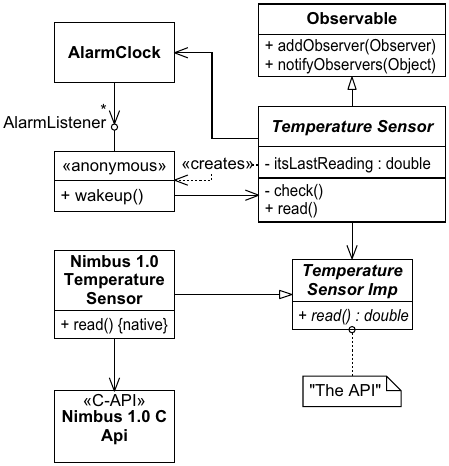<br/>
*Fig 27-9 带 API 的温度传感器*

**创建的问题。**
再看 Fig 27-9。
要让它工作，必须创建一个 `TemperatureSensor` 对象，并把它绑定到一个 `Nimbus1.0TemperatureSensor` 对象上。
谁来管这件事？
当然，负责这件事的软件部分不会是平台无关的，因为它必须明确知道与平台相关的 `Nimbus1.0TemperatureSensor`。

我们可以在 main 程序里做这一切，写成 Listing 27-1 那样。

Listing 27-1 WeatherStation

```java
public class WeatherStation
{
  public static void main(String[] args)
  {
    AlarmClock ac = new AlarmClock(
      new Nimbus1_0AlarmClock;

        TemperatureSensor ts =
          new TemperatureSensor(ac,
           new Nimbus1_0TemperatureSensor);

        BarometricPressureSensor bps =
          new BarometricPressureSensor(ac,
            new Nimbus1_0BarometricPressureSensor);

        BarometricPressureTrend bpt =
          new BarometricPressureTrend(bps)
    }
}
```

这是个可行的方案，但需要极多的例行杂务。
我们也可以改用 FACTORY 来处理创建过程中大部分例行杂务。
Fig 27-10 展示了该结构。
我们把这个工厂命名为 `StationToolkit`。
这是一个接口，提供用于创建 API 类实例的方法。
每个平台都将有自己的 `StationToolkit` 派生类，该派生类会创建相应 API 类的派生类。

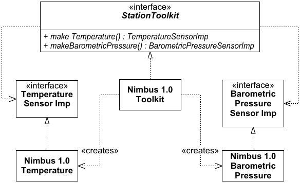<br/>
*Fig 27-10 Station Toolkit*

现在我们可以像 Listing 27-2 那样重写 main 函数。
注意，要把这个 main 程序改为在另一个平台上工作，我们只需改动创建 `Nimbus1.0AlarmClock` 和 `Nimbus1.0Toolkit` 的那两行。
相比 Listing 27-1（每创建一个传感器就要改一处），这是巨大的进步。

Listing 27-2 WeatherStation

```java
public class WeatherStation
{
  public static void main(String[] args)
  {
    AlarmClock ac = new AlarmClock(
      new Nimbus1_0AlarmClock;

        StationToolkit st = new Nimbus1_0Toolkit();

        TemperatureSensor ts =
          new TemperatureSensor(ac,st);

        BarometricPressureSensor bps =
          new BarometricPressureSensor(ac,st);

        BarometricPressureTrend bpt =
          new BarometricPressureTrend(bps)
    }
}
```

注意，`StationToolkit` 被传给了每个传感器。
这让传感器可以创建自己的实现。
Listing 27-3 展示了 `TemperatureSensor` 的构造函数。

Listing 27-3 TemperatureSensor

```java
public class TemperatureSensor extends Observable
{
  public TemperatureSensor(AlarmClock ac,
                           StationToolkit st)
  {
    itsImp = st.makeTemperature();
  }
  private TemperatureSensorImp itsImp;
}
```

**让 Station Toolkit 去创建 AlarmClock。**
我们还可以再进一步：让 `StationToolkit` 创建相应的 `AlarmClock` 派生类。
我们将再次采用 BRIDGE 模式，把对气象监测应用有意义的 `AlarmClock` 抽象，与支撑硬件平台的实现分开。

Fig 27-11 展示了新的 `AlarmClock` 结构。
`AlarmClock` 现在通过它的 `ClockListener` 接口接收 `tic()` 消息。
这些消息由 API 中相应的 `AlarmClockImp` 派生类发出。

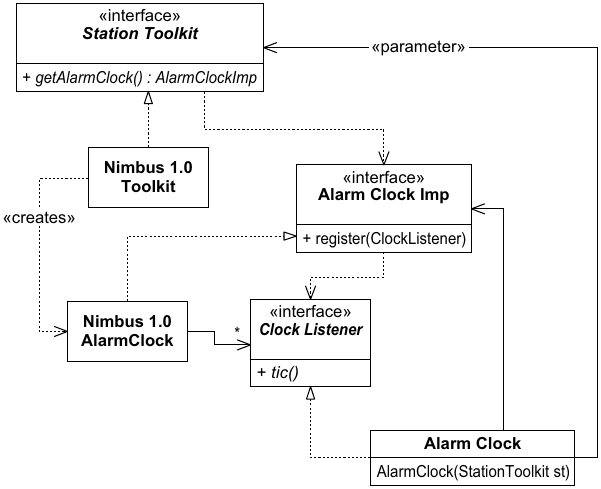<br/>
*Fig 27-11 Station Toolkit 与 Alarm Clock*

Fig 27-12 展示了 `AlarmClock` 是如何被创建的。
相应的 `StationToolkit` 派生类被传入 `AlarmClock` 的构造函数。
`AlarmClock` 指示它创建相应的 `AlarmClockImp` 派生类。
这个对象被传回 `AlarmClock`，`AlarmClock` 向它注册，以便从中接收 `tic()` 消息。

这又一次影响了 Listing 27-4 中的 main 程序。
注意，现在只有一行是平台相关的。
改这一行，整个系统就会改用另一个平台。

Listing 27-4 WeatherStation

```java
public class WeatherStation
{
  public static void main(String[] args)
  {
    StationToolkit st = new Nimbus1_0Toolkit();

    AlarmClock ac = new AlarmClock(st);
    TemperatureSensor ts =
      new TemperatureSensor(ac,st);

    BarometricPressureSensor bps =
      new BarometricPressureSensor(ac,st);

    BarometricPressureTrend bpt =
      new BarometricPressureTrend(bps)
  }
}
```

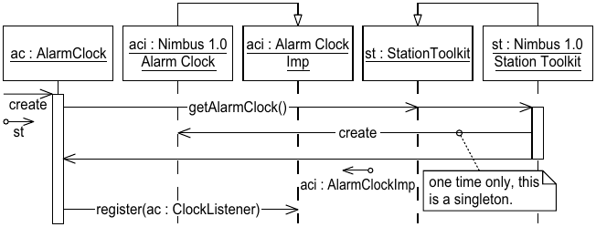<br/>
*Fig 27-12 Alarm Clock 的创建*

这已经挺好了，但在 Java 中我们还能做得更好。
Java 允许我们按名字创建对象。
Listing 27-5 中的 main 程序无需改动就能在新平台上工作。
`StationToolkit` 派生类的名字作为命令行参数传进来即可。
若名字指定正确，相应的 `StationToolkit` 就会被创建，系统其余部分也会表现得当。

Listing 27-5 WeatherStation

```java
public class WeatherStation
{
  public static void main(String[] args)
  {
    try
    {
      Class tkClass = Class.forName(args[0]);
      StationToolkit st =
        (StationToolkit)tkClass.newInstance();

        AlarmClock ac = new AlarmClock(st);

        TemperatureSensor ts =
          new TemperatureSensor(ac,st);

        BarometricPressureSensor bps =
          new BarometricPressureSensor(ac,st);

        BarometricPressureTrend bpt =
          new BarometricPressureTrend(bps)
    }
    catch (Exception e)
    {
    }
  }
}
```

**把类装进包。**
这个软件里有若干部分是我们想单独发布和分发的。
API 及其各个具体化实现，无需应用其余部分即可复用，测试与质量保证团队可能会用到它们。
UI 和传感器应当分开，以便各自独立变化。
毕竟，更新的产品可能在同样的系统架构之上配上更好的 UI。
事实上，发布 II 就会是第一个例子。

Fig 27-13 展示了第一阶段的包结构。
这个包结构几乎是从我们迄今设计出的类中自动落出来的。
每个平台一个包，这些包中的类派生自 API 包中的类。
API 包唯一的客户端是 `WeatherMonitoringSystem` 包，它装着所有其他类。

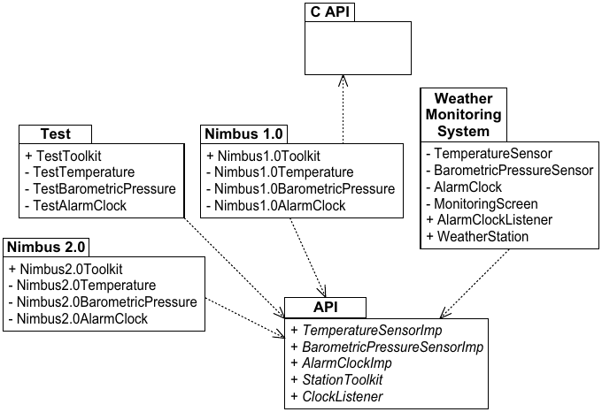<br/>
*Fig 27-13 第一阶段的包结构*

尽管发布 I 的 UI 非常小，但它混在 `WeatherMonitoringSystem` 的类里，这不太好。
把这个类放进单独的包会更好。
但这里有个问题。
按现状，`WeatherStation` 对象创建 `MonitoringScreen` 对象，而 `MonitoringScreen` 对象必须了解所有传感器，才能通过它们的 `Observable` 接口添加自己的观察者。
因此，如果我们把 `MonitoringScreen` 抽到自己的包里，那个包与 `WeatherMonitoringSystem` 包之间就会出现循环依赖。
这违反了无环依赖原则（ADP），也会使这两个包无法独立发布。

我们可以通过把 main 程序从 `WeatherStation` 类中抽出来解决这个问题。
`WeatherStation` 仍然创建 `StationToolkit` 和所有传感器，但不再创建 `MonitoringScreen`。
main 程序将创建 `MonitoringScreen` 和 `WeatherStation`，然后把 `WeatherStation` 传给 `MonitoringScreen`，好让后者能向传感器添加自己的观察者。

`MonitoringScreen` 如何从 `WeatherStation` 取得传感器？
我们需要给 `WeatherStation` 添加一些方法。见 Listing 27-6。

Listing 27-6 WeatherStation

```java
public class WeatherStation
{
  public WeatherStation(String tkName)
  {
    //create station toolkit and sensors as before.
  }

  public void addTempObserver(Observer o)
  {
    itsTS.addObserver(o);
  }

  public void addBPObserver(Observer o)
  {
    itsBPS.addObserver(o);
  }

  public void addBPTrendObserver(Observer o)
  {
    itsBPT.addObserver(o);
  }

// private variables...
  private TemperatuerSensor itsTS;
  private BarometricPressureSensor itsBPS;
  private BarometricPressureTrend itsBPT;
}
```

现在我们可以像 Fig 27-14 那样重画包图。
我们省略了大部分与 `MonitoringScreen` 无关的包。
这看起来相当不错。
当然，UI 可以变化而不影响 `WeatherMonitoringSystem`。
然而，UI 对 `WeatherMonitoringSystem` 的依赖，会在后者变化时引发问题。

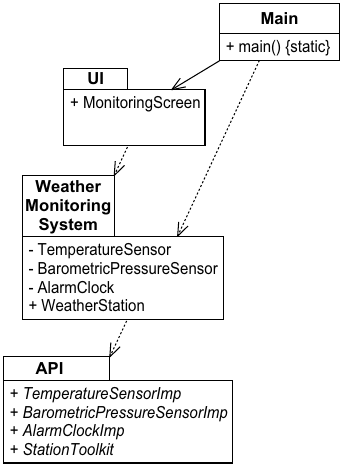<br/>
*Fig 27-14 打破循环后的包图*

UI 和 `WeatherMonitoringSystem` 都是具体的。
当一个具体包依赖另一个具体包时，就违反了依赖倒置原则（DIP）。
在这种情况下，UI 最好依赖于某种抽象，而不是 `WeatherMonitoringSystem`。

我们可以通过创建一个接口来解决：该接口供 `MonitoringScreen` 使用，而 `WeatherStation` 从它派生。（见 Fig 27-15。）

现在，如果把 `WeatherStationComponent` 接口放进它自己的包，我们就能得到想要的分离。（见 Fig 27-16。）
注意，现在 UI 与 `WeatherMonitoringSystem` 已彻底解耦，两者可以彼此独立地变化。
这是件好事。

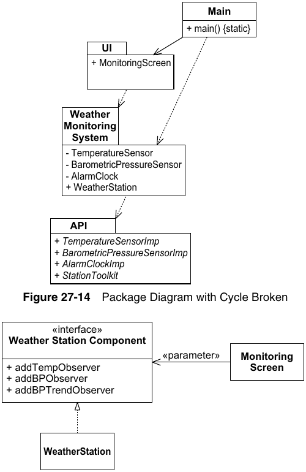<br/>
*Fig 27-15 WeatherStation 抽象接口*

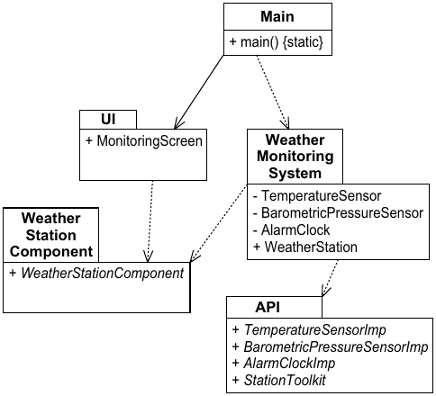<br/>
*Fig 27-16 气象站构件包图*

## 24 小时历史与持久化

发布 I 交付物部分的第 4、5 点（见第 382 页）谈到了维护持久化的 24 小时历史。
我们知道，Nimbus 1.0 和 2.0 硬件都有某种非易失性内存（NVRAM）。
另一方面，测试平台会用磁盘来模拟非易失性内存。

我们需要创建一个独立于各个平台、同时仍提供必要功能的持久化机制。
我们还需要把它与维护 24 小时历史数据的机制连接起来。

显然，底层持久化机制应当被定义为 API 包中的一个接口。
这个接口该是什么形式？
Nimbus I 的 C-API 提供了一些调用，允许从非易失性内存中的特定偏移处读写字节块。
这虽然有效，却也相当原始。
有没有更好的办法？

**持久化 API。**
Java 环境提供了设施，允许把任何对象立即转换成字节数组。
这个过程叫做序列化（serialization）。
这样的字节数组可以通过反序列化（deserialization）过程还原成对象。
如果我们的底层 API 允许我们指定一个对象和该对象的名字，那会很方便。
Listing 27-7 展示了这可能是什么样子。

Listing 27-7 PersistentImp

```java
package api;
import java.io.Serializable;
import java.util.AbstractList;
public interface PersistentImp
{
   void store(String name, Serializable obj);
   Object retrieve(String name);
   AbstractList directory(String regExp);
};
```

`PersistentImp` 接口允许你按名字存储和取出完整的对象。
唯一的限制是这些对象必须实现 `Serializable` 接口——这是个非常小的限制。

**24 小时历史。**
既然已确定存储持久化数据的底层机制，我们来看看会持久化哪类数据。
规格说明要求我们记录前一个 24 小时时段内的高值和低值。
第 380 页的 Fig 27-23 展示了包含这些数据的图。
这张图看起来不太讲得通。
高值和低值冗余得让人难受。
更糟的是，它们来自时钟上的最近 24 小时，而不是前一个日历日。
通常，当我们想要最近 24 小时的高值和低值时，我们指的是前一个日历日。

这是规格的缺陷，还是我们理解的缺陷？
如果规格并非客户真正想要的，那照规格实现对我们毫无好处。

与利益相关者做一次快速确认，证明我们的直觉是对的：我们确实想保留最近 24 小时的滚动历史，但历史低值和高值应当是前一个日历日的。

**24 小时的高值与低值。**
每日高值和低值将基于传感器的实时读数。
例如，每当温度变化时，24 小时最高温和最低温就相应更新。
显然，这是一种 OBSERVER 关系。
Fig 27-17 展示了静态结构，Fig 27-18 展示了相关的动态场景。

我们选择用带 `«observes»` 构造型的关联来表示 OBSERVER 模式。
我们创建了一个名为 `TemperatureHiLo` 的类，它每天午夜被 `AlarmClock` 唤醒。
注意，`wakeEveryDay` 方法被加到了 `AlarmClock` 上。

`TemperatureHiLo` 对象构造时，会同时向 `AlarmClock` 和 `TemperatureSensor` 注册。
每当温度变化，`TemperatureHiLo` 对象就通过 OBSERVER 模式得到通知。
随后 `TemperatureHiLo` 用 `currentReading` 方法通知 `HiLoData` 接口。
`HiLoData` 需要由某个懂得如何存储当前 24 小时日历日高值和低值的类来实现。

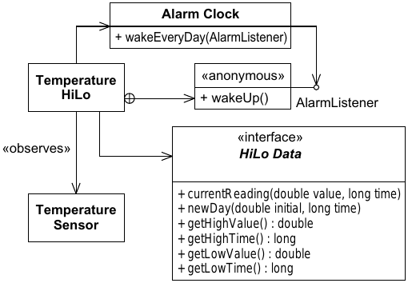<br/>
*Fig 27-17 TemperatureHiLo 结构*

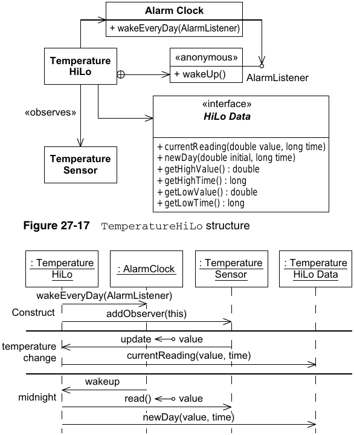<br/>
*Fig 27-18 HiLo 场景*

我们把 `TemperatureHiLo` 类与 `HiLoData` 类分开，有两个理由。
首先，我们想把握有 `TemperatureSensor` 和 `AlarmClock` 的知识，与判定每日高值和低值的算法分开。
其次，也是更重要的：判定每日高值和低值的算法可以复用于气压、风速、露点等。
因此，虽然我们会有 `BarometricPressureHiLo`、`DewPointHiLo`、`WindSpeedHiLo` 等去观察相应的传感器，但每一个都能复用 `HiLoData` 类来计算和存储数据。

午夜时，`AlarmClock` 把 `wakeup` 消息发给 `TemperatureHiLo` 对象。
`TemperatureHiLo` 从 `TemperatureSensor` 取出当前温度，并转发给 `HiLoData` 接口。
`HiLoData` 的实现必须用 `PersistentImp` 接口存下前一个日历日的值，并且必须用初始值开启一个新的日历日。

`PersistentImp` 使用一个字符串来访问持久存储中的对象。
这个字符串充当访问键。
我们的 `HiLoData` 对象将用如下格式的字符串来存储和取出：`“<type>+HiLo+<MM><dd><yyyy>”`。
例如 `“temperatureHiLo04161998”`。

## 实现 HiLo 算法

我们如何实现 `HiLoData` 类？
看起来相当直截了当。
Listing 27-8 展示了这个类的 Java 代码是什么样子。

Listing 27-8 HiLoDataImp

```java
public class HiLoDataImp implements HiLoData,java.io.Serializable
{
  public HiLoDataImp(StationToolkit st, String type,
                     Date theDate, double init,
                     long initTime)
  {
    itsPI = st.getPersistentImp();
    itsType = type;
    itsStorageKey = calculateStorageKey(theDate);
    try
    {
      HiLoData t =(HiLoData)itsPI.retrieve(itsStorageKey);
      itsHighTime = t.getHighTime();
      itsLowTime =   t.getLowTime();
      itsHighValue = t.getHighValue();
      itsLowValue = t.getLowValue();
      currentReading(init, initTime);
    }
    catch (RetrieveException re)
    {
      itsHighValue = itsLowValue = init;
      itsHighTime = itsLowTime = initTime;
    }
  }

  public long   getHighTime() {return itsHighTime;}
  public double getHighValue() {return itsHighValue;}
  public long   getLowTime()   {return itsLowTime;}
  public double getLowValue() {return itsLowValue;}

  // Determine if a new reading changes the
  // hi and lo and return true if reading changed.
  public void currentReading(double current, long time)
  {
    if (current > itsHighValue)
    {
      itsHighValue = current;
      itsHighTime = time;
      store();
    }
    else if (current < itsLowValue)
    {
      itsLowValue = current;
      itsLowTime = time;
      store();
    }
  }

  public void newDay(double initial, long time)
  {
    store();
    // now clear it out and generate a new key.
    itsLowValue = itsHighValue = intial;
    itsLowTime = itsHighTime = time;
    // now calculate a new storage key based on
    // the current date, and store the new record.
    itsStorageKey = calculateStorageKey(new Date());
    store()
  }

  private store()
  {
    try
    {
      itsPI.store(itsStorageKey, this);
    }
    catch (StoreException)
    {
      // log the error somehow.
    }
  }

  private String calculateStorageKey(Date d)
  {
    SimpleDateFormat df = new SimpleDateFormat(“MMddyyyy”);
    return(itsType + “HiLo” + df.format(d));
  }
  private double itsLowValue;
  private long   itsLowTime;
  private double itsHightValue;
  private long   itsHighTime;
  private String itsType;
  // we don’t want to store the following.
  transient private String itsStorageKey;
  transient private api.PersistentImp itsPI;
}
```

嗯，也许并不那么直截了当。
我们走一遍这段代码，看看它做了什么。

在类的底部你会看到私有成员变量。
前四个变量是意料之中的：它们记录高值、低值以及这些值出现的时间。
`itsType` 变量记住这份 `HiLoData` 保存的是哪类读数：温度取 “Temp”，气压取 “BP”，露点取 “DP”，等等。
最后两个变量被声明为 `transient`，这意味着它们不会被存入持久内存。
它们记录当前的存储键，以及一个对 `PersistentImp` 的引用。

构造函数接受五个参数。
`StationToolkit` 用于取得对 `PersistentImp` 的访问。
`type` 和 `Date` 参数用来构建存取该对象所用的存储键。
最后，`init` 和 `initTime` 参数用于在 `PersistentImp` 找不到存储键时初始化对象。

构造函数试着从 `PersistentImp` 取回数据。
如果数据存在，它就把非 transient 数据复制到自己的成员变量中。
随后它用初始值和时间调用 `currentReading`，以确保这些读数被记录下来。
最后，如果 `currentReading` 发现高值或低值数据有变化，它就返回 true，`Store` 函数随即被调用，确保持久内存被更新。

`currentReading` 方法是这个类的核心。
它把旧的高值和低值与新来的读数比较。
如果新读数高于旧高值，或低于旧低值，它就替换相应的值、记录相应的时间，并把改动存入持久内存。

`newDay` 方法在午夜被调用。
首先，它把当前的 `HiLoData` 存入持久内存。
然后它为新的开始重置 `HiLoData` 的值。
它重新计算新日期的存储键，然后把这个新的 `HiLoData` 存入持久内存。

`Store` 函数只是用当前存储键，通过 `PersistentImp` 对象把 `HiLoData` 对象写入持久内存。
最后，`calculateStorageKey` 方法根据 `HiLoData` 的类型和日期参数构建存储键。

**丑陋之处。**
当然，Listing 27-8 的代码并不难懂。
但出于另一个原因，它很丑陋。
`currentReading` 和 `newDay` 函数中所体现的策略，是关于管理高低值数据的，与持久化无关。
另一方面，`store` 和 `calculateStorageKey` 方法、构造函数以及那些 transient 变量，全都特定于持久化，与高低值的管理毫无关系。
这违反了 SRP。

以目前这种混杂状态，这个类有维护噩梦的苗头。
如果持久化机制的某些根本之处发生变化，以至于 `calculateStorageKey` 和 `store` 函数不再适用，那么新的持久化设施就必须被嫁接到这个类里。
像 `newDay` 和 `currentReading` 这样的函数，将不得不被改动以调用新的持久化设施。

**把持久化与策略解耦。**
我们可以用 PROXY 模式把高低值数据管理的策略与持久化机制解耦，从而避免这些潜在问题。
回看[第 346 页](ch26.md)的 Fig 26-7。
注意策略层（应用）与机制层（API）的解耦。

Fig 27-19 采用 PROXY 模式来实现所需的解耦。
它与第 371 页的 Fig 27-17 的区别，是增加了 `HiLoDataProxy` 类。
`TemperatureHiLo` 对象实际持有引用的，就是这个代理类。
代理又持有一个 `HiLoDataImp` 对象，并把调用委托给它。
Listing 27-9 展示 `HiLoDataProxy` 与 `HiLoDataImp` 两者的关键函数的实现。

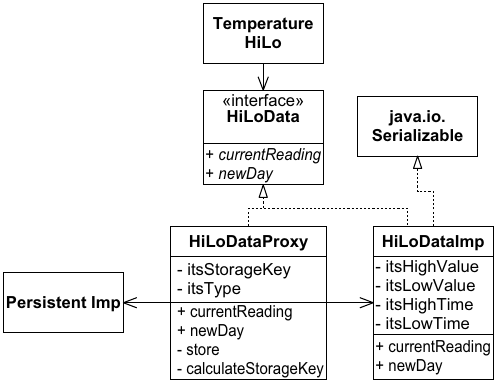<br/>
*Fig 27-19 应用于 HiLo 持久化的代理模式*

Listing 27-9 Snippets of the Proxy solution

```java
class HiLoDataProxy implements HiLoData
{
  public boolean currentReading(double current, long time)
  {
    boolean change;
    change = itsImp.currentReading(current, time);
    if (change)
      store();
    return change;
  }

  public void newDay(double initial, long time)
  {
    store();
    itsImp.newDay(initial, time);
    calculateStorageKey(new Date(time));
    store();
  }

  private HiLoDataImp itsImp;
}

class HiLoDataImp implements HiLoData, java.io.Serializable
{
  public boolean currentReading(double current, long time)
  {
    boolean changed = false;
    if (current > itsHighValue)
    {
      itsHighValue = current;
      itsHighTime = time;
      changed = true;
    }
    else if (current < itsLowValue)
    {
      itsLowValue = current;
      itsLowTime = time;
      changed = true;
    }
    return changed;
  }

  public void newDay(double initial, long time)
  {
    itsHighTime = itsLowTime = time;
    itsHighValue = itsLowValue = initial;
  }
};
```

注意，`HiLoDataImp` 类对持久化毫无概念。
也注意，`HiLoDataProxy` 类包办了所有持久化的丑陋之处，然后委托给 `HiLoDataImp`。
这很好。
此外还注意，代理同时依赖于 `HiLoDataImp`（策略层）和 `PersistentImp`（机制层）。
这正是我们想要的。

但事情并不完美。
敏锐的读者会注意到我们对 `currentReading` 方法所做的改动：我们让它返回一个 boolean。
代理需要这个 boolean，才知道何时该调用 `store`。
为什么不在每次调用 `currentReading` 时都调用 `store`？
NVRAM 有很多种类，有些对可写入次数有上限。
因此，为延长 NVRAM 的寿命，我们只在值发生变化时才写入。
现实又一次插手进来。

**工厂与初始化。**
显然，我们不希望 `TemperatureHiLo` 对代理有任何了解，它应当只了解 `HiLoData`。（见 Fig 27-19。）
但总得有人为 `TemperatureHiLo` 创建要用的 `HiLoDataProxy`。
而且，还得有人创建代理所委托的 `HiLoDataImp`。

我们需要一种在不必确切知道所创建对象类型的情况下创建对象的办法。
我们需要一种让 `TemperatureHiLo` 创建 `HiLoData` 的方式，而它并不需要知道实际创建的是 `HiLoDataProxy` 和 `HiLoDataImp`。
又一次，我们回到 FACTORY 模式。（见 Fig 27-20。）

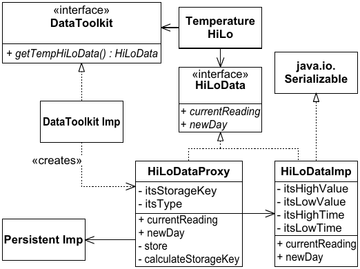<br/>
*Fig 27-20 用抽象工厂创建代理*

`TemperatureHiLo` 使用 `DataToolkit` 接口来创建符合 `HiLoData` 接口的对象。
`getTempHiLoData` 方法被部署到一个 `DataToolkitImp` 对象上，后者创建一个类型码为 “Temp” 的 `HiLoDataProxy`，并把它作为 `HiLoData` 返回。

这很好地解决了创建问题。
`TemperatureHiLo` 无需为了创建 `HiLoDataProxy` 而依赖它。
但 `TemperatureHiLo` 又如何取得对 `DataToolkitImp` 对象的访问？
我们不希望 `TemperatureHiLo` 对 `DataToolkitImp` 有任何了解，因为那会造成一条从策略层到机制层的依赖。

**包结构。**
为回答这个问题，我们来看 Fig 27-21 中的包结构。
缩写 WMS 代表气象监测系统包，即第 370 页 Fig 27-16 中所描述的那个包。

Fig 27-21 进一步印证了我们的想法：持久化接口层应当依赖策略层和机制层。
它还展示了我们把各个类部署到了哪些包里。
注意，抽象工厂 `DataToolkit` 与 `HiLoData` 一起定义在 `WMSData` 包中。
`HiLoData` 在 `WMSDataImp` 包中被实现，而 `DataToolkit` 在 `persistence` 包中被实现。

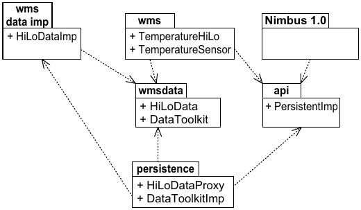<br/>
*Fig 27-21 PROXY 与 FACTORY 的包结构*

**谁来创建工厂？**
现在我们再问一次这个问题。
`wms.TemperatureHiLo` 的实例，如何取得一个 `persistence.DataToolkitImp` 的实例，以便调用 `getTempHiLoData` 方法、创建 `persistence.HiLoDataProxy` 的实例？

我们需要某种静态分配的变量，`wmsdata` 中的类可以访问它，它被声明为持有 `wmsdata.DataToolkit`，但被初始化为持有 `persistence.DataToolkitImp`。
由于 Java 中所有变量（包括静态变量）都必须声明在某个类里，我们可以创建一个名为 `Scope` 的类，让它持有我们所需的静态变量。
我们把这个类放进 `wmsdata` 包。

Listing 27-10 和 27-11 展示了这如何工作。
`wmsdata` 中的 `Scope` 类声明了一个静态成员变量，持有 `DataToolkit` 引用。
`persistence` 包中的 `Scope` 类声明了一个 `init()` 函数，它创建一个 `DataToolkitImp` 实例，并把它存入 `wmsdata.Scope.itsDataToolkit` 变量。

Listing 27-10 wmsdata.Scope

```java
package wmsdata;

public class Scope
{
  public static DataToolkit itsDataToolkit;
}
```

Listing 27-11 persistence.Scope

```java
package persistence;

public class Scope
{
  public static void init()
  {
    wmsdata.Scope.itsDataToolkit =
                      new DataToolkit();
  }
}
```

包与 Scope 类之间有一种有趣的对称性。
`wmsdata` 包中除 `Scope` 之外的所有类，都是带抽象方法、没有变量的接口。
而 `wmsdata.Scope` 类有变量、没有函数。
另一方面，`persistence` 包中除 `Scope` 之外的所有类，都是带变量的具体类。
而 `persistence.Scope` 有函数、没有变量。

Fig 27-22 展示了这在类图中可能如何描绘。
Scope 类是 `«utility»` 类。
这类类的所有成员（无论是变量还是函数）都是静态的——这为对称性画上了句号。
看来，包含抽象接口的包，往往包含有数据而无函数的工具类；而包含具体类的包，往往包含有函数而无数据的工具类。

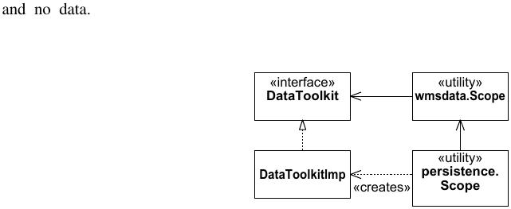<br/>
*Fig 27-22 Scope 工具类*

那么，谁调用 `persistence.Scope.init()`？
很可能是 `main()` 函数。
持有该 main 函数的类，必须位于一个不介意依赖 `persistence` 的包中。
我们常把包含 main 的包称为根包。

**但你说过……**
持久化实现层不应当依赖策略层。
然而细看 Fig 27-21，会发现一条从 `persistence` 到 `wmsDataImp` 的依赖。
这条依赖可以追溯到 Fig 27-20：在那里，`HiLoDataProxy` 依赖 `HiLoDataImp`。
这条依赖之所以存在，是为了让 `HiLoDataProxy` 能够创建它所依赖的 `HiLoDataImp`。

多数情况下，代理不必创建 imp，因为它会从持久存储中读出 imp。
也就是说，`HiLoDataImp` 会由 `PersistentImp.retrieve` 的调用返回给代理。
然而在少数情况下，`retrieve` 函数在持久存储中找不到对象，此时 `HiLoDataProxy` 就不得不创建一个空的 `HiLoDataImp`。

这样看来，我们需要另一个工厂，它知道如何创建 `HiLoDataImp` 实例，而且代理可以调用它。
这意味着更多的包、更多的 Scope 类，等等。

**这真的必要吗？**
在这个例子里，大概不必要。
我们为代理创建工厂，是因为我们希望 `TemperatureHiLo` 能与许多不同的持久化机制协同工作。
于是，`DataToolkit` 这个工厂有实实在在的收益来证明其合理。
但如果在 `HiLoDataProxy` 与 `HiLoDataImp` 之间插一个工厂，能得到什么收益？
如果 `HiLoDataImp` 可以有许多不同的实现、而我们希望代理能与它们全部协同工作，那么我们也许有理由这么做。

然而，我们并不认为需求会易变到那个程度。
`wmsDataImp` 包里装的是气象监测的策略与业务规则，它们已经相当长时间没变过了。
看起来它们在未来也不太可能变化。
这听起来像是著名的临终遗言，但你总得在某个地方划一条线。
在这个例子里，我们判定从代理到 imp 的依赖不构成大的维护风险，于是就不要那个工厂了。

## 结论

我和 Jim Newkirk 在 1998 年初写下了这一章。
大部分编码是 Jim 做的，我则把代码转成 UML 图，并为它们配上文字。
那些代码如今早已不在了。
但正是那段代码的产出，催生了你在这些页面里看到的设计。
大多数图是在代码完成之后绘制的。

1998 年，Jim 和我都还没听说过极限编程。
所以这里的设计并不是在结对编程和测试驱动开发的环境中进行的。
不过，Jim 和我一直以高度协作的方式工作。
我们会一起研读他写的代码，在可行处运行它，一起做设计改动，然后产出本章的 UML 与文字。

所以，尽管这里的设计是 XP 之前的，它仍然是以高度协作、以代码为中心的方式创造出来的。

## 参考文献

1. Gamma, et al. *Design Patterns*. Reading, MA: Addison–Wesley, 1995.
2. Meyer, Bertrand. *Object-Oriented Software Construction*, 2nd ed. Upper Saddle River, NJ: Prentice Hall, 1997.
3. Arnold, Ken, and James Gosling. *The Java Programming Language*, 2nd ed. Reading, MA: Addison–Wesley, 1998.

## Nimbus-LC 需求概览

**使用需求。**
本系统应自动监测各种天气状况。
具体而言，它必须测量以下变量：

- 风速与风向
- 温度
- 气压
- 相对湿度
- 风寒指数
- 露点温度

系统还应给出当前气压读数的趋势指示。
可能的值有三种：稳定、上升、下降。
例如：当前气压为 29.95 英寸汞柱（IOM），并且正在下降。

系统应有一块显示屏，持续指示所有测量值，以及当前的时间和日期。

**24 小时历史。**
通过触摸屏，用户可以指示系统显示下列任一测量值的 24 小时历史：

- 温度
- 气压
- 相对湿度

这些历史应以折线图的形式呈现给用户。（见 Fig 27-23。）

**用户设置。**
系统应向用户提供以下设施，以便在安装期间配置气象站：

- 设置当前时间、日期和时区
- 设置显示单位（英制或公制）

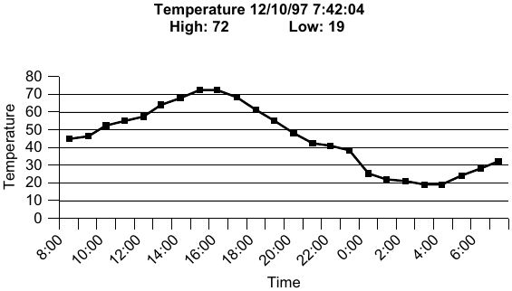<br/>
*Fig 27-23 温度历史*

**管理需求。**
系统应为访问气象站的管理功能提供一种安全机制。
这些功能包括：

- 用已知值校准传感器
- 重置气象站

## Nimbus-LC 用例

**参与者。**
本系统中有两种不同的用户角色。

**User（用户）。** 用户查看气象站正在测量的实时天气信息。
他们也会与系统交互，以显示各个传感器相关的历史数据。

**Administrator（管理员）。** 管理员管理系统在安全方面的功能：校准各个传感器、设置时间/日期、设置度量单位，以及在需要时重置气象站。

**用例。**

**用例 #1：监测天气数据。**
系统将显示当前温度、气压、相对湿度、风速、风向、风寒温度、露点以及气压趋势。

**测量历史。**
系统将显示一张折线图，描绘系统中各传感器在过去 24 小时的读数。
除图形之外，系统还将显示当前时间与日期，以及过去 24 小时内的最高和最低读数。

**用例 #2：查看温度历史。**

**用例 #3：查看气压历史。**

**用例 #4：查看相对湿度历史。**

**设置。**

**用例 #5：设置单位。**
用户设定将要显示的单位类型，可在英制与公制之间选择。默认为公制。

**用例 #6：设置日期。** 用户设定当前日期。

**用例 #7：设置时间。** 用户设定系统的当前时间与时区。

**管理。**

**用例 #8：重置气象站。**
管理员能够把气象站恢复为出厂默认设置。
必须注意，这将抹除气象站中存储的全部历史，并移除可能已做过的任何校准。
作为最后一道确认，系统将告知管理员这样做的后果，并提示是否确定要重置。

**用例 #9：校准温度传感器。**
管理员使用一个已知良好的温度源，把该值输入系统。
系统应接受该值，并在内部用它把实际读数与系统当前测量到的读数进行校准。
关于校准传感器的细节，见硬件描述文档。

**用例 #10：校准气压传感器。**

**用例 #11：校准相对湿度传感器。**

**用例 #12：校准风速传感器。**

**用例 #13：校准风向传感器。**

**用例 #14：校准露点传感器。**

**用例 #15：校准日志。**
系统将向管理员显示本机的校准历史。
该历史包括校准的时间与日期、被校准的传感器，以及用于校准该传感器的值。

## Nimbus-LC 发布计划

**引言。**
气象站的实现将以一系列迭代完成。
每次迭代都在此前成果的基础上推进，直到我们提供了发布给客户所需的全部功能。
本文件概述本项目的三次发布。

**发布 I。**
本次发布有两个目标。
第一，创建一个能支撑大部分应用的架构，且该架构独立于 Nimbus 硬件平台。
第二个目标是控制两个最大的风险：

1. 让旧的 Nimbus 1.0 API 在装着新操作系统的处理器板上工作。这当然做得到，但很难估计要花多久，因为我们无法预见所有的不兼容之处。
2. Java 虚拟机。我们从未在嵌入式板上用过 JVM。我们不知道它能否与我们的操作系统配合，甚至不知道它是否正确地实现了全部 Java 字节码。供应商向我们保证一切都会好的，但我们仍然认为风险相当大。

JVM 与触摸屏、图形子系统的集成，与本次发布并行推进。
预计它会在第二阶段开始之前完成。

**风险**

1. 操作系统升级——我们板上目前用的还是较老版本的这个 OS。为了使用 JVM，我们需要升级到最新版本的 OS。这还要求我们使用最新版本的开发工具。
2. OS 供应商正在这个版本的 OS 上提供最新版本的 JVM。为了跟上时代，我们想用 1.2 版的 JVM。然而 V1.2 目前还在 beta 中，并且会在本项目的构建期间发生变化。
3. 板级 “C” API 的 Java 本地接口，需要在新架构中验证。

**交付物**

1. 我们的硬件，运行新的 OS 和最新版本的 JVM。
2. 一个流式输出，显示当前温度和气压读数。（最终发布中不用的代码即丢弃。）
3. 当气压发生变化时，系统将告知我们气压是在上升、下降还是稳定。
4. 每小时，系统将显示过去 24 小时温度和气压的测量数据。这些数据将是持久化的：即使我们对本机断电再上电，数据依然保存。
5. 每天 12:00 A.M.，系统将显示前一天温度和气压的最高值与最低值。
6. 所有测量均采用公制。

**发布 II。**
在项目这一阶段，用户界面的基础被加到第一次发布上。
不增加额外的测量项。
对测量本身唯一的改动，是增加校准机制。
本阶段的首要关注点是系统的呈现。
主要风险是到 LCD 面板/触摸屏的软件接口。
另外，由于这是第一次以可以向用户演示的形式显示 UI 的发布，需求可能开始出现一些反复。
除软件之外，我们还将交付一份新硬件的规格说明——这也是把校准加到本阶段的主要原因。
这个 API 将用 Java 规定。

**实现的用例**

- #2——查看温度历史
- #3——查看气压历史
- #5——设置单位
- #6——设置日期
- #7——设置时间/时区
- #9——校准温度传感器
- #10——校准气压传感器

**风险**

1. 到 Java 虚拟机的 LCD 面板/触摸屏接口，需要在真实硬件上测试。
2. 需求变更。
3. JVM 的变化，以及 Java 基础类库从 beta 走向正式发布形式过程中的变化。

**交付物**

1. 一个可执行、并提供上述用例中所规定的全部功能的系统。
2. 用例 #1 中温度、气压与时间/日期部分也将实现。
3. 软件架构中的 GUI 部分将在本阶段完成。
4. 软件的管理部分将被实现，以支持温度和气压的校准。
5. 一份新硬件 API 的规格说明，用 Java 而不是 “C” 来规定。

**发布 III。**
这是产品交付客户之前的最后一次发布。

**实现的用例**

- #1——监测天气数据
- #4——查看相对湿度历史
- #8——重置气象站
- #11——校准相对湿度传感器
- #12——校准风速传感器
- #13——校准风向传感器
- #14——校准露点传感器
- #15——校准日志

**风险**

1. 需求变更——预计随着产品完成度提高，可能会有需要改动之处。
2. 完成整个产品可能表明，需要在发布 II 结束时规定的硬件 API 上做改动。
3. 硬件的限制——随着我们完成产品，可能会撞上硬件的限制（如内存、CPU 等）。

**交付物**

1. 运行在旧硬件平台上的新软件。
2. 一份已用此实现验证过的新硬件规格说明。
