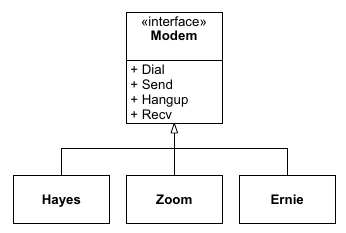
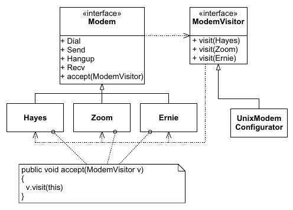
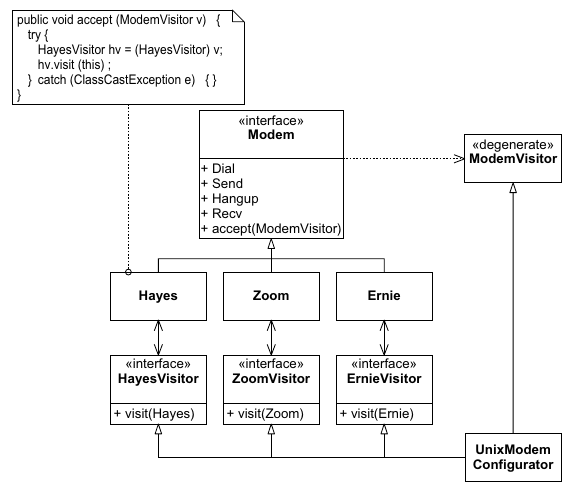
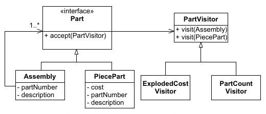
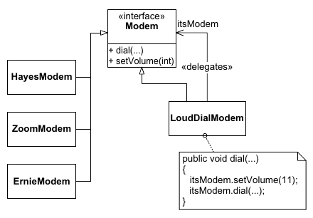
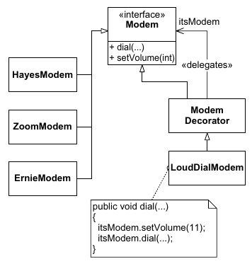
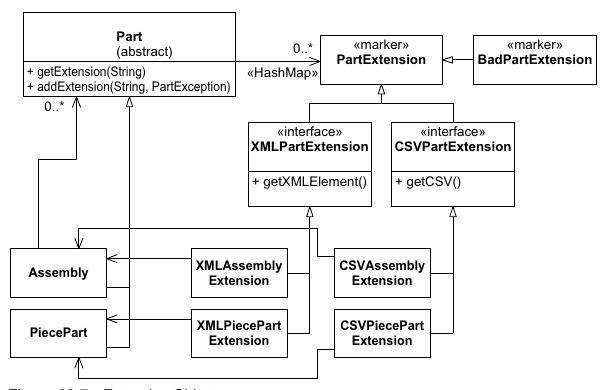

# 28 Visitor

<center></center><br/>

> “‘那是位访客，’我咕哝着，‘在我的房门外叩叩作响；
> 仅此而已，再无其他。’”
> <p align="right">——Edgar Allen Poe，The Raven（《乌鸦》）</p>

> **问题：** 你需要往一个类层次结构中添加一个新方法，但添加它的举动将令人心痛，或会损害设计。

这是个常见问题。例如，假设你有一个 Modem 对象层次结构。
基类包含所有调制解调器共有的通用方法。
各派生类代表许多不同厂商和型号调制解调器的驱动。
再假设你有一个需求：往这个层次结构中添加一个名为 `configureForUnix` 的新方法。
这个方法将配置调制解调器，使其能在 UNIX 操作系统下工作。
由于每个不同的调制解调器在设置配置、处理 UNIX 方面都有自己的怪癖，
所以它必须在每个调制解调器派生类中做不同的事情。

不幸的是，添加 `configureForUnix` 会引出一连串糟糕的问题。
Windows 怎么办？MacOs 呢？Linux 呢？
难道我们每使用一个新操作系统，都真的要在 Modem 层次结构中添加一个新方法吗？
这显然很难看。
我们将永远无法把 Modem 接口封闭起来。
每当出现一个新操作系统，我们都得改动这个接口，并重新部署所有的调制解调器软件。

> **VISITOR 模式族**
>
> VISITOR 家族允许在不修改现有层次结构的前提下，往其中添加新方法。
> 这个家族中的模式如下：
>
> - VISITOR
> - ACYCLIC VISITOR
> - DECORATOR
> - EXTENSION OBJECT

## VISITOR¹

¹ [GOF95]，第 331 页。

考虑 Fig 28-1 中的 Modem 层次结构。
`Modem` 接口包含所有调制解调器都能实现的通用方法。
图中展示了三个派生类——一个驱动 Hayes 调制解调器，一个驱动 Zoom 调制解调器，第三个驱动我们的一位硬件工程师 Ernie 生产的调制解调器卡。

<br/>
*Fig 28-1 调制解调器层次结构*

我们如何在不把 `ConfigureForUnix` 方法放进 `Modem` 接口的前提下，把这些调制解调器配置为 UNIX 模式？
我们可以使用一种叫**双重分派（dual dispatch）**的技术，它是 VISITOR 模式的核心机制。

Fig 28-2 展示了 VISITOR 结构，Listing 28-1 至 28-6 展示了对应的 Java 代码。
Listing 28-7 展示了测试代码，它既验证 VISITOR 有效，又演示了另一位程序员应当如何使用它。

Listing 28-1
Modem.java

```java
public interface Modem
{
  public void dial(String pno);
  public void hangup();
  public void send(char c);
  public char recv();
  public void accept(ModemVisitor v);
}
```

<br/>
*Fig 28-2 VISITOR*

Listing 28-2
ModemVisitor.java

```java
public interface ModemVisitor
{
  public void visit(HayesModem modem);
  public void visit(ZoomModem modem);
  public void visit(ErnieModem modem);
}
```

Listing 28-3
HayesModem.java

```java
public class HayesModem implements Modem
{
  public void dial(String pno){}
  public void hangup(){}
  public void send(char c){}
  public char recv() {return 0;}
  public void accept(ModemVisitor v) {v.visit(this);}
    String configurationString = null;
}
```

Listing 28-4
ZoomModem.java

```java
public class ZoomModem implements Modem
{
  public void dial(String pno){}
  public void hangup(){}
  public void send(char c){}
  public char recv() {return 0;}
  public void accept(ModemVisitor v) {v.visit(this);}
    int configurationValue = 0;
}
```

Listing 28-5
ErnieModem.java

```java
public class ErnieModem implements Modem
{
  public void dial(String pno){}
  public void hangup(){}
  public void send(char c){}
  public char recv() {return 0;}
  public void accept(ModemVisitor v) {v.visit(this);}

    String internalPattern = null;
}
```

Listing 28-6
UnixModemConfigurator.java

```java
public class UnixModemConfigurator implements ModemVisitor
{
  public void visit(HayesModem m)
  {
    m.configurationString = "&s1=4&D=3";
  }

  public void visit(ZoomModem m)
  {
    m.configurationValue = 42;
  }

  public void visit(ErnieModem m)
  {
    m.internalPattern = "C is too slow";
  }
}
```

Listing 28-7
TestModemVisitor.java

```java
import junit.framework.*;
public class TestModemVisitor extends TestCase
{
  public TestModemVisitor(String name)
  {
    super(name);
  }

  private UnixModemConfigurator v;
  private HayesModem h;
  private ZoomModem z;
  private ErnieModem e;

  public void setUp()
  {
    v = new UnixModemConfigurator();
    h = new HayesModem();
    z = new ZoomModem();
    e = new ErnieModem();
  }

  public void testHayesForUnix()
  {
    h.accept(v);
    assertEquals("&s1=4&D=3", h.configurationString);
  }

  public void testZoomForUnix()
  {
    z.accept(v);
    assertEquals(42, z.configurationValue);
  }

  public void testErnieForUnix()
  {
    e.accept(v);
    assertEquals("C is too slow", e.internalPattern);
  }
}
```

注意，在访问者层次结构中，被访问（Modem）层次结构的每一个派生类都对应一个方法。
这是一种 90˚ 的旋转——从派生类到方法。

测试代码表明，要把一个调制解调器配置为 UNIX 模式，程序员只需创建一个 `UnixModemConfigurator` 类的实例，
并把它传给 `Modem` 的 `accept` 函数。
于是，相应的 Modem 派生类会在 `ModemVisitor`（`UnixModemConfigurator` 的基类）上调用 `visit(this)`。
如果那个派生类是 Hayes，`visit(this)` 就会调用 `public void visit(Hayes)`。
这又将分派到 `UnixModemConfigurator` 的 `public void visit(Hayes)` 函数，该函数随即将 Hayes 调制解调器配置为 Unix 模式。

有了这个结构，要添加新的操作系统配置函数，只需添加新的 `ModemVisitor` 派生类，完全不必以任何方式改动 Modem 层次结构。
所以，VISITOR 模式用 `ModemVisitor` 的派生类取代了 Modem 层次结构中的方法。

<ins>之所以叫“双重分派”，是因为它涉及两次多态分派。</ins>
第一次是 `accept` 函数，这次分派确定了被调用 `accept` 的对象类型。
第二次是 `visit` 方法，它确定要执行的具体函数。
这两次分派使 VISITOR 具有极快的执行速度。

> **VISITOR 就像一个矩阵**
>
> VISITOR 的两次分派构成了一个函数矩阵。
> 在我们的调制解调器例子中，矩阵的一个轴是不同类型的调制解调器，另一个轴是不同类型的操作系统。
> 矩阵中的每个单元都被一个函数填满，该函数描述如何为特定的操作系统初始化特定的调制解调器。

## ACYCLIC VISITOR

注意，被访问（Modem）层次结构的基类依赖于访问者层次结构的基类（`ModemVisitor`）。
还注意，访问者层次结构的基类为被访问层次结构的每个派生类都提供了一个函数。
于是，存在一个依赖环，把所有被访问的派生类（所有 Modem）系在了一起。
这使得增量编译访问者结构、或往被访问层次结构中添加新派生类，都变得非常困难。

VISITOR 非常适用于这样的程序：其中被修改的层次结构不太经常需要新派生类。
如果 Hayes、Zoom 和 Ernie 是唯一可能需要出现的 Modem 派生类，
或者预计新的 Modem 派生类出现的频率很低，那么 VISITOR 就非常合适。

另一方面，如果被访问的层次结构高度易变，需要创建许多新派生类，
那么每次往被访问层次结构中添加一个新派生类，Visitor 基类（例如 `ModemVisitor`）都必须连同它的所有派生类一起被修改并重新编译。
在 C++ 中，情况更糟。
每当添加任何新派生类，整个被访问的层次结构都必须重新编译并重新部署。

为解决这些问题，可以使用一种称为 ACYCLIC VISITOR 的变体。²（见 Fig 28-3。）
这种变体通过让 Visitor 基类（`ModemVisitor`）退化（degenerate）³来打破依赖环。
这个类中没有任何方法，意味着它不依赖于被访问层次结构的派生类。

<br/>
*Fig 28-3 ACYCLIC VISITOR*

访问者派生类同样派生自一些访问者接口。
被访问层次结构的每个派生类对应一个访问者接口。
这是从派生类到接口的 180˚ 旋转。
被访问派生类中的 `accept` 函数把 Visitor 基类⁴强转为适当的访问者接口。
如果强转成功，方法就调用相应的 `visit` 函数。
Listing 28-8 至 28-16 展示了代码。

² [PLOPD3]，第 93 页。

³ 退化类是指完全没有方法的类。在 C++ 中，它会有一个纯虚析构函数。在 Java 中，这样的类被称为“Marker Interface”（标记接口）。

⁴ 在 C++ 中，我们使用 `dynamic_cast`。

Listing 28-8
Modem.java

```java
public interface Modem
{
  public void dial(String pno);
  public void hangup();
  public void send(char c);
  public char recv();
  public void accept(ModemVisitor v);
}
```

Listing 28-9
ModemVisitor.java

```java
public interface ModemVisitor
{
}
```

Listing 28-10
ErnieModemVisitor.java

```java
public interface ErnieModemVisitor
{
  public void visit(ErnieModem m);
}
```

Listing 28-11
HayesModemVisitor.java

```java
public interface HayesModemVisitor
{
  public void visit(HayesModem m);
}
```

Listing 28-12
ZoomModemVisitor.java

```java
public interface ZoomModemVisitor
{
  public void visit(ZoomModem m);
}
```

Listing 28-13
ErnieModem.java

```java
public class ErnieModem implements Modem
{
  public void dial(String pno){}
  public void hangup(){}
  public void send(char c){}
  public char recv() {return 0;}
  public void accept(ModemVisitor v)
  {
    try
    {
      ErnieModemVisitor ev = (ErnieModemVisitor)v;
      ev.visit(this);
    }
    catch (ClassCastException e)
    {
    }
  }
  String internalPattern = null;
}
```

Listing 28-14
HayesModem.java

```java
public class HayesModem implements Modem
{
  public void dial(String pno){}
  public void hangup(){}
  public void send(char c){}
  public char recv() {return 0;}
  public void accept(ModemVisitor v)
  {
    try
    {
      HayesModemVisitor hv = (HayesModemVisitor)v;
      hv.visit(this);
    }
    catch (ClassCastException e)
    {
    }
  }
  String configurationString = null;
}
```

Listing 28-15
ZoomModem.java

```java
public class ZoomModem implements Modem
{
  public void dial(String pno){}
  public void hangup(){}
  public void send(char c){}
  public char recv() {return 0;}
  public void accept(ModemVisitor v)
  {
    try
    {
      ZoomModemVisitor zv = (ZoomModemVisitor)v;
      zv.visit(this);
    }
    catch(ClassCastException e)
    {
    }
  }
  int configurationValue = 0;
}
```

Listing 28-16
TestModemVisitor.java

```java
import junit.framework.*;
public class TestModemVisitor extends TestCase
{
  public TestModemVisitor(String name)
  {
    super(name);
  }

  private UnixModemConfigurator v;
  private HayesModem h;
  private ZoomModem z;
  private ErnieModem e;

  public void setUp()
  {
    v = new UnixModemConfigurator();
    h = new HayesModem();
    z = new ZoomModem();
    e = new ErnieModem();
  }

  public void testHayesForUnix()
  {
    h.accept(v);
    assertEquals("&s1=4&D=3", h.configurationString);
  }

  public void testZoomForUnix()
  {
    z.accept(v);
    assertEquals(42, z.configurationValue);
  }

  public void testErnieForUnix()
  {
    e.accept(v);
    assertEquals("C is too slow", e.internalPattern);
  }
}
```

这打破了依赖环，使得添加被访问派生类和做增量编译都更容易了。
不幸的是，这也使解法复杂了许多。
更糟的是，强转的时机可能取决于被访问层次结构的宽度和广度，因此很难刻画。

<ins>对于苛刻的实时系统，强转那种庞大而不可预测的执行时间可能使 ACYCLIC VISITOR 不适用。</ins>
对于其他系统，这个模式的复杂性也可能使它出局。
但对于那些被访问层次结构易变、且增量编译很重要的系统，这个模式可以是一个好选择。

> **ACYCLIC VISITOR 就像一个稀疏矩阵**
>
> 正如 VISITOR 模式创建了一个函数矩阵，被访问的类型在一个轴上，要执行的函数在另一个轴上一样，
> ACYCLIC VISITOR 创建的是一个稀疏矩阵。
> 访问者类不必为每个被访问的派生类都实现 `visit` 函数。
> 例如，如果 Ernie 调制解调器无法配置为 UNIX 模式，那么 `UnixModemConfigurator` 就不实现 `ErnieVisitor` 接口。
> 于是，ACYCLIC VISITOR 模式允许我们忽略某些派生类与函数的组合。
> 这有时是一个很有用的优点。

## 在报表生成器中使用 VISITOR

VISITOR 模式一个非常常见的用途，是遍历大型数据结构并生成报表。
这让数据结构对象不必包含任何报表生成代码。
添加新报表时，只需添加新的 VISITOR，而不是修改数据结构中的代码。
这意味着报表可以放在独立的组件中，并单独部署给需要它们的客户。

考虑一个表示物料清单（bill of materials）的简单数据结构。（见 Fig 28-4。）
从这个数据结构，我们可以生成数量无限的报表。
例如，我们可以生成一份汇总某个组件总成本的报表，也可以生成一份列出组件中所有零件（piece part）的报表。

<br/>
*Fig 28-4 物料清单报表生成器结构*

这些报表中的每一个，都可以由 `Part` 类中的方法生成。
例如，可以给 `Part` 类添加 `getExplodedCost` 和 `getPieceCount` 方法。
这些方法在 `Part` 的每个派生类中实现，从而完成相应的报表。
不幸的是，这意味着客户想要的每份新报表都会迫使我们改动 Part 层次结构。

单一职责原则（SRP）告诉我们，希望把因不同原因而变化的代码分离开。
Part 层次结构可能随着新种类零件的需求而改变。
但是，它不应该因为需要新种类的报表而改变。
因此，我们想把报表从 Part 层次结构中分离出来。
Fig 28-4 中的 VISITOR 结构展示了如何实现这一点。

每个新报表都可以写成一个新访问者。
我们把 `Assembly` 的 `accept` 函数写为：访问该访问者，并对所有包含的 `Part` 实例调用 `accept`。
于是，整棵树都被遍历了。
对树中的每个节点，在报表上调用相应的 `visit` 函数。
报表累加所需的统计数据，之后可以被查询出感兴趣的数据，并呈现给用户。

这个结构允许我们创建无限数量的报表，而完全不影响 Part 层次结构。
此外，每个报表都可以独立于其他所有报表单独编译和分发。
这很好。Listing 28-17 至 28-23 展示了这在 Java 中是什么样子的。

Listing 28-17
Part.java

```java
public interface Part
{
  public String getPartNumber();
  public String getDescription();
  public void accept(PartVisitor v);
}
```

Listing 28-18
Assembly.java

```java
import java.util.*;

public class Assembly implements Part
{
  public Assembly(String partNumber, String description)
  {
    itsPartNumber = partNumber;
    itsDescription = description;
  }

  public void accept(PartVisitor v)
  {
    v.visit(this);
    Iterator i = getParts();
    while (i.hasNext())
    {
      Part p = (Part)i.next();
      p.accept(v);
    }
  }
  public void add(Part part)
  {
    itsParts.add(part);
  }

  public Iterator getParts()
  {
    return itsParts.iterator();
  }

  public String getPartNumber()
  {
    return itsPartNumber;
  }

  public String getDescription()
  {
    return itsDescription;
  }

  private List itsParts = new LinkedList();
  private String itsPartNumber;
  private String itsDescription;
}
```

Listing 28-19
PiecePart.java

```java
public class PiecePart implements Part
{
  public PiecePart(String partNumber,
                   String description,
                   double cost)
  {
    itsPartNumber = partNumber;
    itsDescription = description;
    itsCost = cost;
  }

  public void accept(PartVisitor v)
  {
    v.visit(this);
  }

  public String getPartNumber()
  {
    return itsPartNumber;
  }

  public String getDescription()
  {
    return itsDescription;
  }

  public double getCost()
  {
    return itsCost;
  }

  private String itsPartNumber;
  private String itsDescription;
  private double itsCost;
}
```

Listing 28-20
PartVisitor.java

```java
public interface PartVisitor
{
  public void visit(PiecePart pp);
  public void visit(Assembly a);
}
```

Listing 28-21
ExplodedCostVisitor.java

```java
public class ExplodedCostVisitor implements PartVisitor
{
  private double cost = 0;
  public double cost() {return cost;}

  public void visit(PiecePart p)
  {cost += p.getCost();}

  public void visit(Assembly a) {}

}
```

Listing 28-22
PartCountVisitor.java

```java
import java.util.*;

public class PartCountVisitor implements PartVisitor
{
  public void visit(PiecePart p)
  {
    itsPieceCount++;
    String partNumber = p.getPartNumber();
    int partNumberCount = 0;
    if (itsPieceMap.containsKey(partNumber))
    {
      Integer carrier = (Integer)itsPieceMap.get(partNumber);
      partNumberCount = carrier.intValue();
    }
    partNumberCount++;
    itsPieceMap.put(partNumber, new Integer(partNumberCount));
  }

  public void visit(Assembly a)
  {
  }

  public int getPieceCount() {return itsPieceCount;}
  public int getPartNumberCount() {return itsPieceMap.size();}
  public int getCountForPart(String partNumber)
  {
    int partNumberCount = 0;
    if (itsPieceMap.containsKey(partNumber))
    {
      Integer carrier = (Integer)itsPieceMap.get(partNumber);
      partNumberCount = carrier.intValue();
    }
    return partNumberCount;
  }

  private int itsPieceCount = 0;
  private HashMap itsPieceMap = new HashMap();

}
```

Listing 28-23
TestBOMReport.java

```java
import junit.framework.*;
import java.util.*;

public class TestBOMReport extends TestCase
{
  public TestBOMReport(String name)
  {
    super(name);
  }
  private PiecePart p1;
  private PiecePart p2;
  private Assembly a;
  public void setUp()
  {
    p1 = new PiecePart("997624", "MyPart", 3.20);
    p2 = new PiecePart("7734", "Hell", 666);
    a = new Assembly("5879", "MyAssembly");
  }
  public void testCreatePart()
  {
    assertEquals("997624", p1.getPartNumber());
    assertEquals("MyPart", p1.getDescription());
    assertEquals(3.20, p1.getCost(), .01);
  }
  public void testCreateAssembly()
  {
    assertEquals("5879", a.getPartNumber());
    assertEquals("MyAssembly", a.getDescription());
  }
  public void testAssembly()
  {
    a.add(p1);
    a.add(p2);
    Iterator i = a.getParts();
    PiecePart p = (PiecePart)i.next();
    assertEquals(p, p1);
    p = (PiecePart)i.next();
    assertEquals(p, p2);
    assert(i.hasNext() == false);
  }
  public void testAssemblyOfAssemblies()
  {
    Assembly subAssembly = new Assembly("1324", "SubAssembly");
    subAssembly.add(p1);
    a.add(subAssembly);
    Iterator i = a.getParts();
    assertEquals(subAssembly, i.next());
  }
  private boolean p1Found = false;
  private boolean p2Found = false;
  private boolean aFound = false;

  public void testVisitorCoverage()
  {
    a.add(p1);
    a.add(p2);
    a.accept(new PartVisitor(){
      public void visit(PiecePart p)
      {
        if (p == p1)
          p1Found = true;
        else if (p == p2)
          p2Found = true;
      }

      public void visit(Assembly assy)
      {
        if (assy == a)
          aFound = true;
      }
    });
    assert(p1Found);
    assert(p2Found);
    assert(aFound);
  }

  private Assembly cellphone;

  void setUpReportDatabase()
  {
    cellphone = new Assembly("CP-7734", "Cell Phone");
    PiecePart display = new PiecePart("DS-1428", "LCD Display", 14.37);
    PiecePart speaker = new PiecePart("SP-92", "Speaker", 3.50);
    PiecePart microphone = new PiecePart("MC-28", "Microphone", 5.30);
    PiecePart cellRadio = new PiecePart("CR-56", "Cell Radio", 30);
    PiecePart frontCover = new PiecePart("FC-77", "Front Cover", 1.4);
    PiecePart backCover = new PiecePart("RC-77", "RearCover", 1.2);
    Assembly keypad = new Assembly("KP-62", "Keypad");
    Assembly button = new Assembly("B52", "Button");
    PiecePart buttonCover = new PiecePart("CV-15", "Cover", .5);
    PiecePart buttonContact = new PiecePart("CN-2", "Contact", 1.2);
    button.add(buttonCover);
    button.add(buttonContact);
    for (int i=0; i<15; i++)
      keypad.add(button);
    cellphone.add(display);
    cellphone.add(speaker);
    cellphone.add(microphone);
    cellphone.add(cellRadio);
    cellphone.add(frontCover);
    cellphone.add(backCover);
    cellphone.add(keypad);
  }

  public void testExplodedCost()
  {
    setUpReportDatabase();
    ExplodedCostVisitor v = new ExplodedCostVisitor();
    cellphone.accept(v);
    assertEquals(81.27, v.cost(), .001);
  }

  public void testPartCount()
  {
    setUpReportDatabase();
    PartCountVisitor v = new PartCountVisitor();
    cellphone.accept(v);
    assertEquals(36, v.getPieceCount());
    assertEquals(8, v.getPartNumberCount());
    assertEquals("DS-1428", 1, v.getCountForPart("DS-1428"));
    assertEquals("SP-92", 1, v.getCountForPart("SP-92"));
    assertEquals("MC-28", 1, v.getCountForPart("MC-28"));
    assertEquals("CR-56", 1, v.getCountForPart("CR-56"));
    assertEquals("RC-77", 1, v.getCountForPart("RC-77"));
    assertEquals("CV-15", 15, v.getCountForPart("CV-15"));
    assertEquals("CN-2", 15, v.getCountForPart("CN-2"));
    assertEquals("Bob", 0, v.getCountForPart("Bob"));
  }
}
```

## VISITOR 的其他用途

一般来说，Visitor 模式可用于任何存在需要被多种不同方式解释的数据结构的应用中。
编译器常常创建表示语法正确源代码的中间数据结构，然后利用这些数据结构生成编译后的代码。
你可以想象为每种不同的处理器或优化方案各设一个访问者。
也可以想象一个把中间数据结构转换为交叉引用清单、甚至是 UML 图的访问者。

许多应用程序都会使用配置数据结构。
可以想象，应用程序的不同子系统各自带着自己特定的访问者遍历这个数据结构，从中完成初始化。

<ins>在每一处使用访问者的地方，所使用的数据结构都独立于它被用途的变化。</ins>
可以创建新的访问者，可以修改现有的访问者，而且所有访问者都可以重新部署到已安装的系统上，
却无需重新编译、或重新部署现有数据结构。
这正是 VISITOR 的力量所在。

## DECORATOR⁵

Visitor 给了我们一种在不改动现有层次结构的前提下往其中添加方法的方式。
实现同样目的的另一个模式是 DECORATOR。

⁵ [GOF95]。

再次考虑 Fig 28-1 中的 Modem 层次结构。
想象我们有一个用户众多的应用程序。
每个坐在自己计算机前的用户，都可以要求系统通过本机调制解调器向外拨打电话。
有些用户喜欢听到调制解调器的拨号声，另一些则希望调制解调器保持安静。

我们的实现方式是：在代码中每一处拨号的地方查询用户偏好。
如果用户想听调制解调器发声，我们就把扬声器音量调高，否则就关掉它。

```java
...
Modem m = user.getModem();
if (user.wantsLoudDial())
  m.setVolume(11); // its one more than 10, isn't it?
m.dial(...);
...
```

想象一下，这段代码在整个应用程序中重复数百次——这幅光景足以让人联想到 80 小时的工作周和令人发指的调试会话。
这是必须避免的。

另一个选择是在调制解调器对象自身设置一个标志，让 `dial` 方法检查它，并据此设置音量。

```java
...
public class HayesModem implements Modem
{
  private boolean wantsLoudDial = false;

  public void dial(...)
  {
    if (wantsLoudDial)
    {
      setVolume(11);
    }
    ...
  }
  ...
}
```

这样好些了，但它仍必须在 `Modem` 的每个派生类中重复一遍。
新的 Modem 派生类的作者必须记得复制这段代码。
依赖程序员的记忆，是风险很大的生意。

我们可以用 TEMPLATE METHOD⁶模式解决这个问题：把 `Modem` 从接口改成类，
让它持有 `wantsLoudDial` 变量，并在 `dial` 函数中先检查该变量，然后再调用 `dialForReal` 函数。

⁶ 见 [第 162 页](ch14.md) 的 “Template Method”。

```java
...
public abstract class Modem
{
  private boolean wantsLoudDial = false;

  public void dial(...)
  {
    if (wantsLoudDial)
    {
      setVolume(11);
    }
    dialForReal(...)
  }

  public abstract void dialForReal(...);
}
```

这样更好了，但 `Modem` 为何要以这种方式受制于用户的任性？
`Modem` 为什么需要知道大声拨号这回事？
是不是今后用户每提出另一个古怪要求，比如挂断前先注销登录，它都得被修改一次？

又一次，通用封闭原则（CCP）登场了。
我们想把这些因不同原因而变化的东西分离开来。
我们同样可以援引单一职责原则（SRP）：大声拨号的需求与 Modem 的固有职能毫无关系，因此不应该成为 Modem 的一部分。

DECORATOR 通过创建一个全新的名为 `LoudDialModem` 的类来解决这个问题。
`LoudDialModem` 派生自 Modem，并委托给它包含的一个 Modem 实例。
它截获 `dial` 函数，把音量调高，然后再委托出去。Fig 28-5 展示了这个结构。

<br/>
*Fig 28-5 DECORATOR：LoudDialModem*

这样，“大声拨号”的决策就可以在一处做出了。
在代码中用户设置偏好的那个地方，如果他要求大声拨号，就可以创建一个 `LoudDialModem`，并把用户的调制解调器传入其中。
`LoudDialModem` 会把发给它的所有调用都委托给用户的调制解调器，所以用户不会察觉任何差别。
然而，`dial` 方法会先把音量调高，再委托给用户的调制解调器。
于是，`LoudDialModem` 就可以成为用户的调制解调器，而系统中的其他任何东西都不受影响。
Listing 28-24 至 28-27 展示了代码。

Listing 28-24
Modem.java

```java
public interface Modem
{
  public void dial(String pno);
  public void setSpeakerVolume(int volume);
  public String getPhoneNumber();
  public int getSpeakerVolume();
}
```

Listing 28-25
HayesModem.java

```java
public class HayesModem implements Modem
{
  public void dial(String pno)
  {
    itsPhoneNumber = pno;
  }

  public void setSpeakerVolume(int volume)
  {
    itsSpeakerVolume = volume;
  }

  public String getPhoneNumber()
  {
    return itsPhoneNumber;
  }

  public int getSpeakerVolume()
  {
    return itsSpeakerVolume;
  }

  private String itsPhoneNumber;
  private int itsSpeakerVolume;
}
```

Listing 28-26
LoudDialModem.java

```java
public class LoudDialModem implements Modem
{
  public LoudDialModem(Modem m)
  {
    itsModem = m;
  }

  public void dial(String pno)
  {
    itsModem.setSpeakerVolume(10);
    itsModem.dial(pno);
  }

  public void setSpeakerVolume(int volume)
  {
    itsModem.setSpeakerVolume(volume);
  }

  public String getPhoneNumber()
  {
    return itsModem.getPhoneNumber();
  }

  public int getSpeakerVolume()
  {
    return itsModem.getSpeakerVolume();
  }

  private Modem itsModem;
}
```

Listing 28-27
ModemDecoratorTest.java

```java
import junit.framework.*;

public class ModemDecoratorTest extends TestCase
{
  public ModemDecoratorTest(String name)
  {
    super(name);
  }

  public void testCreateHayes()
  {
    Modem m = new HayesModem();
    assertEquals(null, m.getPhoneNumber());
    m.dial("5551212");
    assertEquals("5551212", m.getPhoneNumber());
    assertEquals(0, m.getSpeakerVolume());
    m.setSpeakerVolume(10);
    assertEquals(10, m.getSpeakerVolume());
  }

  public void testLoudDialModem()
  {
    Modem m = new HayesModem();
    Modem d = new LoudDialModem(m);
    assertEquals(null, d.getPhoneNumber());
    assertEquals(0, d.getSpeakerVolume());
    d.dial("5551212");
    assertEquals("5551212", d.getPhoneNumber());
    assertEquals(10, d.getSpeakerVolume());

  }
}
```

## 多重装饰器

有时，同一个层次结构上可能存在两个或更多的装饰器。
例如，我们可能希望用一个 `LogoutExitModem` 来装饰 Modem 层次结构：它在 `Hangup` 方法被调用时发送字符串 ‘exit’。
这个第二个装饰器将不得不复制我们已经在 `LoudDialModem` 中写好的全部委托代码。
我们可以通过创建一个叫 `ModemDecorator` 的新类来消除这些重复代码，由它提供全部的委托代码。
然后，真正的装饰器只需从 `ModemDecorator` 派生，并只重写它们需要重写的那些方法即可。
Fig 28-6、Listing 28-28 和 Listing 28-29 展示了这个结构。

<br/>
*Fig 28-6 ModemDecorator*

Listing 28-28
ModemDecorator.java

```java
public class ModemDecorator implements Modem
{
  public ModemDecorator(Modem m)
  {
    itsModem = m;
  }

  public void dial(String pno)
  {
    itsModem.dial(pno);
  }

  public void setSpeakerVolume(int volume)
  {
    itsModem.setSpeakerVolume(volume);
  }

  public String getPhoneNumber()
  {
    return itsModem.getPhoneNumber();
  }

  public int getSpeakerVolume()
  {
    return itsModem.getSpeakerVolume();
  }

  protected Modem getModem()
  {
    return itsModem;
  }

  private Modem itsModem;
}
```

Listing 28-29
LoudDialModem.java

```java
public class LoudDialModem extends ModemDecorator
{
  public LoudDialModem(Modem m)
  {
    super(m);
  }

  public void dial(String pno)
  {
    getModem().setSpeakerVolume(10);
    getModem().dial(pno);
  }

}
```

## EXTENSION OBJECT⁷

在不改动层次结构的前提下为它添加功能的另一种方式，是采用 EXTENSION OBJECT 模式。
这个模式比其他几个更复杂，但也要强大和灵活得多。
层次结构中的每个对象都维护着一个特殊扩展对象的列表。
每个对象还提供一个方法，允许按名字查找扩展对象。
扩展对象提供操作原层次结构对象的方法。

例如，再假设我们又有了一个物料清单系统。
我们需要为这个层次结构中的每个对象开发出创建自身 XML 表示的能力。
我们可以把 `toXML` 方法放进层次结构里，但这会违反 SRP。
也许我们不想把 BOM 相关的东西和 XML 相关的东西放进同一个类。
我们可以用 VISITOR 生成 XML，但那不允许我们把每种 BOM 对象的 XML 生成代码分离开来。
在 VISITOR 中，每个 BOM 类的所有 XML 生成都挤在同一个 VISITOR 对象里。
那如果我们想把每种不同 BOM 对象的 XML 生成都放进自己的类呢？

EXTENSION OBJECT 提供了一种很好的方式来实现这个目标。
Listing 28-30 至 28-41 中的代码展示了带两种不同扩展对象的 BOM 层次结构。
一种扩展对象把 BOM 对象转换为 XML，另一种把 BOM 对象转换为 CSV（逗号分隔值）字符串。
第一种通过 `getExtension("XML")` 访问，第二种通过 `getExtension("CSV")` 访问。
这个结构展示在 Fig 28-7 中，取自完成的代码。「marker」立体类型表示标记接口（即没有任何方法的接口）。

⁷ [PLOPD3]，第 79 页。

<br/>
*Fig 28-7 Extension Object*

<ins>非常重要的是要理解：我并不是把 Listing 28-30 至 28-41 中的代码从空白处直接写出来的。</ins>
而是让代码从一个测试用例演化到下一个测试用例。
第一个源文件，Listing 28-30，展示了所有测试用例。
它们按所示顺序编写。
每个测试用例都是在尚不存在任何能使其通过的代码之前编写的。
每当一个测试用例被写下来并处于失败状态，就编写使其通过的代码。
代码从不比使现有测试用例通过所需的更复杂。
于是，代码从一个可工作的基座演化到下一个可工作的基座。
我知道自己试图构建 EXTENSION OBJECT 模式，并用它来引导这次演化。

Listing 28-30
TestBOMXML.java

```java
import junit.framework.*;
import java.util.*;
import org.jdom.*;

public class TestBOMXML extends TestCase
{
  public TestBOMXML(String name)
  {
    super(name);
  }

  private PiecePart p1;
  private PiecePart p2;
  private Assembly a;

  public void setUp()
  {
    p1 = new PiecePart("997624", "MyPart", 3.20);
    p2 = new PiecePart("7734", "Hell", 666);
    a = new Assembly("5879", "MyAssembly");
  }

  public void testCreatePart()
  {
    assertEquals("997624", p1.getPartNumber());
    assertEquals("MyPart", p1.getDescription());
    assertEquals(3.20, p1.getCost(), .01);
  }

  public void testCreateAssembly()
  {
    assertEquals("5879", a.getPartNumber());
    assertEquals("MyAssembly", a.getDescription());
  }

  public void testAssembly()
  {
    a.add(p1);
    a.add(p2);
    Iterator i = a.getParts();
    PiecePart p = (PiecePart)i.next();
    assertEquals(p, p1);
    p = (PiecePart)i.next();
    assertEquals(p, p2);
    assert(i.hasNext() == false);
  }

  public void testAssemblyOfAssemblies()
  {
    Assembly subAssembly = new Assembly("1324", "SubAssembly");
    subAssembly.add(p1);
    a.add(subAssembly);
    Iterator i = a.getParts();
    assertEquals(subAssembly, i.next());
  }

  public void testPiecePart1XML()
  {
    PartExtension e = p1.getExtension("XML");
    XMLPartExtension xe = (XMLPartExtension)e;
    Element xml = xe.getXMLElement();
    assertEquals("PiecePart", xml.getName());
    assertEquals("997624",xml.getChild("PartNumber").getTextTrim());
    assertEquals("MyPart", xml.getChild("Description").getTextTrim());
    assertEquals(3.2, Double.parseDouble(xml.getChild("Cost").getTextTrim()), .01);
  }

  public void testPiecePart2XML()
  {
    PartExtension e = p2.getExtension("XML");
    XMLPartExtension xe = (XMLPartExtension)e;
    Element xml = xe.getXMLElement();
    assertEquals("PiecePart", xml.getName());
    assertEquals("7734", xml.getChild("PartNumber").getTextTrim());
    assertEquals("Hell", xml.getChild("Description").getTextTrim());
    assertEquals(666, Double.parseDouble(xml.getChild("Cost").getTextTrim()), .01);
  }

  public void testSimpleAssemblyXML()
  {
    PartExtension e = a.getExtension("XML");
    XMLPartExtension xe = (XMLPartExtension)e;
    Element xml = xe.getXMLElement();
    assertEquals("Assembly", xml.getName());
    assertEquals("5879", xml.getChild("PartNumber").getTextTrim());
    assertEquals("MyAssembly", xml.getChild("Description").getTextTrim());
    Element parts = xml.getChild("Parts");
    List partList = parts.getChildren();
    assertEquals(0, partList.size());
  }

  public void testAssemblyWithPartsXML()
  {
    a.add(p1);
    a.add(p2);
    PartExtension e = a.getExtension("XML");
    XMLPartExtension xe = (XMLPartExtension)e;
    Element xml = xe.getXMLElement();
    assertEquals("Assembly", xml.getName());
    assertEquals("5879", xml.getChild("PartNumber").getTextTrim());
    assertEquals("MyAssembly", xml.getChild("Description").getTextTrim());
    Element parts = xml.getChild("Parts");
    List partList = parts.getChildren();
    assertEquals(2, partList.size());
    Iterator i = partList.iterator();
    Element partElement = (Element)i.next();
    assertEquals("PiecePart", partElement.getName());
    assertEquals("997624", partElement.getChild("PartNumber").getTextTrim());
    partElement = (Element)i.next();
    assertEquals("PiecePart", partElement.getName());
    assertEquals("7734", partElement.getChild("PartNumber").getTextTrim());
  }

  public void testPiecePart1toCSV()
  {
    PartExtension e = p1.getExtension("CSV");
    CSVPartExtension ce = (CSVPartExtension)e;
    String csv = ce.getCSV();
    assertEquals("PiecePart,997624,MyPart,3.2", csv);
  }

  public void testPiecePart2toCSV()
  {
    PartExtension e = p2.getExtension("CSV");
    CSVPartExtension ce = (CSVPartExtension)e;
    String csv = ce.getCSV();
    assertEquals("PiecePart,7734,Hell,666.0", csv);
  }

  public void testSimpleAssemblyCSV()
  {
    PartExtension e = a.getExtension("CSV");
    CSVPartExtension ce = (CSVPartExtension)e;
    String csv = ce.getCSV();
    assertEquals("Assembly,5879,MyAssembly", csv);
  }

  public void testAssemblyWithPartsCSV()
  {
    a.add(p1);
    a.add(p2);
    PartExtension e = a.getExtension("CSV");
    CSVPartExtension ce = (CSVPartExtension)e;
    String csv = ce.getCSV();
    assertEquals("Assembly,5879,MyAssembly," +
                 "{PiecePart,997624,MyPart,3.2}," +
                 "{PiecePart,7734,Hell,666.0}"
                 , csv);
  }

  public void testBadExtension()
  {
    PartExtension pe = p1.getExtension("ThisStringDoesn’tMatchAnyException");
    assert(pe instanceof BadPartExtension);
  }

}
```

Listing 28-31
Part.java

```java
import java.util.*;

public abstract class Part
{
  HashMap itsExtensions = new HashMap();

  public abstract String getPartNumber();
  public abstract String getDescription();

  public void addExtension(String extensionType, PartExtension extension)
  {
    itsExtensions.put(extensionType, extension);
  }

  public PartExtension getExtension(String extensionType)
  {
    PartExtension pe = (PartExtension) itsExtensions.get(extensionType);
    if (pe == null)
      pe = new BadPartExtension();
    return pe;
  }
}
```

Listing 28-32
PartExtension.java

```java
public interface PartExtension
{
}
```

Listing 28-33
PiecePart.java

```java
public class PiecePart extends Part
{
  public PiecePart(String partNumber, String description, double cost)
  {
    itsPartNumber = partNumber;
    itsDescription = description;
    itsCost = cost;
    addExtension("CSV", new CSVPiecePartExtension(this));
    addExtension("XML", new XMLPiecePartExtension(this));
  }

  public String getPartNumber()
  {
    return itsPartNumber;
  }

  public String getDescription()
  {
    return itsDescription;
  }

  public double getCost()
  {
    return itsCost;
  }

  private String itsPartNumber;
  private String itsDescription;
  private double itsCost;
}
```

Listing 28-34
Assembly.java

```java
import java.util.*;

public class Assembly extends Part
{
  public Assembly(String partNumber, String description)
  {
    itsPartNumber = partNumber;
    itsDescription = description;
    addExtension("CSV", new CSVAssemblyExtension(this));
    addExtension("XML", new XMLAssemblyExtension(this));
  }

  public void add(Part part)
  {
    itsParts.add(part);
  }

  public Iterator getParts()
  {
    return itsParts.iterator();
  }

  public String getPartNumber()
  {
    return itsPartNumber;
  }

  public String getDescription()
  {
    return itsDescription;
  }

  private List itsParts = new LinkedList();
  private String itsPartNumber;
  private String itsDescription;
}
```

Listing 28-35
XMLPartExtension.java

```java
import org.jdom.*;

public interface XMLPartExtension extends PartExtension
{
  public Element getXMLElement();
}
```

Listing 28-36
XMLPiecePartException.java

> 译注：此处原书清单标题误作 “XMLPiecePartException.java”，类名实为 `XMLPiecePartExtension`，照录原文。

```java
import org.jdom.*;

public class XMLPiecePartExtension implements XMLPartExtension
{
  public XMLPiecePartExtension(PiecePart part)
  {
    itsPiecePart = part;
  }

  public Element getXMLElement()
  {
    Element e = new Element("PiecePart");
    e.addContent(
      new Element("PartNumber").setText(
        itsPiecePart.getPartNumber()));
    e.addContent(
      new Element("Description").setText(
        itsPiecePart.getDescription()));
    e.addContent(
      new Element("Cost").setText(
        Double.toString(itsPiecePart.getCost())));
    return e;
  }

  private PiecePart itsPiecePart = null;
}
```

Listing 28-37
XMLAssemblyExtension.java

```java
import org.jdom.*;
import java.util.*;

public class XMLAssemblyExtension implements XMLPartExtension
{
  public XMLAssemblyExtension(Assembly assembly)
  {
    itsAssembly = assembly;
  }

  public Element getXMLElement()
  {
    Element e = new Element("Assembly");
    e.addContent(new Element("PartNumber").setText(itsAssembly.getPartNumber()));
    e.addContent(new Element("Description").setText(itsAssembly.getDescription()));
    Element parts = new Element("Parts");
    e.addContent(parts);
    Iterator i = itsAssembly.getParts();
    while (i.hasNext())
    {
      Part p = (Part) i.next();
      PartExtension pe = p.getExtension("XML");
      XMLPartExtension xpe = (XMLPartExtension)pe;
      parts.addContent(xpe.getXMLElement());
    }
    return e;
  }

  private Assembly itsAssembly = null;
}
```

Listing 28-38
CSVPartExtension.java

```java
public interface CSVPartExtension extends PartExtension
{
  public String getCSV();
}
```

Listing 28-39
CSVPiecePartExtension.java

```java
public class CSVPiecePartExtension implements CSVPartExtension
{
  private PiecePart itsPiecePart = null;

  public CSVPiecePartExtension(PiecePart part)
  {
    itsPiecePart = part;
  }

  public String getCSV()
  {
    StringBuffer b = new StringBuffer("PiecePart,");
    b.append(itsPiecePart.getPartNumber());
    b.append(",");
    b.append(itsPiecePart.getDescription());
    b.append(",");
    b.append(itsPiecePart.getCost());
    return b.toString();
  }
}
```

Listing 28-40
CSVAssemblyExtension.java

```java
import java.util.Iterator;

public class CSVAssemblyExtension implements CSVPartExtension
{
  private Assembly itsAssembly = null;

  public CSVAssemblyExtension(Assembly assy)
  {
    itsAssembly = assy;
  }

  public String getCSV()
  {
    StringBuffer b = new StringBuffer("Assembly,");
    b.append(itsAssembly.getPartNumber());
    b.append(",");
    b.append(itsAssembly.getDescription());
    Iterator i = itsAssembly.getParts();
    while (i.hasNext())
    {
      Part p = (Part) i.next();
      CSVPartExtension ce = (CSVPartExtension)p.getExtension("CSV");
      b.append(",{");
      b.append(ce.getCSV());
      b.append("}");
    }
    return b.toString();
  }
}
```

Listing 28-41
BadPartExtension.java

```java
public class BadPartExtension implements PartExtension
{
}
```

注意，扩展对象是由每个 BOM 对象的构造函数装入该对象的。
这意味着，在某种程度上，BOM 对象仍然依赖于 XML 和 CSV 类。
如果连这条微弱的依赖也需要打破，我们可以创建一个 FACTORY⁸对象，由它创建 BOM 对象并装入它们的扩展。

⁸ 见 [第 269 页](ch21.md) 的 “Factory”。

扩展对象可以被装入对象这一事实，带来了很大的灵活性。
可以根据系统的状态，向某些对象中插入或删除某些扩展对象。
要在这份灵活性上得意忘形，是很容易的事。
大部分时候，你大概不会觉得有必要这样。
事实上，`PiecePart.getExtention(String extensionType)` 的最初实现是这样的：

> 译注：原书此处方法名拼作 `getExtention`，疑为笔误（Listing 28-31 中为 `getExtension`），照录原文。

```java
public PartExtension getExtension(String extensionType)
{
  if (extensionType.equals(“XML”))
    return new XMLPiecePartExtension(this);

  else if (extensionType.equals(“CSV”))
    return new XMLAssemblyExtension(this);

  return new BadPartExtension();
}
```

我对这段代码并不十分满意，因为它与 `Assembly.getExtension` 中的代码几乎完全一样。
`Part` 中的 HashMap 方案避免了这种重复，而且更简单。
任何读到它的人都会确切知道扩展对象是如何被访问的。

## 结论

VISITOR 家族为我们提供了若干种方式来修改一个类层次结构的行为，而不必改动这些类。
因此，它们帮助我们维护 OCP。
它们还提供了把不同种类功能分离开来的机制，从而使类不至于被许多不同的函数弄得杂乱不堪。
就此而言，它们帮助我们维护 CCP。
应该很清楚，SRP、LSP 和 DIP 同样被应用在了 VISITOR 家族的结构上。

VISITOR 模式具有很强的诱惑力。
使用它们时很容易得意忘形。
<ins>在它们有用的地方使用它们，但要对它们的必要性保持健康的怀疑态度。</ins>
常常，那些可以用 VISITOR 解决的问题，也能被更简单的东西解决。

> **提醒**
>
> 既然你已经读完本章，也许可以回到[第 107 页](ch9.md) 的第 9 章，去解决那个对图形排序的问题。

## 参考文献

1. Gamma, et al. Design Patterns. Reading, MA: Addison–Wesley, 1995.
2. Martin, Robert C., et al. Pattern Languages of Program Design 3. Reading, MA: Addison–Wesley, 1998.
