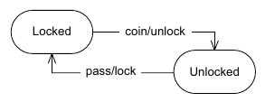
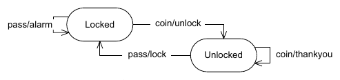
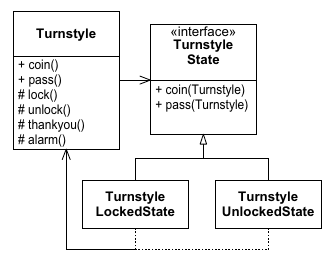
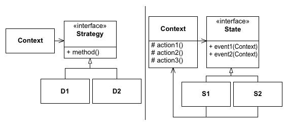
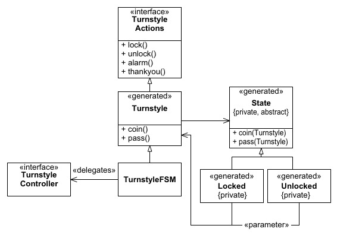
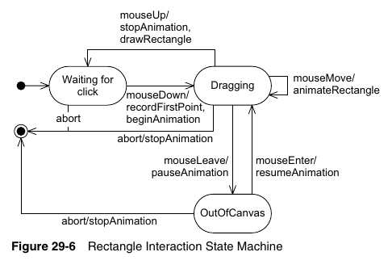
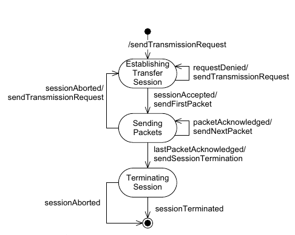

# 29 State

<center></center><br/>

> 一种状态若没有改变的手段，也就没有保持自身的手段。
> <p align="right">——Edmund Burke（1729–1797）</p>

有限状态自动机是软件武器库中有用的抽象之一。
它们为探索和定义复杂系统的行为提供了一种简单而优雅的方式。
它们还提供了一种强大的实现策略，易于理解、易于修改。
我在系统的各个层级都使用它们——从控制高层 GUI¹ 到底层通信协议。
它们几乎无处不在地适用。

¹ 见 [第 462 页](ch30.md) 的 “The Taskmaster Architecture”。

## 有限状态自动机概览

一个简单的有限状态机（FSM）就可以从地铁闸机的运作中找到。
这就是那个控制乘客通过、进入地铁列车的闸门的装置。
Fig 29-1 展示了控制地铁闸机的 FSM 的雏形。
这张图被称为状态转移图（state transition diagram，STD）。²

<br/>
*Fig 29-1 简单闸机 FSM*

² 见 [附录 B](appendix-b.md) 中第 493 页的 “States and Internal Transitions”、第 494 页的 “Transitions between states” 和 “Nested States”。

> 译注：附录 B 尚未翻译，链接暂为悬空。

STD 至少由四部分组成。
那些气泡叫做**状态**。
连接状态的箭头叫做**转移**。
转移上标注着一个事件名，后跟一个动作名。
Fig 29-1 中的 STD 读法如下：

- 如果机器处于 Locked 状态，而我们收到一个 coin 事件，那么我们转移到 Unlocked 状态，并调用 unlock 动作。
- 如果机器处于 Unlocked 状态，而我们收到一个 pass 事件，那么我们转移到 Locked 状态，并调用 lock 动作。

这两个句子完整地描述了 Fig 29-1 中的图。
每个句子都用四个要素描述了一条转移箭头：起始状态、触发转移的事件、结束状态、要执行的动作。
<ins>事实上，这些转移句子可以压缩成一张简单的表，叫做状态转移表（state transition table，STT）。</ins>
它可能长这样：

|       |       |            |          |
|-------|-------|------------|----------|
| Locked | coin  | Unlocked   | unlock   |
| Unlocked | Pass | Locked     | lock     |

这台机器如何工作？
假定 FSM 从 Locked 状态开始它的一生。
一位乘客走到闸机前，投进一枚硬币。
这使得软件收到 coin 事件。
STT 中的第一条转移说：如果我们处于 Locked 状态且收到 coin 事件，就转移到 Unlocked 状态并调用 unlock 动作。
于是，软件把状态改为 Unlocked 并调用 unlock 函数。
乘客随后穿过闸门，使软件检测到 pass 事件。
由于 FSM 现在处于 Unlocked 状态，第二条转移被触发，把机器强制拉回 Locked 状态，并导致 lock 函数被调用。

显然，STD 和 STT 都是对机器行为的简单而优雅的描述。
但同时也是强大的设计工具。
它们带来的好处之一，是设计者可以轻松地发现奇怪且未被处理的情况。
例如，检查 Fig 29-1 中的每个状态，并对它应用两个已知事件。
你会发现，Unlocked 状态中没有处理 coin 事件的转移，Locked 状态中也没有处理 pass 事件的转移。

这些遗漏是严重的逻辑缺陷，也是程序员错误的一个非常常见的来源。
程序员考虑正常流程时，往往比考虑异常可能性时更周密。
STD 或 STT 给了程序员一种简单的方式，检查设计是否在每个状态中处理了每个事件。

我们可以通过添加必要的转移来修复这个 FSM。
新版本展示在 Fig 29-2 中。
在这里我们可以看到：如果乘客在第一枚之后又投了更多硬币，机器保持在 Unlocked 状态，并点亮一盏小小的“谢谢”灯，鼓励乘客继续投币。³
另外，如果乘客在闸门锁着的时候设法穿了过去（也许借助一把大锤），那么 FSM 将保持在 Locked 状态并拉响警报。

³ ；^）

<br/>
*Fig 29-2 覆盖异常事件的闸机 FSM*

## 实现技术

### 嵌套 Switch/Case 语句

实现 FSM 有许多不同的策略。
第一种，也是最直接的，是嵌套的 switch/case 语句。
Listing 29-1 展示了这样的一种实现。

Listing 29-1
Turnstile.java (Nested Switch Case Implementation)

```java
package com.objectmentor.PPP.Patterns.State.turnstile;

public class Turnstile
{
  // States
  public static final int LOCKED = 0;
  public static final int UNLOCKED = 1;

  // Events
  public static final int COIN = 0;
  public static final int PASS = 1;

  /*private*/ int state = LOCKED;

  private TurnstileController turnstileController;

  public Turnstile(TurnstileController action)
  {
    turnstileController = action;
  }

  public void event(int event)
  {
    switch (state)
    {
    case LOCKED:
      switch (event)
      {
      case COIN:
        state = UNLOCKED;
        turnstileController.unlock();
        break;
      case PASS:
        turnstileController.alarm();
        break;
      }
      break;
    case UNLOCKED:
      switch (event)
      {
      case COIN:
        turnstileController.thankyou();
        break;
      case PASS:
        state = LOCKED;
        turnstileController.lock();
        break;
      }
      break;
    }
  }
}
```

嵌套的 switch/case 语句把代码划分成四个互斥的区域，每个区域对应 STD 中的一条转移。
每个区域在需要时改变状态，然后调用相应的动作。
于是，Locked 和 Coin 的区域把状态改为 Unlocked 并调用 unlock。

这段代码有一些有趣的方面，与嵌套 switch/case 语句本身无关。
要理解它们，你需要看我用检查这段代码的单元测试。（见 Listing 29-2 和 29-3。）

Listing 29-2
TurnstileController.java

```java
package com.objectmentor.PPP.Patterns.State.turnstile;

public interface TurnstileController
{
  public void lock();
  public void unlock();
  public void thankyou();
  public void alarm();
}
```

Listing 29-3
TestTurnstile.java

```java
package com.objectmentor.PPP.Patterns.State.turnstile;

import junit.framework.*;
import junit.swingui.TestRunner;

public class TestTurnstile extends TestCase
{
  public static void main(String[] args)
  {
    TestRunner.main(new String[]{"TestTurnstile"});
  }

  public TestTurnstile(String name)
  {
    super(name);
  }

  private Turnstile t;
  private boolean lockCalled = false;
  private boolean unlockCalled = false;
  private boolean thankyouCalled = false;
  private boolean alarmCalled = false;

  public void setUp()
  {
    TurnstileController controllerSpoof = new TurnstileController()
    {
      public void lock() {lockCalled = true;}
      public void unlock() {unlockCalled = true;}
      public void thankyou() {thankyouCalled = true;}
      public void alarm() {alarmCalled = true;}
    };

    t = new Turnstile(controllerSpoof);
  }

  public void testInitialConditions()
  {
    assertEquals(Turnstile.LOCKED, t.state);
  }

  public void testCoinInLockedState()
  {
    t.state = Turnstile.LOCKED;
    t.event(Turnstile.COIN);
    assertEquals(Turnstile.UNLOCKED, t.state);
    assert(unlockCalled);
  }

  public void testCoinInUnlockedState()
  {
    t.state = Turnstile.UNLOCKED;
    t.event(Turnstile.COIN);
    assertEquals(Turnstile.UNLOCKED, t.state);
    assert(thankyouCalled);
  }

  public void testPassInLockedState()
  {
    t.state = Turnstile.LOCKED;
    t.event(Turnstile.PASS);
    assertEquals(Turnstile.LOCKED, t.state);
    assert(alarmCalled);
  }

  public void testPassInUnlockedState()
  {
    t.state = Turnstile.UNLOCKED;
    t.event(Turnstile.PASS);
    assertEquals(Turnstile.LOCKED, t.state);
    assert(lockCalled);
  }
}
```

**包作用域的状态变量。**
注意那四个分别名为 `testCoinInLockedState`、`testCoinInUnlockedState`、`testPassInLockedState` 和 `testPassInUnlockedState` 的测试函数。
这些函数分别测试 FSM 的四个转移。
它们的做法是：先把 `Turnstile` 的 `state` 变量强制设为想要检查的状态，然后调用想要验证的事件。
为了让测试能访问 `state` 变量，它不能是私有的。
于是，我把它设为包作用域，并加了一个注释，表明我的意图是让它为私有。

<ins>对象教条坚持认为：一个类的所有实例变量都应当是私有的。</ins>
我公然无视了这条规则，并因此破坏了 `Turnstile` 的封装。

是吗？

别误会，我更愿意把 `state` 变量保持为私有。
但那样做就会剥夺我的测试代码强制设置其值的能力。
我本可以创建包作用域上适当的 `setState` 和 `getState` 方法，但那似乎很可笑。
我并不想把 `state` 变量暴露给 `TestTurnstile` 之外的任何类，那我为什么要创建暗示包作用域上的任何人都能读写该变量的 setter 和 getter 呢？

Java 一个不幸的弱点，是缺乏类似 C++ `friend` 的概念。
如果 Java 有 `friend` 声明，我就可以把 `state` 保持为私有，并把 `TestTurnstile` 声明为 `Turnstile` 的朋友。
然而，事已至此，我认为把 `state` 放在包作用域、并用注释表明意图，是最佳选择。

**测试动作。**
注意 Listing 29-2 中的 `TurnstileController` 接口。
它的存在，正是为了让 `TestTurnstile` 类能够确保 `Turnstile` 类以正确的顺序调用了正确的动作方法。
没有这个接口，要确保状态机正常工作就要困难得多。

这是测试影响设计的一个例子。
如果我只是在没考虑测试的情况下写出状态机，我大概不会创建 `TurnstileController` 接口。
那将是一件憾事。
`TurnstileController` 接口漂亮地把有限状态机的逻辑与它需要执行的动作解耦了。
另一个使用完全不同逻辑的 FSM，可以完全不受影响地使用 `TurnstileController`。

<ins>编写测试代码以孤立地验证每个单元的需求，迫使我们以一些原本想不到的方式解耦代码。</ins>
于是，可测试性是一种驱动设计走向更低耦合的力量。

**嵌套 Switch/Case 实现的代价与收益。**
对于简单的状态机，嵌套 switch/case 实现既优雅又高效。
所有状态和事件都能在一两页代码中看见。
然而，对于较大的 FSM，情况就不同了。
在一个拥有几十个状态和事件的状态机里，代码会退化成一页又一页的 case 语句。
没有任何便捷的定位手段帮助你看清自己正读到状态机的哪个位置。
维护长长的嵌套 switch/case 语句，可能是一项非常困难且易出错的工作。

嵌套 switch/case 的另一个代价是：有限状态机的逻辑与实现动作的代码之间没有很好的分离。
Listing 29-1 中存在很强的这种分离，因为动作实现在 `TurnstileController` 的一个派生类中。
然而，在我见过的大多数嵌套 switch/case FSM 中，动作的实现都埋藏在 case 语句里。
事实上，在 Listing 29-1 中这样做仍然是可能的。

### 解释转移表

实现 FSM 的一个非常常见的技术，是创建一张描述转移的数据表。
这张表由一个处理事件的引擎来解释。
引擎查找与事件匹配的转移，调用相应的动作，并改变状态。

Listing 29-4 展示了创建转移表的代码，Listing 29-5 展示了转移引擎。
这两个清单都是本章末尾 Listing 29-12 完整实现的片段。

Listing 29-4
Building the turnstile transition table

```java
public Turnstile(TurnstileController action)
{
  turnstileController = action;
  addTransition(LOCKED,   COIN, UNLOCKED, unlock() );
  addTransition(LOCKED,   PASS, LOCKED,   alarm()   );
  addTransition(UNLOCKED, COIN, UNLOCKED, thankyou());
  addTransition(UNLOCKED, PASS, LOCKED,   lock()    );
}
```

Listing 29-5
The transition engine

```java
public void event(int event)
{
  for (int i = 0; i < transitions.size(); i++)
  {
    Transition transition = (Transition) transitions.elementAt(i);
    if (state == transition.currentState && event == transition.event)
    {
      state = transition.newState;
      transition.action.execute();
    }
  }
}
```

**解释转移表的代价与收益。**
一个强大的好处是：构建转移表的代码读起来就像一张规范的 state transition table。
那四个 `addTransaction` 行非常容易理解。
状态机的逻辑都集中在一处，不受动作实现的污染。

与嵌套 switch/case 实现相比，维护这样一个有限状态机非常容易。
要添加一条新转移，只需在 `Turnstile` 构造函数中添加一行新的 `addTransition` 即可。

这种方法的另一个好处是：这张表可以在运行时轻松修改。
这允许动态地改变状态机的逻辑。
我用过类似机制，来允许对复杂有限状态机做热修补。

还有一个好处是：可以创建多张表，每张表代表不同的 FSM 逻辑。
这些表可以在运行时根据起始条件来选择。

这种方法的代价主要在于速度。
搜索转移表需要时间。
对于大型状态机，这段时间可能变得可观。
另一个代价是：为支持这张表必须编写的代码量。
如果你仔细查看 Listing 29-12，会发现相当多的小支持函数，它们的目的是让 Listing 29-4 中状态转移表的表达保持简单。

## STATE 模式⁴

⁴ [GOF95]，第 305 页。

实现有限状态机的另一种技术，是 STATE 模式。
这个模式把嵌套 switch/case 语句的效率与解释转移表的灵活性结合了起来。

Fig 29-3 展示了该解法的结构。
`Turnstile` 类为事件提供公有方法，为动作提供保护方法。
它持有一个名为 `TurnstileState` 的接口的引用。
`TurnstileState` 的两个派生类代表 FSM 的两个状态。

<br/>
*Fig 29-3 闸机的 STATE 模式*

当 `Turnstile` 的两个事件方法之一被调用时，它把该事件委托给 `TurnstileState` 对象。
`TurnstileLockedState` 的方法实现了 LOCKED 状态下的适当动作。
`TurnstileUnlockedState` 的方法实现了 UNLOCKED 状态下的适当动作。
要改变 FSM 的状态，就把 `Turnstile` 对象中的引用赋给这些派生类之一的实例。

Listing 29-6 展示了 `TurnstileState` 接口及其两个派生类。
状态机很容易从那些派生类的四个方法中看出。
例如，`LockedTurnstileState` 的 `coin` 方法告诉 `Turnstile` 对象把状态改为 unlocked 状态，然后调用 `Turnstile` 的 unlock 动作函数。

Listing 29-6
TurnstileState.java

```java
interface TurnstileState
{
  void coin(Turnstile t);
  void pass(Turnstile t);
}

class LockedTurnstileState implements TurnstileState
{
  public void coin(Turnstile t)
  {
    t.setUnlocked();
    t.unlock();
  }

  public void pass(Turnstile t)
  {
    t.alarm();
  }
}

class UnlockedTurnstileState implements TurnstileState
{
  public void coin(Turnstile t)
  {
    t.thankyou();
  }

  public void pass(Turnstile t)
  {
    t.setLocked();
    t.lock();
  }
}
```

`Turnstile` 类展示在 Listing 29-7 中。
注意那些持有 `TurnstileState` 派生类的静态变量。
这些类没有任何变量，因此永远不需要多于一个的实例。
把 `TurnstileState` 派生类的实例放在变量中，省去了每次状态改变都创建新实例的需要。
把这些变量设为静态，则省去了在我们可能需要多于一个 `Turnstile` 实例时、还要为那些派生类创建新实例的需要。

Listing 29-7
Turnstile.java

```java
public class Turnstile
{
  private static TurnstileState lockedState = new LockedTurnstileState();
  private static TurnstileState unlockedState = new UnlockedTurnstileState();

  private TurnstileController turnstileController;
  private TurnstileState state = lockedState;

  public Turnstile(TurnstileController action)
  {
    turnstileController = action;
  }

  public void coin()
  {
    state.coin(this);
  }

  public void pass()
  {
    state.pass(this);
  }

  public void setLocked()
  {
    state = lockedState;
  }

  public void setUnlocked()
  {
    state = unlockedState;
  }

  public boolean isLocked()
  {
    return state == lockedState;
  }

  public boolean isUnlocked()
  {
    return state == unlockedState;
  }

  void thankyou()
  {
    turnstileController.thankyou();
  }

  void alarm()
  {
    turnstileController.alarm();
  }

  void lock()
  {
    turnstileController.lock();
  }

  void unlock()
  {
    turnstileController.unlock();
  }
}
```

**STATE 与 STRATEGY。**
Fig 29-3 中的图强烈地令人想起 STRATEGY⁵ 模式。
两者都有一个上下文类；两者都委托给一个拥有若干派生类的多态基类。
区别在于（见 Fig 29-4）：在 STATE 中，派生类持有一个指回上下文类的引用。
派生类的主要功能，就是通过这个引用来选择并调用上下文类上的方法。
而在 STRATEGY 模式中，不存在这样的约束或意图。
一个 STRATEGY 的派生类不必持有对上下文的引用，也不必调用上下文上的方法。
于是，<ins>所有的 STATE 模式实例都是 STRATEGY 模式实例，但并非所有的 STRATEGY 实例都是 STATE。</ins>

⁵ 见 [第 168 页](ch14.md) 的 “Strategy”。

<br/>
*Fig 29-4 STATE 与 STRATEGY*

**STATE 模式的代价与收益。**
STATE 模式在动作与状态机逻辑之间提供了非常强的分离。
动作实现在 Context 类中，逻辑则分布在 State 类的派生类中。
这使得修改任何一方而不影响另一方变得非常容易。
例如，要重用 Context 类的动作而配上不同的状态逻辑，只需简单地使用 `State` 类的不同派生类即可，这非常容易。
或者，我们可以创建 `Context` 的子类来修改或替换那些动作，而不影响 State 派生类的逻辑。

这种技术的另一个好处是它非常高效。
它大概与嵌套 switch/case 实现的效率相当。
于是，我们获得了表驱动方法的灵活性，同时保有嵌套 switch/case 方法的效率。

这种技术的代价是双重的。
第一，编写 State 派生类充其量是一件乏味的事。
编写一个拥有 20 个状态的状态机，可能令人昏昏欲睡。
第二，逻辑是分布开的。
没有一个地方可以让你一览全貌。
这使得代码难以维护。
这令人想起嵌套 switch/case 方法的晦涩。

## SMC——状态机编译器

编写状态派生类的乏味、以及需要在单一地方表达状态机逻辑的诉求，促使我编写了一个编译器：
它把文本形式的状态转移表翻译成实现 STATE 模式所需的类。
这个编译器是免费的，可以从 http://www.objectmentor.com 下载。

编译器的输入如 Listing 29-8 所示。
语法如下：

```
currentState
{
  event newState action
  ...
}
```

最上面的四行分别描述：状态机的名字、上下文类的名字、初始状态、以及在非法事件发生时将被抛出的异常的名字。

Listing 29-8
Turnstile.sm

```
FSMName Turnstile
Context TurnstileActions
Initial Locked
Exception FSMError
{
    Locked
    {
        coin    Unlocked                unlock
        pass    Locked                  alarm
    }
    Unlocked
    {
        coin        Unlocked         thankyou
        pass        Locked           lock
    }
}
```

要使用这个编译器，你必须编写一个声明动作函数的类。
这个类的名字在 Context 行中指定。
我把它叫作 `TurnstileActions`。（见 Listing 29-9。）

Listing 29-9
TurntstyleActions.java

> 译注：清单标题照录原文（含笔误），类名实为 `TurnstileActions`。

```java
public abstract class TurnstileActions
{
  public void lock() {}
  public void unlock() {}
  public void thankyou() {}
  public void alarm() {}
}
```

编译器生成一个从上下文派生的类。
生成类的名字在 FSMName 行中指定。
我把它叫作 `Turnstile`。

我本可以在 `TurnstileActions` 中实现那些动作函数。
但我更倾向于再写一个从生成类派生的类，并在那里实现动作函数。
Listing 29-10 展示了这样做的方式。

Listing 29-10
TurnstileFSM.java

```java
public class TurnstileFSM extends Turnstile
{
  private TurnstileController controller;
  public TurnstileFSM(TurnstileController controller)
  {
    this.controller = controller;
  }

  public void lock()
  {
    controller.lock();
  }

  public void unlock()
  {
    controller.unlock();
  }

  public void thankyou()
  {
    controller.thankyou();
  }

  public void alarm()
  {
    controller.alarm();
  }
}
```

我们要写的只有这些。
其余由 SMC 生成。
得到的结构如 Fig 29-5 所示。
我们称之为**三层有限状态机（THREE-LEVEL FINITE STATE MACHINE）**。⁶

⁶ [PLoPD1]，第 383 页。

<br/>
*Fig 29-5 三层 FSM*

这三层以非常低的成本提供了最大的灵活性。
我们只需从 `TurnstileActions` 派生，就可以创建许多不同的有限状态机。
我们也只需从 `Turnstile` 派生，就可以用许多不同的方式实现那些动作。

注意，生成的代码与你必须编写的代码完全隔离。
你永远不必修改生成的代码。
你甚至不必看它。
你可以像对待二进制代码一样对待它。

你可以在本章末尾 Listings 部分（Listing 29-13 至 29-15）中看到生成的代码以及这个例子的其他支持代码。

**SMC 方式的 STATE 模式的代价与收益。**
显然，我们已经设法最大化了各种方式的收益。
有限状态机的描述全部集中在一处，非常容易维护。
有限状态机的逻辑与动作的实现被强隔离，使得两者可以互不影响地改变。
解法高效、优雅，且只需最少的编码。

代价在于使用 SMC。
你必须有另一个工具，并且要学习如何使用它。
不过在这种情况下，这个工具的安装和使用都出奇地简单。（见 Listing 29-16 及其前面的段落。）
而且它是免费的！

## 状态机应当用在哪里？

我把状态机（以及 SMC）用于好几类不同的应用。

### GUI 的高层应用策略

20 世纪 80 年代图形革命的目标之一，是为人创建无状态的界面。
彼时，计算机界面被采用分层菜单的文本方式所主导。
人很容易迷失在菜单结构里，不知道自己把屏幕置于了什么状态。
GUI 通过尽量减少屏幕所经历的状态变化来缓解这个问题。
在现代 GUI 中，人们投入大量工作，让常用功能始终出现在屏幕上，并确保用户不会因隐藏状态而困惑。

颇具讽刺意味的是：实现这些“无状态” GUI 的代码，却是强烈地由状态驱动的。
在这类 GUI 中，代码必须弄清哪些菜单项和按钮该置灰、哪些子窗口该出现、哪个标签页该激活、焦点该放在哪里，等等。
所有这些决策都与界面的状态相关。

我很久以前就学到，除非把这些因素组织进一个单一的控制结构，否则控制它们是一场噩梦。
那个控制结构最好被刻画为一个 FSM。
从那些日子起，我几乎一直在使用由 SMC（或它的前身）生成的 FSM 来编写我的 GUI。

考虑 Listing 29-11 中的状态机。
这台机器控制一个应用程序登录部分的 GUI。
收到 start 事件后，机器弹出一个登录屏幕。
一旦用户按下回车键，机器检查口令。
如果口令正确，它进入 loggedIn 状态并启动用户流程（未展示）。
如果口令错误，它显示一个屏幕告知用户其口令错误。
如果用户想再试一次，他按 OK 按钮；否则按 cancel 按钮。
如果连续三次输入错误口令（thirdBadPassword 事件），机器锁定屏幕，直到输入管理员口令。

Listing 29-11
login.sm

```
Initial init
{
  init
  {
    start logginIn displayLoginScreen
  }

  logginIn
  {
    enter checkingPassword checkPassword
    cancel init clearScreen
  }

  checkingPassword
  {
    passwordGood loggedIn startUserProcess
    passwordBad notifyingPasswordBad displayBadPasswordScreen
    thirdBadPassword screenLocked displayLockScreen
  }

  notifyingPasswordBad
  {
    OK checkingPassword displayLoginScreen
    cancel init clearScreen
  }

  screenLocked
  {
    enter checkingAdminPassword checkAdminPassword
  }

  checkingAdminPassword
  {
    passwordGood init clearScreen
    passwordBad screenLocked displayLockScreen
  }
}
```

我们在这里所做的，是把应用的高层策略捕捉进一个状态机。
这个高层策略生活在一处，易于维护。
它大大简化了系统中的其余代码，因为那些代码不再与策略代码混杂在一起。

显然，这种方法可以用于 GUI 之外的界面。
事实上，我也对文本界面和机器对机器界面使用过类似的方法。
但 GUI 往往比那些更复杂，所以它们的需求更大、数量更多。

### GUI 交互控制器

想象你想允许用户在屏幕上画矩形。
他们使用的手势如下：
首先，他们在调色板窗口中点击矩形图标。
然后他们在画布窗口中把鼠标移到矩形的一个角上。
然后他们按下鼠标按钮，把鼠标朝期望的第二个角拖动。
用户拖动的同时，一个潜在矩形的动画形象出现在屏幕上。
用户继续按住鼠标按钮并拖动鼠标，把矩形操纵到期望的形状。
当矩形到位时，用户松开鼠标按钮。
程序于是停止动画，并在屏幕上画出一个固定的矩形。

当然，用户随时可以通过点击调色板上的另一个图标来中止这个操作。
如果用户把鼠标拖出画布窗口，动画就消失。
如果鼠标回到画布窗口，动画重新出现。

最后，画完一个矩形后，用户只需在画布窗口中再次点击并拖动，就能画另一个。
没有必要再点击调色板上的矩形图标。

我这里描述的，正是一个有限状态机。
它的状态转移图出现在 Fig 29-6 中。
带箭头的实心圆表示状态机的起始状态。⁷
带空心圆的实心圆是机器的终止状态。

⁷ 见 [附录 B](appendix-b.md) 中第 493 页的 “States and Internal Transitions”。

> 译注：附录 B 尚未翻译，链接暂为悬空。

GUI 交互中满是有限状态机。
它们由来自用户的传入事件驱动。
那些事件引起交互状态的变化。

### 分布式处理

分布式处理是另一种系统状态依据传入事件而变化的情形。
例如，假设你必须把一大块信息从网络上的一个节点传到另一个节点。
再假设网络响应时间十分宝贵，所以你需要把大块切碎，作为一组小数据包发送。

描绘这一场景的状态机展示在 Fig 29-7 中。
它从请求一个传输会话开始，继而逐个发送数据包并等待确认，最后以终止会话结束。

<br/>
*Fig 29-6 矩形交互状态机*

<br/>
*Fig 29-7 用许多数据包发送大块*

## 结论

有限状态机被大大地低估了。
有许多场景，使用它有助于创建更清晰、更简单、更灵活、更准确的代码。
利用 STATE 模式以及从状态转移表生成代码的简单工具，可以给你很大的帮助。

## Listings

**Turnstile.java：使用表解释**

这个清单展示如何通过解释一个转移数据结构向量来实现有限状态机。
它与 Listing 29-2 的 `TurnstileController` 和 Listing 29-3 的 `TurnstileTest` 完全兼容。

Listing 29-12
Turnstile.java using table interpretation

```java
import java.util.Vector;

public class Turnstile
{
  // States
  public static final int LOCKED = 0;
  public static final int UNLOCKED = 1;

  // Events
  public static final int COIN = 0;
  public static final int PASS = 1;

  /*private*/ int state = LOCKED;
  private TurnstileController turnstileController;
  private Vector transitions = new Vector();

  private interface Action
  {
    void execute();
  }

  private class Transition
  {
    public Transition(int currentState, int event,
                      int newState, Action action)
    {
      this.currentState = currentState;
      this.event = event;
      this.newState = newState;
      this.action = action;
    }

    int currentState;
    int event;
    int newState;
    Action action;
  }

  public Turnstile(TurnstileController action)
  {
    turnstileController = action;
    addTransition(LOCKED,   COIN, UNLOCKED, unlock() );
    addTransition(LOCKED,   PASS, LOCKED,   alarm()   );
    addTransition(UNLOCKED, COIN, UNLOCKED, thankyou());
    addTransition(UNLOCKED, PASS, LOCKED,   lock()    );
  }

  private void addTransition(int currentState, int event,
                             int newState, Action action)
  {
    transitions.add(
      new Transition(currentState, event, newState, action));
  }

  private Action lock()
  {
    return new Action(){public void execute(){doLock();}};
  }

  private Action thankyou()
  {
    return new Action(){public void execute(){doThankyou();}};
  }

  private Action alarm()
  {
    return new Action(){public void execute(){doAlarm();}};
  }

  private Action unlock()
  {
    return new Action(){public void execute(){doUnlock();}};
  }

  private void doUnlock()
  {
    turnstileController.unlock();
  }

  private void doLock()
  {
    turnstileController.lock();
  }

  private void doAlarm()
  {
    turnstileController.alarm();
  }

  private void doThankyou()
  {
    turnstileController.thankyou();
  }

  public void event(int event)
  {
    for (int i = 0; i < transitions.size(); i++)
    {
      Transition transition = (Transition) transitions.elementAt(i);
      if (state == transition.currentState && event == transition.event)
      {
        state = transition.newState;
        transition.action.execute();
      }
    }
  }

}
```

**由 SMC 生成的 Turnstile.java 及其他支持文件**

> 译注：原文此处作 “Listings 31-13 through 31-16”，疑为 29-13 至 29-16 之笔误。

Listing 29-13 至 29-16 补全了闸机 SMC 例子的代码。
`Turnstile.java` 由 SMC 生成。生成器会弄出一点残渣，但代码不算糟糕。

Listing 29-13
Turnstile.java (generated by SMC)

```java
//----------------------------------------------
//
// FSM:       Turnstile
// Context:   TurnstileActions
// Exception: FSMError
// Version:
// Generated: Thursday 09/06/2001 at 12:23:59 CDT
//
//----------------------------------------------

//----------------------------------------------
//
// class Turnstile
//     This is the Finite State Machine class
//
public class Turnstile extends TurnstileActions
{
  private State itsState;
  private static String itsVersion = "";

  // instance variables for each state
  private static Locked itsLockedState;
  private static Unlocked itsUnlockedState;

  // constructor
  public Turnstile()
  {
    itsLockedState = new Locked();
    itsUnlockedState = new Unlocked();
    itsState = itsLockedState;

    // Entry functions for: Locked
  }

  // accessor functions

  public String getVersion()
  {
    return itsVersion;
  }

  public String getCurrentStateName()
  {
    return itsState.stateName();
  }

  // event functions - forward to the current State

  public void pass() throws FSMError
  {
    itsState.pass();
  }

  public void coin() throws FSMError
  {
    itsState.coin();
  }

  //--------------------------------------------
  //
  // private class State
  //     This is the base State class
  //
  private abstract class State
  {
    public abstract String stateName();

    // default event functions

    public void pass() throws FSMError
    {
      throw new FSMError( "pass", itsState.stateName());
    }

    public void coin() throws FSMError
    {
      throw new FSMError( "coin", itsState.stateName());
    }

  }

  //--------------------------------------------
  //
  // class Locked
  //     handles the Locked State and its events
  //
  private class Locked extends State
  {
    public String stateName()
      { return "Locked"; }

    //
    // responds to coin event
    //
    public void coin()
    {
      unlock();
      // change the state
      itsState = itsUnlockedState;
    }

    //
    // responds to pass event
    //
    public void pass()
    {
      alarm();
      // change the state
      itsState = itsLockedState;
    }
  }
  //--------------------------------------------
  //
  // class Unlocked
  //     handles the Unlocked State and its events
  //
  private class Unlocked extends State
  {
    public String stateName()
      { return "Unlocked"; }
    //
    // responds to pass event
    //
    public void pass()
    {
      lock();
      // change the state
      itsState = itsLockedState;
    }
    //
    // responds to coin event
    //
    public void coin()
    {
      thankyou();
      // change the state
      itsState = itsUnlockedState;
    }
  }
}
```

`FSMError` 是我们告诉 SMC 在出现非法事件时要抛出的异常。
闸机例子太简单了，不可能出现非法事件，所以这个异常是无用的。
然而，在较大的状态机中，会有某些事件不应出现在某些状态中。
那些转移从不出现在 SMC 的输入里。
于是，如果那样的事件真的发生了，生成的代码就会抛出该异常。

Listing 29-14
FSMError.java

```java
public class FSMError extends Exception
{
  public FSMError(String event, String state)
  {
    super("Invalid event:" + event + " in state:" + state);
  }
}
```

SMC 生成状态机的测试代码，与我们在本章写过的所有其他测试程序非常相似。
有一些细微差别。

Listing 29-15
SMCTurnstileTest.java

```java
import junit.framework.*;
import junit.swingui.TestRunner;

public class SMCTurnstileTest extends TestCase
{
  public static void main(String[] args)
  {
    TestRunner.main(new String[]{"SMCTurnstileTest"});
  }

  public SMCTurnstileTest(String name)
  {
    super(name);
  }

  private TurnstileFSM t;
  private boolean lockCalled = false;
  private boolean unlockCalled = false;
  private boolean thankyouCalled = false;
  private boolean alarmCalled = false;

  public void setUp()
  {
    TurnstileController controllerSpoof =
      new TurnstileController()
    {
      public void lock() {lockCalled = true;}
      public void unlock() {unlockCalled = true;}
      public void thankyou() {thankyouCalled = true;}
      public void alarm() {alarmCalled = true;}
    };
    t = new TurnstileFSM(controllerSpoof);
  }

  public void testInitialConditions()
  {
    assertEquals("Locked", t.getCurrentStateName());
  }

  public void testCoinInLockedState() throws Exception
  {
    t.coin();
    assertEquals("Unlocked", t.getCurrentStateName());
    assert(unlockCalled);
  }

  public void testCoinInUnlockedState() throws Exception
  {
    t.coin(); // put in Unlocked state
    t.coin();
    assertEquals("Unlocked", t.getCurrentStateName());
    assert(thankyouCalled);
  }

  public void testPassInLockedState() throws Exception
  {
    t.pass();
    assertEquals("Locked", t.getCurrentStateName());
    assert(alarmCalled);
  }

  public void testPassInUnlockedState() throws Exception
  {
    t.coin(); // unlock
    t.pass();
    assertEquals("Locked", t.getCurrentStateName());
    assert(lockCalled);
  }
}
```

`TurnstileController` 类与本章出现过的其他所有类完全相同。
你可以在 Listing 29-2 中看到它。

用来生成 `Turnstile.java` 代码的 ant 文件展示在 Listing 29-16 中。
注意，它没什么大不了的。
事实上，如果你只想在一个 DOS 窗口里敲入构建命令，你可以敲：

```
java smc.Smc -f TurnstileFSM.sm
```

Listing 29-16
build.xml

```xml
<project name="SMCTurnstile" default="TestSMCTurnstile" basedir=".">

  <property environment="env" />

  <path id="classpath">
    <pathelement path="${env.CLASSPATH}"/>
  </path>

  <target name="TurnstileFSM">
    <java classname="smc.Smc">
      <arg value="-f TurnstileFSM.sm"/>
      <classpath refid="classpath" />
    </java>
  </target>

</project>
```

## 参考文献

1. Gamma, et al. Design Patterns. Reading, MA: Addison–Wesley, 1995.
2. Coplien and Schmidt. Pattern Languages of Program Design. Reading, MA: Addison–Wesley, 1995.
