# 30 The ETS Framework
<!-- markdownlint-disable MD033 -->
<!-- markdownlint-disable MD045 -->
<center>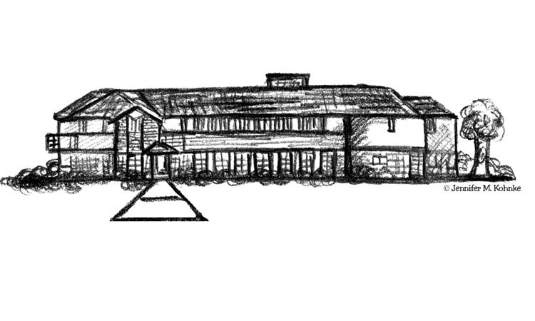</center><br/>

> 本章与 James Newkirk 合作撰写

本章描述一个重要的软件项目：它从 1993 年 3 月一直开发到 1997 年底。
这套软件由教育测验服务（ETS）委托，由我们两人以及 Object Mentor, Inc.（OMI）的几位其他开发者共同开发。

本章的关注点是：产生一个可复用框架的技术——包括技术层面与管理层面。
创建这样一个框架，是项目成功的关键一步，它的设计和开发历程应该颇具教益。

没有哪个软件项目是在完美环境中开发的，这个项目也不例外。
要理解设计的技术方面，理解环境问题同样重要。
因此，在深入项目的软件工程方面之前，我们先交代一点项目及其开发环境的背景。

## 引言

### 项目概览

要在美国或加拿大成为一名持牌建筑师，你必须通过一场考试。
如果你通过，州执照委员会将颁发给你一份从事建筑职业的执照。
这场考试是由教育测验服务（ETS）依据国家建筑执照委员会（NCARB）的章程开发的，目前由考斯集团国际（Chauncey Group International）负责组织。

考试由九个部分组成，跨越数天进行。
在考试的三个图形部分中，考生被要求在一个类似 CAD 的环境中，通过绘制或放置对象来创建解。
例如，他们可能会被要求：

- 为某一种建筑绘制楼层平面图
- 设计一个屋顶，扣在一栋既有建筑上
- 把一栋拟建建筑放到一块地块上，并设计服务该建筑的停车区、道路系统和步道系统

过去，考生对这些问题的解是用铅笔和纸画出来的。
这些图纸随后交给一组评审员评分。
评审员是经验极其丰富的建筑师，他们会仔细研读考生的解，并决定让考生通过还是不及格。

1989 年，NCARB 委托 ETS 研究：能否开发一个自动化系统来交付并评分考试的图形部分。
到 1992 年，ETS 和 NCARB 已一致认为这样的系统确实可行。
而且，由于需求不断变化，他们觉得面向对象的途径是合适的。
于是他们联系了 Object Mentor, Inc.（OMI）帮忙做设计。

1993 年 3 月，OMI 获授一份合同，负责生产考试的一部分。
一年后，在成功完成那一部分之后，OMI 获授第二份合同，负责生产其余的大部分。

**程序结构。**
ETS 决定的结构相当优雅。
图形考试被拆分成 15 个不同的问题，叫做**小场景（vignette）**。
每个小场景测试一块特定的知识领域。
一个可能测试考生对屋顶设计的理解，另一个可能测试他们对楼层平面图设计方法的理解。

每个小场景进一步细分为两个部分。
“交付”部分是一个图形用户界面，考生在上面“绘制”手头问题的解。
“评分”部分读取由交付部分创建的解，并为之评分。
交付在方便考生的地点进行。
解随后被传输到一个中心地点，在那里评分。

**脚本。**
虽然只有 15 个小场景，但每个都有许多可能的“**脚本（script）**”。
脚本规定了考生要解决的问题的确切性质。
例如，楼层平面图小场景可能有这样一个脚本：要求考生设计一个图书馆；另一个则要求考生设计一个杂货店。
于是，小场景程序必须以通用方式编写。
它们的交付和评分必须由脚本来规定。

**平台。**
交付程序和评分程序都必须在 Windows 3.1 下运行（后来升级到 W95/NT）。
程序要用 C++ 编写，并使用面向对象技术。

**第一份合同。**
1993 年 3 月，OMI 获授一份合同，开发所有小场景中最复杂的“Building Design（建筑设计）”的交付和评分。
这个决定的动机来自 Booch 的建议：先开发风险最高的元素，以此管理风险，并校准团队的估算过程。

**Building Design。**
Building Design 要测试考生设计一栋相对简单的两层建筑楼层平面图的能力。
考生会得到一栋要设计的建筑，连同完整的需求和约束。
然后考生使用交付程序，把房间、门、窗、走廊、楼梯和电梯放进自己的解中。

评分程序随后将把解与大量“**特性（feature）**”核对，这些特性用来评估考生的知识。
这些特性的具体性质是保密的，但一般地说，它们评估的事情包括：

- 建筑是否满足客户的需求？
- 建筑是否符合建筑规范？
- 考生是否展示了设计逻辑？
- 建筑及其房间在地块上的朝向是否正确？

### 早期历史 1993–1994

在这个早期阶段，我们两人（Martin 和 Newkirk）是这个项目仅有的开发者。
我们与 ETS 的合同要求我们生产 Building Design 的交付程序和评分程序。
但我们还想同时开发一个可复用框架，与 Building Design 一起建设。

到 1997 年，必须有 15 个小场景的交付程序和评分程序投入运行。
我们有四年时间。
我们觉得，一个可复用框架将让我们朝这个目标迈出一大步。
这样的框架也将大大有助于帮助我们管理小场景的一致性和质量。
毕竟，我们不想让不同小场景中的相似功能以微妙不同的方式运作。

于是，1993 年 3 月，我们着手生产 Building Design 的两个组件，以及一个能被其余十四个小场景复用的框架。

**成功。**
1993 年 9 月，交付程序和评分程序的首个版本完成，我们向 NCARB 和 ETS 的代表演示了这些程序。
演示反响很好，一次现场试验安排在 1994 年 1 月。

与大多数项目一样，一旦用户看到程序实际运行，他们就意识到自己要求的并不是真正想要的。
我们在整个 1993 年每周向 ETS 发送小场景的中间版本，直到 9 月那次演示前，已经做了大量变更和增强。

演示之后，迫在眉睫的现场试验使变更和增强的速率达到了洪水般的地步。
我们两人被占得满负荷，全职制作并测试这些变更，为现场试验准备程序。

Building Design 规格的这种翻腾，又被现场试验的结果进一步加速，让我们在整个 1994 年第一季度更加忙碌。

1993 年 12 月，开始为建造其余小场景的合同进行谈判。
谈判花了三个月才结束。
1994 年 3 月，ETS 授予 OMI 一份合同，生产一个框架和另外 10 个小场景。
ETS 自己的工程师将基于我们的框架生产其余 5 个小场景。

### Framework？（框架？）

1993 年底，Building Design 翻腾得最厉害的时候，我们中的一人（Newkirk）花了一周时间，与 ETS 的一位工程师一起，为他即将参与合同的那份工做预备。
目标是演示：那个 6 万行可复用 C++ 框架中的代码，如何被复用来建造其他小场景。
然而，事情进展得并不好。
到周末，已经很清楚：复用这个框架的唯一办法，是把它源代码的碎片剪切粘贴进新的小场景。
显然，这不是一个好选项。

事后看来，我们没能创建一个可用框架，有两个原因。
第一，我们一直专注于 Building Design，而忽略了其他所有小场景。
第二，我们经历了数月的需求翻腾和进度压力。
这两件事合在一起，让那些只属于 Building Design 的概念渗进了框架。

<ins>在某种程度上，我们天真地想当然，认为面向对象技术的好处是现成的。</ins>
我们觉得，通过使用 C++ 并做仔细的对象设计，创建一个可复用框架应该轻而易举。
我们错了。
我们发现了一件多年来的常识——构建可复用框架很难。

### Framework！（框架！）

1994 年 3 月，新合同签署后，我们为项目增加了两位工程师，并开始开发新的小场景。
我们仍然相信需要一个框架，并且确信手头这个东西无法充当那个角色。
显然，我们需要改变策略。

**1994 年的团队**

- Robert C. Martin，架构师兼首席设计者，20 余年经验
- James W. Newkirk，设计者兼项目负责人，15 余年经验
- Bhama Rao，设计者兼程序员，12 余年经验
- William Mitchell，设计者兼程序员，15 余年经验

**期限**

期限由一个事实设定：考试必须在 1997 年投入生产。
候选人在二月受考，五月评分。
这是一个硬性要求。

**策略**

为了赶上那个进度、并确保程序的质量和一致性可控，我们为框架的构建采用了一个新策略。
原来那个 6 万行框架的一部分被保留下来，但大部分被废弃。

**一个被否决的替代方案。**
一个选项是：尝试先行重新设计框架，并在任何小场景开工之前把它做完。
事实上，许多人会把这种做法认同为架构驱动（architecture-driven）的进路。
然而，我们没有选择这个选项，因为它会迫使我们生产大量无法在可工作的小场景内部测试的框架代码。
我们不相信自己能够完全预见小场景的需求。
简言之，我们觉得架构需要几乎立即被放进可工作的小场景中去验证。
我们不想靠猜。

Rebecca Wirfs–Brock 曾说过：“在你能比较有把握地说自己为某个领域构建了正确的架构之前，你必须针对一个框架至少构建三个（然后扔掉）应用程序。”²

² [BOOCH-OS]，第 275 页。

在没能产出框架之后，我们的感受与此类似。
于是，我们决定让框架与几个新小场景的开发并行推进。
这样，我们可以比较各小场景的相似功能，并以通用、可复用的方式设计那些功能。

四个小场景并行开工。
随着它们被开发，人们发现某些部分彼此相似。
于是这些部分被重构成更通用的形态，再重新装进所有三个小场景。
<ins>于是，除非某个东西已经在至少四个小场景中被成功复用，否则它不会进入框架。</ins>

另外，Building Design 中的部分代码也以类似方式被切出并重构。
一旦这些部分在所有三个小场景中正常工作，它们就被放进框架。

被添加到框架的常见功能包括：

- UI 屏幕的结构——消息窗口、绘制窗口、按钮面板等。
- 创建、移动、调整、识别和删除图形元素
- 缩放和滚动
- 绘制简单的草图元素，如直线、圆和多折线
- 小场景计时和自动中止
- 保存和恢复解文件，包括错误恢复
- 许多几何元素的数学模型：线、射线、线段、点、盒、圆、圆弧、三角形、多边形等。
这些模型包含诸如 Intersection、Area、IsPointIn、IsPointOn 之类的方法
- 单个评分特性的评估与加权

在接下来的八个月里，框架增长到大约 6 万行 C++ 代码，代表着略多于一个人年的直接投入。
但这个框架正在被四个不同的小场景复用。

### 成果

**扔掉一个。**
旧的 Building Design 我们怎么办？
随着框架长大、新小场景成功复用它，Building Design 越来越像一个局外人。
它与其他所有小场景都不同，将不得不用另外的方式维护和演化。
尽管 Building Design 代表了一年多的人年投入，我们决定毫不留情，把旧版本整个扔掉。
我们承诺在项目的后期重新设计和重新实现它。

**漫长的初期开发时间。**
框架策略的一个负面结果，是首批小场景相对漫长的开发时间。
前四个小场景的交付程序花了将近四个人年来开发。

**复用效率。**
初始小场景完成后，框架富集了 6 万行 C++ 代码，而小场景交付程序小得惊人。
每个程序大约有 4,000 行样板代码（即每个小场景都相同的代码）。
每个程序还有平均 6,000 行应用特定代码。
最小的一个场景只有 500 行应用特定代码，最大的有 12,000 行。
我们觉得非常了不起：平均而言，每个小场景中近六分之五的代码取自框架。
这些程序中的代码只有十分之一是独有的。

**开发生产率。**
前四个小场景之后，开发时间急剧下降。
又七个交付程序（包括 Building Design 的重写）在 18 人个月内完成。
这些新场景的行数比例与前四个大致相同。

而且，Building Design 程序第一次写花了我们一年多的人年，有了框架之后从头重写只花了 2.5 人月。
这几乎是 6:1 的生产率提升。

看待这些成果的另一种方式：前五个小场景（包括 Building Design）各需一个人年的投入。
此后的每个小场景则只需 2.6 人月——提升了近 400%。

**每周交付。**
从项目一开始，并在整个活跃开发期内，我们每周向 ETS 交付中间版本。
ETS 测试和评估这些版本，然后把变更清单发给我们。
我们估算这些变更，然后与 ETS 一起安排它们交付的那一周。
困难的变更、或重要性低的变更，经常被让位于高优先级变更而推迟。
于是，ETS 始终掌控着项目和进度。

**强健而灵活的设计。**
这个项目最令人满意的一个方面，是架构和框架经受住了需求变更的剧烈动荡。
在开发高峰期，几乎没有哪一周不是带着长长一份变更与修复清单。
其中一些变更是对 bug 的响应，但更多是由于实际需求的变化。
然而，<ins>在重度开发中的种种修改、拨弄和微调里，“软件的设计没有散架”。</ins>³

³ Pete Brittingham，NCARB 项目经理，ETS。

**最终结果。**
到 1997 年 2 月，建筑候选人开始使用交付程序参加他们的注册考试。
到 1997 年 5 月，他们的结果开始被评分。
系统从那以后一直运转至今，运行良好。
如今，北美每一位建筑候选人都用这套软件参加这场考试。

## 框架设计

### 评分应用的共同需求

考虑如何测试一个人的知识与技能这个问题。
ETS 为 NCARB 项目采用的方案相当繁复。
我们可以用一个简单的虚构例子来演示它——一个基础数学测试。

在我们的基础数学测试中，学生面对 100 道数学题，从简单的加减法，到大的乘法题和长除法题。
我们检查他们对这些题的作答，以判断他们在基础数学上的能力与技巧。
我们的目标是给他们一个 pass/fail（通过/不通过）的等级。“Pass” 意味着我们确信他们已经掌握了基础数学所需的根本知识与技能。
“Fail”意味着我们确信他们没有掌握。
在我们不能确定的那些情况，我们返回 “indeterminate”（不能确定） 的分数。

但我们还有另一个目标。
我们想能够列举出学生的强项和弱项。
我们想把基础数学这个主题切分成子主题，然后对每个子主题评估学生。

例如，考虑一个学错了乘法口诀的人。
也许他总是把 7 × 8 当成 42。
这个人会在很大比例的乘除法题上答错。
那个学生当然该挂科。
但另一方面，假如他其他一切都做对了！
他在长乘法中正确地构造了部分积，在长除法中正确地构造了算式。
事实上，他唯一的错误就是 7 × 8 = 42。
我们当然希望知道这一点。
事实上，既然对这种学生的纠正措施如此简单，我们很可能愿意给他一个通过的等级，外加一些纠正性指导。

那么，我们如何构造测试的评分，来确定学生在基础数学的哪些领域已经习得专长、哪些领域还没有？
考虑 Fig 30-1 中的图。
图中的矩形表示我们想要测试的专长领域。
连线表示一种层次依赖。
于是，基础数学的知识依赖于术语（terms）和因子（factors）的知识。
术语的知识依赖于加法口诀的知识，以及加减法机制的知识。
加法的知识依赖于加法交换律和结合律的知识，以及进位（carrying）机制的知识。

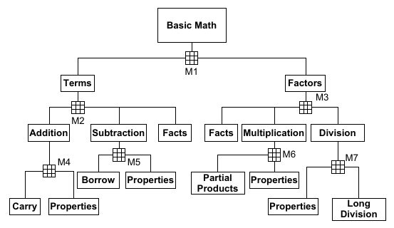<br/>
*Fig 30-1 基础数学的特性层次*

叶子矩形被称为“**特性（feature）**”。
特性是可以被评估、并被赋予可接受（A）、不可接受（U）或不能确定（I）值的知识单元。
于是，给定我们的 100 道题和学生的答案，我们想把每个特性应用到每道题上并确定一个分数。
就 “Carry”（进位）特性而言，我们会查看每道加法题，并将其与学生答案比对。
如果学生做对了所有加法题，“Carry” 特性的结果当然就是 ‘A’。
然而，对学生做错的每道加法题，我们都会试着判断所犯的错误是不是进位错误。
我们可能尝试不同的进位错误组合，看其中某个错误是否会导出学生给出的答案。
如果我们能以很高的概率断定发生了进位错误，我们就会相应地调整 carry 特性的分数。
最终，carry 特性返回的分数，将是一个基于“可归因于进位错误的错误答案总数”的统计结果。

如果例如学生做错了一半的加法题，且其中大多数可归因于进位错误，我们当然会为 carry 特性返回 ‘U’。
反之，如果只有四分之一的错误可归因于进位错误，我们可能返回 ‘I’。

最终，所有特性都以这种方式被评估。
每个特性检查测试答案，为该特定特性发展出一个分数。
各个特性的分数，构成了对学生基础数学知识的一个分析。

下一步，是从这个分析中导出一个最终等级。
为此，我们使用权重和矩阵，把特性的分数沿层次向上合并。
注意 Fig 30-1 中，在层次的各层之间的接合处有矩阵图标。
矩阵为来自每个特性的分数关联一个加权因子，然后为该层次层的分数提供一个映射。
例如，紧接在 Addition 节点之下的那个矩阵，将确定施加于 Carry 分数和 Properties 分数的权重，并描述如何生成 Addition 的总分数。

Fig 30-2 展示了这些矩阵中一个的形状。
Carry 的输入被认为比 Properties 的输入更重要，所以它被赋予两倍权重。
加权后的分数被相加，结果再应用到矩阵上。

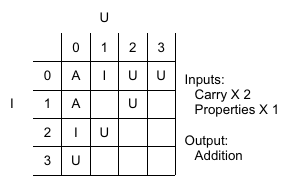<br/>
*Fig 30-2 Addition 矩阵*

例如，假设 Carry 的分数是 ‘I’，Properties 的分数是 ‘A’。
没有 ‘U’ 分数，所以我们使用矩阵最左的一列。
加权后的 ‘I’ 分数是 2，所以我们使用矩阵的第三行，得到结果 ‘I’。
注意矩阵中有空格。
这些是不可能出现的状况。
给当前的权重，没有任何分数组合会选中矩阵中的空单元。

这套权重与矩阵的方案，在层次的每一层重复，直到导出一个最终分数。
于是，最终分数是各个特性分数的合并与再合并。
层次的结构使 ETS 的心理测量师们能够进行非常精确的调谐。

### 评分框架的设计

Fig 30-3 展示了评分框架的静态结构。
这个结构可以分成两个主要部分。
右边用独特字体显示的三个类不属于框架。
它们代表必须为每个特定评分应用编写的类。
Fig 30-3 中的其余类都是框架类，为所有评分应用共有。

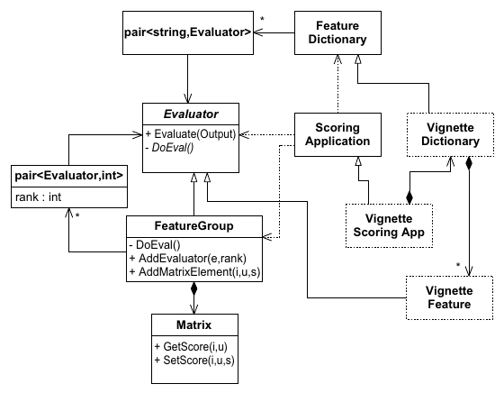<br/>
*Fig 30-3 评分框架*

评分框架中最重要的类是 `Evaluator`。
这是一个抽象类，代表评分树的叶子节点和矩阵节点。
当想要评分树中某个节点的分数时，`Evaluate(ostream&)` 函数被调用。
这个函数运用 TEMPLATE METHOD⁴ 模式，为把分数记录到输出设备提供了一个标准方法。

⁴ [GOF95]，第 325 页。

Listing 30-1
Evaluator

```java
class Evaluator
{
public:
  enum Score {A,I,U,F,X};
  Evaluator();
  virtual ~Evaluator();

  Score Evaluate(ostream& scoreOutput);
  void SetName(const String& theName) {itsName = theName;}
  const String& GetName() {return itsName;}

private:
  virtual Score DoEval() = 0;
  String itsName;
};
```

见 Listing 30-1 和 30-2。
`Evaluate()` 函数调用一个私有的纯虚函数 `DoEval()`。
这个函数将被重写，以对评分树节点执行实际的评估。
它返回分数，并让 `Evaluate()` 以标准形式输出它。

Listing 30-2
Evaluator::Evaluate

```java
Evaluator::Score Evaluator::Evaluate(ostream& o)
{
  static char scoreName[] = {‘A’, ’I’, ’U’, ’F’, ’X’};
  o << itsName << “:”;
  score = DoEval();
  o << scoreName[score] << endl;
  return score;
}
```

> 译注：原书清单中的引号使用了排版弯引号（`‘ ’ “ ”`），照录原文；`score` 变量未在本清单中声明，同样照录。

评分树的叶子节点由 Fig 30-3 中的 `VignetteFeature` 类表示。
实际上，每个评分应用中都会有几十个这样的类。
每个类都会重写 `DoEval()`，来计算其特定评分特性的分数。

评分树的矩阵节点由 Fig 30-3 中的 `FeatureGroup` 类表示。
Listing 30-3 展示了这个类的样子。
有两个函数协助创建 `FeatureGroup` 对象：第一个是 `AddEvaluator`，第二个是 `AddMatrixElement`。

Listing 30-3
FeatureGroup

```java
class FeatureGroup : public Evaluator
{
public:
  FeatureGroup(const RWCString& name);
  virtual ~FeatureGroup();
  void AddEvaluator(Evaluator* e , int rank);
  void AddMatrixElement(int i, int u, Score s);
private:
  Evaluator::Score DoEval();
  Matrix itsMatrix;
  vector<pair<Evaluator*,int> > itsEvaluators;
};
```

`AddEvaluator` 函数允许子节点被添加进 `FeatureGroup`。
例如，回到 Fig 30-1，Addition 节点将是一个 `FeatureGroup`，
我们会调用两次 `AddEvaluator`，把 Carry 和 Properties 节点装入其中。
`AddEvaluator` 函数允许指定评估者的秩（rank）。
秩是施加于从评估者输出的分数之上的乘数。
于是，当我们调用 `AddEvaluator` 把 Carry 加进 Addition 的 `FeatureGroup` 时，
我们会指定秩为 2，因为 Carry 特性的权重是 Properties 特性的两倍。

`AddMatrixElement` 函数往矩阵中添加一个单元。
每个需要填充的单元都必须调用它一次。
例如，Fig 30-2 中的矩阵将使用 Listing 30-4 中的调用序列创建。

Listing 30-4
创建 Addition 矩阵

```java
addition.AddMatrixElement(0,0,Evaluator::A);
addition.AddMatrixElement(0,1,Evaluator::I);
addition.AddMatrixElement(0,2,Evaluator::U);
addition.AddMatrixElement(0,3,Evaluator::U);
addition.AddMatrixElement(1,0,Evaluator::A);
addition.AddMatrixElement(1,2,Evaluator::U);
addition.AddMatrixElement(2,0,Evaluator::I);
addition.AddMatrixElement(2,1,Evaluator::U);
addition.AddMatrixElement(3,0,Evaluator::U);
```

`DoEval` 函数只是遍历评估者列表，把它们的分数乘以秩，并把乘积加到 I 分数和 U 分数各自对应的累加器上。
完成后，它用这两个累加器作为矩阵下标，取出最终分数。（见 Listing 30-5。）

Listing 30-5
FeatureGroup::DoEval

```java
Evaluator::Score FeatureGroup::DoEval()
{
  int sumU, sumI;
  sumU = sumI = 0;
  Evaluator::Score s, rtnScore;
  Vector<Pair<Evaluator*, int> >::iterator ei;
  ei = itsEvaluators.begin()

  for(; ei != itsEvaluators.end(); ei++)
  {
    Evaluator* e = (*ei).first;
    int rank = (*ei).second;
    s = e.Evaluate(outputStream);
    switch(s)
    {
    case I:
      sumI += rank;
    break;
    case U:
      sumU += rank;
    break;
    }
  } // for ei
  rtnScore = itsMatrix.GetScore( sumI, sumU );
  return rtnScore;
}
```

> 译注：原书清单中 `ei = itsEvaluators.begin()` 一行缺少分号，`case` 分支缺少 `break` 后的空行节奏亦与常规不同，均照录原文。

还剩最后一个问题。
评分树是如何构建的？
显然，ETS 的心理测量师们会希望有能力在不改动实际应用的前提下，改变树的拓扑和权重。
于是评分树由 `VignetteScoringApp` 类构建。（见 Fig 30-3。）

每个评分应用都拥有这个类自己的实现。
这个类的职责之一是构建 `FeatureDictionary` 类的一个派生类。
这个类包含一个字符串到 `Evaluator` 指针的映射。

当评分应用启动时，评分框架取得控制。
它调用 `ScoringApplication` 类中的方法，使适当的 `FeatureDictionary` 派生类被创建。
然后它读取一个描述评分树拓扑和权重的特殊文本文件。
这个文本文件使用特殊名字来标识特性。
这些名字就是在 `FeatureDictionary` 中关联到相应 `Evaluator` 指针的名字。

于是，以最简单的形式说，一个评分应用不过就是一组特性，加上一个构造 `FeatureDictionary` 的方法。
评分树的构建和评估由框架处理，因此为所有评分应用所共有。

## TEMPLATE METHOD 的一个案例

一个小场景测试候选人布置类似图书馆或警察局这样的建筑楼层平面图的能力。
在这个小场景中，考生必须绘制房间、走廊、门、窗、墙洞、楼梯、电梯等。
程序把绘制转换成一个评分程序可以解释的数据结构。
对象模型看起来像 Fig 30-4。

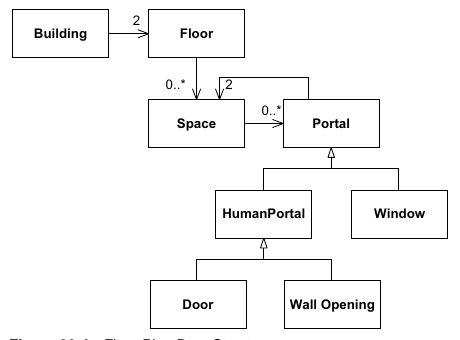<br/>
*Fig 30-4 楼层平面图数据结构*

别误会。
这个数据结构中的对象功能极其有限。
它们在任何意义上都不是多态对象。
相反，它们是简单的数据载体——一个纯粹的表现模型。

一栋建筑由两层楼组成。
每层有许多空间（space）。
每个空间包含许多门户（portal），每个门户分隔两个空间。
门户可以是窗，也可以供人通行。
供人通行的门户要么是墙洞，要么是门。

评分通过检查解的一系列特性来进行。
特性是这样的东西：

- 考生是否画出了所有要求的空间？
- 每个空间是否可接受的宽高比？
- 每个空间是否有一条入口？
- 外部空间是否有窗？
- 男厕和女厕是否由一扇门连通？
- 总裁办公室是否能看到山景？
- 厨房是否便于到达后巷？
- 餐厅是否便于到达厨房？
- 人能否穿过走廊系统到达每个房间？

ETS 的心理测量师们希望能方便地改变评分矩阵的形状。
他们希望改变权重、把特性重新分组进不同的子层次，等等。
他们希望去掉他们认为毫无价值的特性，或添加新特性。
这些操作中的大多数，只需改变单个配置文本文件即可。

出于性能考虑，我们只想计算那些包含在矩阵中的特性。
所以我们为每个特性创建了一个类。
每个这样的 `Feature` 类都有一个 `Evaluate` 方法，它会遍历 Fig 30-4 中的数据结构并计算一个分数。
这意味着我们有几十几十个 `Feature` 类，全都遍历同一个数据结构。
代码重复糟到了可怕的地步。

### 只写一次循环（Write a Loop Once）

为对付代码重复，我们开始使用 TEMPLATE METHOD 模式。
那是在 1993 和 1994 年，远早于我们了解任何模式的时候。
我们管自己正在做的事叫“Write a loop once”（只写一次循环）。（见 Listing 30-6 和 30-7。）
这些就是那个程序中真正的 C++ 模块。

Listing 30-6
solspcft.h

```cpp
/* $Header: /Space/src_repository/ets/grande/vgfeat/
solspcft.h,v 1.2 1994/04/11 17:02:02 rmartin Exp $ */

#ifndef FEATURES_SOLUTION_SPACE_FEATURE_H
#define FEATURES_SOLUTION_SPACE_FEATURE_H

#include "scoring/eval.h"

template <class T> class Query;

class SolutionSpace;
//--------------------------------------------
// Name
// SolutionSpaceFeature
//
// Description
// This class is a base class which provides a loop which
// scans through the set of solution spaces and then
// finds all the solution spaces that match it. Pure virtual
// functions are provided for when a solution space are found.
//

class SolutionSpaceFeature : public Evaluator
{
public:
  SolutionSpaceFeature(Query<SolutionSpace*>&);
  virtual ~SolutionSpaceFeature();
  virtual Evaluator::Score DoEval();
  virtual void NewSolutionSpace(const SolutionSpace&) = 0;
  virtual Evaluator::Score GetScore() = 0;

private:
  SolutionSpaceFeature(const SolutionSpaceFeature&);
  SolutionSpaceFeature& operator= (const SolutionSpaceFeature&);

  Query<SolutionSpace*>& itsSolutionSpaceQuery;
};
#endif
```

Listing 30-7
solspcft.cpp

```cpp
/* $Header: /Space/src_repository/ets/grande/vgfeat/
solspcft.cpp,v 1.2 1994/04/1 1 17:02:00 rmartin Exp $ */

#include "componen/set.h"

#include "vgsolut/solspc.h"
#include "componen/query.h"
#include "vgsolut/scfilter.h"
#include "vgfeat/solspcft.h"

extern ScoringFilter* GscoreFilter;

SolutionSpaceFeature::SolutionSpaceFeature(Query<SolutionSpace*>& q)
: itsSolutionSpaceQuery(q) {}

SolutionSpaceFeature::~SolutionSpaceFeature() {}

Evaluator::Score SolutionSpaceFeature::DoEval()
{
  Set<SolutionSpace*>& theSet = GscoreFilter->GetSolutionSpaces();
  SelectiveIterator<SolutionSpace*>ai(theSet,itsSolutionSpaceQuery);
  for (; ai; ai++)
  {
    SolutionSpace& as = **ai;
    NewSolutionSpace(as);
  }
  return GetScore();
}
```

> 译注：原书 `solspcft.h` 中注释 “a solution space are found” 的语法错误照录。

从注释头可以看出，这段代码写于 1994 年。
所以，对习惯了 STL 的读者，它看起来会有点怪异。
不过，如果你忽略那些残渣和离奇的迭代器，你会在其中看到经典的 TEMPLATE METHOD 模式。
`DoEval` 函数遍历所有 `SolutionSpace` 对象，然后调用纯虚函数 `NewSolutionSpace`。
`SolutionSpaceFeature` 的派生类实现 `NewSolutionSpace`，把每个空间对照某个特定评分标准来度量。

`SolutionSpaceFeature` 的派生类，包括度量“解中是否放入了恰当空间”“空间是否具有恰当面积和宽高比”“电梯是否正确叠对”等等的特性。

<ins>漂亮之处在于：遍历数据结构的那个循环只在一处。</ins>
所有评分特性都继承它，而不是各自重新实现它。

有些特性必须度量附着在空间上的门户的特性。
于是我们复制了这个模式，创建了从 `SolutionSpaceFeature` 派生的 `PortalFeature` 类。
`PortalFeature` 内部 `NewSolutionSpace` 的实现遍历 `SolutionSpace` 参数中的所有门户，
并调用纯虚函数 `NewPortal(const Portal&)`。（见 Fig 30-5。）

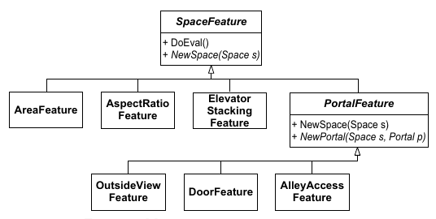<br/>
*Fig 30-5 评分特性的 TEMPLATE METHOD 结构*

这个结构允许我们创建几十个不同的评分特性——每一个都遍历楼层平面图数据结构——却不需要知道楼层平面图数据结构长什么样。
如果楼层平面图数据结构的细节发生变化（例如，我们决定用 STL 而不是自己的迭代器），我们只需要改两个类，而不是几十个。

为什么我们选 TEMPLATE METHOD 而非 STRATEGY？⁵

⁵ 显然，当时我们不是用这些术语来想的。我们做出这个决定时，模式的名字还没有被发明出来。

<ins>假如我们用了 STRATEGY，耦合会松得多！（见 Fig 30-6。）</ins>

使用 TEMPLATE METHOD 结构，如果不得不修改遍历数据结构的算法，我们就得修改 `SpaceFeature` 和 `PortalFeature`。
这很可能会迫使我们重新编译所有特性。
然而，使用 STRATEGY 模式，这个变化会被限制在那两个 Driver 类中。
特性几乎不可能需要重新编译。

那我们为什么选了 TEMPLATE METHOD？
因为它更简单。
因为那个数据结构不是一个会频繁变化的东西。
而且重新编译所有特性只花几分钟。

所以，即使 TEMPLATE METHOD 模式中的继承导致了一个耦合更紧的设计，
即使 STRATEGY 模式比 TEMPLATE METHOD 模式更符合 DIP，
到头来，为 STRATEGY 多写两个类是不值得的。

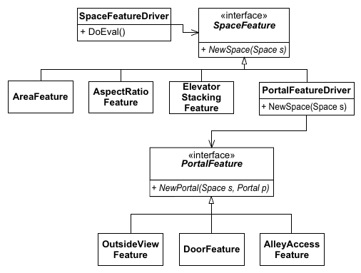<br/>
*Fig 30-6 使用 STRATEGY 的楼层平面图评分结构*

### 交付应用的共同需求

交付程序之间有着相当大的重叠。
例如，所有小场景的屏幕结构都相同。
屏幕左边是一个窗口，里面只有一列按钮。
这个窗口叫作“Command Window（命令窗口）”。
Command Window 中的按钮充当应用程序的控制件。
它们标注着诸如 “Place Item”“Erase”“Move/Adjust”“Zoom” 和 “Done” 之类的术语。
点击这些按钮，驱动应用程序完成期望的行为。

Command Window 右边是 Task Window（任务窗口）。
这是一个大的可滚动、可缩放区域，用户在其中绘制他的解。
在 Command Window 中发起的命令，通常用于修改 Task Window 中的内容。
事实上，在命令窗口中发起的大多数命令，都需要在 Task Window 内进行大量交互。

例如，要把一个房间放进楼层平面图，用户在 Command Window 中点击 Place Item 按钮。
一个可能的房间列表菜单弹出。
用户选择他想要放进平面图的那类房间。
然后用户把鼠标移进 Task Window，在他希望放置房间的位置点击。
视小场景不同，这可能把房间左上角锚定在用户点击处。
一个可拉伸房间的左下角随后跟着鼠标在 Task Window 中的移动，直到用户第二次点击，把左下角锚定在那个位置。

这些动作在每个小场景中都相似，但并非完全相同。
有些小场景不处理房间，而是处理等高线、产权线或屋顶。
尽管存在差异，在小场景内操作的总体范式是相当相似的。

这种相似性意味着我们有一个重要的复用机会。
我们应该能够创建一个面向对象框架，捕捉住大部分相似性，并让差异能够被方便地表达。
在这点上，我们成功了。

### 交付框架的设计

ETS 框架最终增长到将近 75,000 行代码。
显然，我们无法在这里展示那个框架的所有细节。
于是，我们选择了框架中最具说明性的两个元素来探讨：**事件模型**和**taskmaster 架构**。

**事件模型。**
用户的每个动作都会产生事件。
如果用户点击一个按钮，就产生一个以该按钮命名的事件。
如果用户选择一个菜单项，就产生一个以该菜单项命名的事件。
把这些事件装配（marshal）起来，是框架的一大难题。

之所以成为难题，是因为所有事件中很大的一部分可以由框架处理，
而每个单独的小场景又可能需要覆盖框架处理某个特定事件的方式。
于是，我们需要找到一种方式，让每个小场景在需要时拥有覆盖事件处理的权力。

问题又因为事件列表不是封闭的而变得复杂。
每个小场景可以选择它自己的一套 Command Window 按钮和它自己的一套菜单项。
于是，框架需要装配所有小场景共有的那些事件，同时允许每个小场景覆盖默认处理；
并且需要允许小场景装配它自己小场景特定的事件。
这不是一件容易办成的事。

举个例子，考虑 Fig 30-7。
这个图⁶展示了一个小场景的 Command Window 中发生的事件所使用的那台有限状态机的一小部分。
每个小场景都有这台有限状态机自己的特殊版本。

⁶ 像这样的状态图的记法，在 [附录 B](./appendix-b.md) 第 489 页起有完整描述。

> 译注：附录 B 尚未翻译，链接暂为悬空。

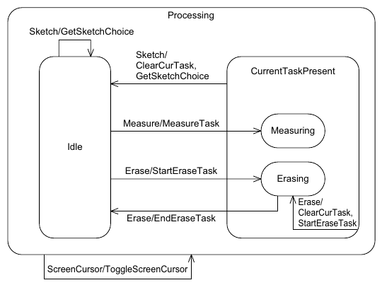<br/>
*Fig 30-7 Command Window 事件处理器*

Fig 30-7 展示了三种不同事件的行为。
我们先考虑最简单的情况：ScreenCursor 事件。
这个事件在用户点击 Change Cursor 按钮时产生。
用户每点击一次这个按钮，Task Window 中的光标就在箭头和全屏十字线之间切换。
于是，尽管光标改变了状态，事件处理器本身却没有发生状态改变。

当用户想删除他画过的对象时，他点击 Erase 按钮。
然后他点击 Task Window 中要删除的那个或那些对象。
最后，他再次点击 Erase 按钮，提交这次删除。
Fig 30-7 中的状态机展示了 Command Window 事件处理器如何处理这件事。
第一个 Erase 事件引起从 Idle 状态到 Erasing 状态的转移，并启动一个 Erase Task。
关于 Task，我们下一节会讲得更多。
现在你只需要知道：Erase Task 会处理发生在 Task Window 中的任何事件。

注意，即使在 Erasing 状态中，ScreenCursor 事件仍能正常起作用，且不会干扰擦除操作。
还要注意，从 Erasing 状态出去有两条路。
如果再次发生 Erase 事件，Erase Task 被结束，删除被提交，状态机转回 idle 状态。
这是结束擦除操作的正常方式。

结束擦除操作的另一条路，是点击 Command Window 中的其他某些按钮。
如果在擦除进行中，你点击了一个启动不同任务的 Command Window 按钮（例如 Sketch 按钮），那么 Erase Task 被中止，删除被取消。

Fig 30-7 展示了这种取消如何与 Sketch 事件协作，但还有许多未展示的事件以同样的方式工作。
如果用户在 Erasing 或 Idle 状态按下 Sketch 按钮，系统会转移到 Idle 状态，并调用 `GetSketchChoices` 函数。
这个函数弹出草图菜单，其中列有用户可执行的操作。
其中一个操作是 measure（测量）。

当用户从草图菜单中选择 measure 项时，Measure 事件发生。
这启动一个 Measure Task。
测量时，用户可以在 Task Window 中点击两个点。
两个点会用小小的十字线标出，两点间的距离会在屏幕底部的小消息窗口中报告。
用户随后可以再点两个点，再两个，再两个，等等。
Measure Task 没有正常出口。
相反，用户必须点击一个能启动另一个任务的按钮，比如 Erase 或 Sketch。

**事件模型设计。**
Fig 30-8 展示了实现 Command Window 事件处理器的那些类的静态模型。
右边的层次结构代表 `CommandWindow`，左边的层次结构代表把事件翻译成动作的那台有限状态机。

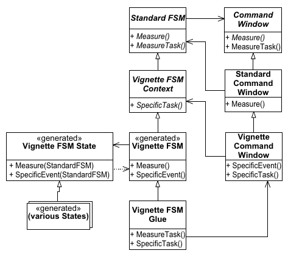<br/>
*Fig 30-8 Command Window 事件处理器静态模型*

`CommandWindow`、`StandardCommandWindow` 和 `StandardFSM` 是框架类。
其余的都是小场景特定的。
`CommandWindow` 提供标准动作（如 `MeasureTask` 和 `EraseTask`）的实现。

事件由 `VignetteCommandWindow` 接收。
它们被传给有限状态机，由后者把它们翻译成动作。
动作随后被传回 `CommandWindow` 层次结构，由后者实现它们。

`CommandWindow` 类提供标准动作（如 `MeasureTask` 和 `EraseTask`）的实现。
“标准动作”是所有小场景共有的动作。
`StandardCommandWindow` 负责把标准事件装配给有限状态机。
`VignetteCommandWindow` 是小场景特定的，它既提供特定动作的实现，也提供特定事件的装配。
它还允许标准实现与装配被覆盖。

于是，框架为所有共同任务提供默认实现与默认装配。
但其中任何一个实现或装配都可以被小场景覆盖。

**追踪一个标准事件。**
Fig 30-9 展示了一个标准事件如何被装配给有限状态机、并被翻译成一个标准动作。
消息 1 是 Measure 事件。
它来自 GUI，被传给 `VignetteCommandWindow`。
这个事件的默认装配由 `StandardCommandWindow` 提供，所以它在消息 1.1 中把事件转发给 `StandardFSM`。

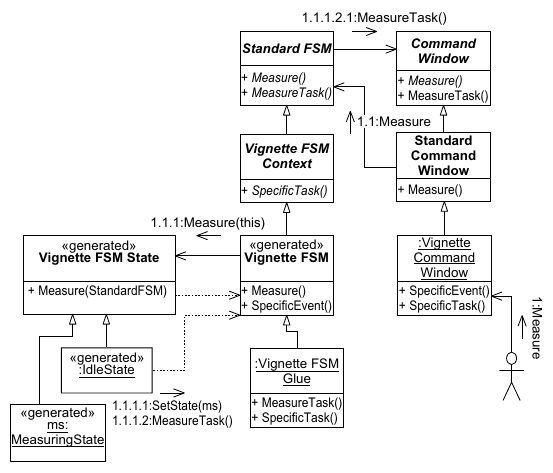<br/>
*Fig 30-9 处理 Measure 事件*

`StandardFSM` 是一个框架类，为所有传入的标准事件和所有传出的标准动作提供接口。
这个层级上并不实现任何这些函数。
`VignetteFSMContext` 为小场景特定的事件和动作添加接口，但不提供实现。

把一个事件翻译成一个动作的真正工作，发生在 `VignetteFSM` 和 `VignetteFSMState` 类中。
`VignetteFSM` 包含所有事件函数的实现。
于是，1.1:Measure 消息被分派到这一层。
`VignetteFSM` 以向 `VignetteFSMState` 对象发送 1.1.1:Measure(this) 来响应。

`VignetteFSMState` 是一个抽象类。
有限状态机的每个状态都有它的一个派生类。
在 Fig 30-9 中，我们假定 FSM 的当前状态是 Idle。（见 Fig 30-7。）
于是 1.1.1:Measure(this) 消息被分派到 `IdleState` 对象。
这个对象以向 `VignetteFSM` 回发两条消息来响应。
第一条是 1.1.1.1:SetState(ms)，把 FSM 的状态改为 Measuring 状态。
第二条消息是 1.1.1.2:MeasureTask()，它是 Idle 状态下 Measure 事件所要求的动作。

MeasureTask 消息最终在 `VignetteFSMGlue` 类中被实现。
该类识别出这个动作是声明在 `CommandWindow` 中的标准动作，于是以消息 1.1.1.2.1:MeasureTask 把它路由过去，从而完成整个回路。

把事件转换成动作所采用的机制，是 STATE 模式。
我们在框架的许多区域大量使用这个模式，后面几节会展示。「generated」立体类型出现在 STATE 模式类上，表明这些类是由 SMC 自动生成的。

**追踪一个特定事件。**
Fig 30-10 展示了一个小场景特定事件发生时的情形。
同样，消息 1:SpecificEvent 被 `VignetteCommandWindow` 捕获。
不过，由于特定事件的装配是在这一层实现的，发送消息 1.1:SpecificEvent 的是 `VignetteCommandWindow`。
而且，它把它发送给 `VignetteFSMContext` 类——`SpecificEvent` 方法就是在那里首次声明的。

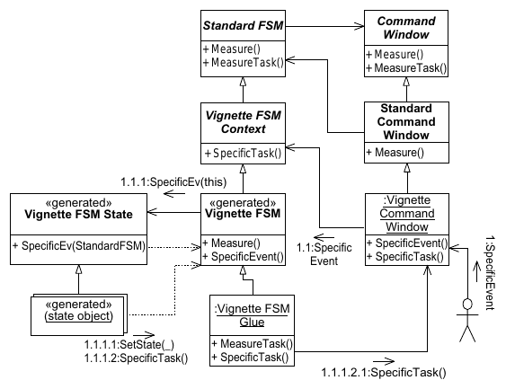<br/>
*Fig 30-10 处理一个特定事件*

同样，事件被分派到 `VignetteFSM`，后者在消息 1.1.1:SpecificEv 中与当前状态对象协商，以产生相应的动作。
如前，状态对象回发两条消息：1.1.1.1:SetState 和 1.1.1.2:SpecificTask。

再次，消息被分派到 `VignetteFSMGlue`。
不过这一次，它被识别为小场景特定动作，因此被直接路由到 `VignetteCommandWindow`——特定动作就在那里实现。

**生成并复用 Command Window 状态机。**
读到这里，你可能会想：以这种方式装配事件和动作，为什么需要这么多类？
不过请记住：类虽然多，对象却很少。
事实上，被实例化的对象只是 `VignetteCommandWindow`、`VignetteFSMGlue`，以及各种状态对象——而状态对象是琐碎的、自动生成的。

虽然消息流看起来复杂，其实相当简单。
窗口检测到一个事件，把它传给 FSM 翻译成动作，再从 FSM 接收回动作。
其余的复杂性，都与分离“框架所知的标准动作”和“小场景所知的特定动作”有关。

影响我们按现有方式划分类的另一个因素，是我们使用 SMC 来自动生成有限状态机类。
考虑以下描述，并回到 Fig 30-7：

```txt
Idle
{
  Measure Measuring MeasureTask
  Erase   Erasing   StartEraseTask
  Sketch  Idle      GetSketchChoice
}
```

注意，这段简单的文本描述了状态机处于 Idle 状态时发生的全部转移。
花括号里的三行分别标识触发转移的事件、转移的目标状态、以及转移执行的动作。

SMC⁷ 接受这种形式的文本，并生成标有「generated」的类。
SMC 生成的代码既不需要编辑，也不需要检视。

⁷ SMC（状态机编译器）是一个自由软件，可从 <http://www.objectmentor.com> 获取。

使用 SMC 生成状态机，使得为小场景创建事件处理器这一部分变得相当简单。
开发者必须编写 `VignetteCommandWindow`，连同它对特定事件和动作的相应实现。
开发者还必须编写 `VignetteFSMContext`，它只是声明特定事件和动作的接口。
然后开发者需要编写 `VignetteFSMGlue` 类，它只是把动作分派回 `VignetteCommandWindow`。
这些任务中没有一个特别具有挑战性。

开发者还必须做另外一件事。
他必须为 SMC 编写有限状态机的描述。
这个状态机实际上相当复杂。
Fig 30-7 中的图完全没能体现它的复杂程度。
一个真正的小场景必须处理多到几十种不同事件，而每种事件都可能有截然不同的行为。

幸运的是，大多数小场景的行为大致相同。
于是我们能够以一个标准状态机描述为模型，为每个小场景做相对小的修改。
这样，每个小场景都有它自己的 FSM 描述。

这种方法有些令人不满足，因为那些 FSM 描述文件彼此非常相似。
事实上，有好几次我们被迫修改那个通用状态机，这意味着我们必须在每个 FSM 描述文件中做出相同或几乎相同的修改。
这既乏味又容易出错。

我们本可以发明另一种方案，把 FSM 描述的通用部分与特定部分分离开来，
但到头来我们不觉得值得付出那个努力。
这是一个我们不止一次自责的决定。

### Taskmaster 架构

我们已经看到事件如何被转换成动作，以及这种转换如何依赖一台相当复杂的有限状态机。
现在我们要看看动作本身是如何被处理的。
每个动作的核心同样由一台有限状态机驱动——这应该不会让你意外。

考虑上一节讨论的 MeasureTask。
用户想要测量两点间距离时，调用这个任务。
一旦被调用，用户点击 TaskWindow 中的一个点。
那个点会出现一个小小的十字线。
随后用户移动鼠标时，一条可拉伸的线从点击点画到当前鼠标位置。
而且，那条线的当前长度会在一个独立的消息窗口中显示。
当用户第二次点击时，又画一个十字线，可拉伸的线消失，两点之间的最终距离显示在消息框中。
如果用户再点一次，过程重新开始。

一旦事件处理器选定了 MeasureTask（如 Fig 30-9 所示），
`CommandWindow` 就创建实际的 MeasureTask 对象，该对象随后运行 Fig 30-11 中展示的有限状态机。

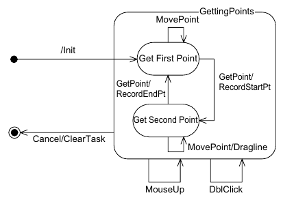<br/>
*Fig 30-11 Measure 任务的有限状态机*

MeasureTask 以调用它的 `init` 函数开始一生，然后处于 GetFirstPoint 状态。
发生在 TaskWindow 中的 GUI 事件，被路由到当前正在执行的任务。
于是，当用户在 TaskWindow 中移动鼠标时，当前任务收到一个 MovePoint 消息。
注意，在 GetFirstPoint 状态中，这个事件什么也不做（如所预期）。

当用户终于在 TaskWindow 中点击时，发生一个 GotPoint 事件。
这引起转移到 GetSecondPoint 状态，并调用 `RecordStartPt` 动作。
这个动作会画出第一个十字线，同时把鼠标点击的位置记为起点。

在 GetSecondPoint 状态中，MovePoint 事件引起 `Dragline` 动作被调用。
这个动作设置 XOR 模式⁸，从记住的起点画一条线到当前鼠标位置。
它还计算这两点间的距离，并在消息窗口中显示。

⁸ XOR 模式是一种 GUI 可以被置入的模式。它极大地简化了在屏幕上已有图形之上拖动可拉伸线条或形状的问题。如果你不懂这个，不用担心。

只要鼠标在 TaskWindow 上移动，MovePoint 事件就频繁发生，
所以只要鼠标在动，线的运动和消息窗口中显示的长度就会看起来在持续更新。

当用户第二次点击时，我们转回 GetFirstPoint 状态，并调用 `RecordEndPt` 动作。
这个动作关闭 XOR 模式，擦掉第一个点与当前鼠标位置之间的线，在点击点画一个十字线，并在消息窗口中显示起点与点击点之间的距离。

只要用户愿意，这个事件序列就不断重复。
它只在任务被 `CommandWindow` 取消时才终止——这多半是对用户点击某个命令按钮的响应。

Fig 30-12 展示了一个略复杂的任务——绘制“两点”盒。
两点盒是一个用两次点击画在屏幕上的矩形。
第一次点击锚定盒的一个角。
一个可拉伸的盒随后跟着鼠标。
当用户第二次点击时，盒变为永久。

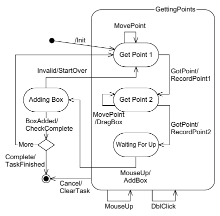<br/>
*Fig 30-12 两点盒*

如前，任务在调用 `Init` 之后从 GetPoint1 状态开始。
在这个状态中，鼠标的移动被忽略。
当鼠标被点击时，我们转移到 GetPoint2 并调用 `RecordPoint1` 动作。
这个动作把点击点记为起点。

在 GetPoint2 状态中，鼠标移动引起 `DragBox` 动作被调用。
这个函数设置 XOR 模式，从起点到当前鼠标位置画出可拉伸的盒。

当鼠标第二次落下时，我们转移到 WaitingForUp 状态，并调用 `RecordPoint2`。
这个函数只是记录盒的最终点。
它不取消 XOR 模式、不擦掉可拉伸的盒、也不画出真正的盒——因为我们还不确定盒是否有效。

此时，鼠标仍然按着，用户正要抬起手指。
我们需要等待这件事发生，否则某个其他任务可能抢到 mouse-up 事件，把事情搞乱。
等待期间，我们忽略鼠标的任何移动，让盒保持在最后一次点击点。

一旦鼠标抬起，我们转移到 AddingBox 状态并调用 `AddBox` 函数。
这个函数检查盒是否有效。
盒无效的原因可能有很多。
它可能是退化的（即起点和终点相同），也可能与绘图上的其他东西冲突。
每个小场景都有权拒绝用户试图画出的东西。

如果盒被发现无效，就产生一个 Invalid 事件，状态机转回 GetPoint1，同时调用 `StartOver` 函数。
然而，如果盒被发现有效，就产生一个 BoxAdded 事件。
这导致 `CheckComplete` 函数被调用。
这是又一个特定于小场景的函数。
它判定用户应该被允许继续画更多盒，还是任务应当结束。

框架中实实在在有几十个这样的任务。
每个都由 `Task` 类的一个派生类表示。（见 Fig 30-13。）
每个任务内部都有一台有限状态机，它们都远比我们这里能够展示的更复杂。
再次强调，那些状态机中的每一个都是 SMC 生成的。

Fig 30-13 展示了 Taskmaster 架构。
这个架构把 `CommandWindow` 连接到 `TaskWindow`，并创建和管理用户选定的任务。

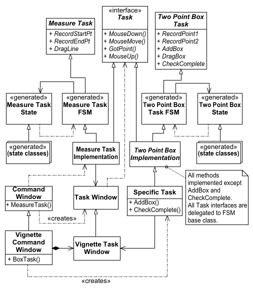<br/>
*Fig 30-13 Taskmaster 架构*

图中展示了两个任务，它们的 FSM 分别描绘在 Fig 30-11 和 30-12 中。
注意 STATE 模式的使用，以及每个任务中生成的类。
所有这些类，直到 `MeasureTaskImplementation` 和 `TwoPointBoxImplementation`，都属于框架。
事实上，开发者必须编写的类只有 `VignetteTaskWindow`，以及任务类的特定派生类。

`MeasureTaskImplementation` 和 `TwoPointBoxImplementation` 这些类，代表着框架所包含的许多不同任务。
但注意，这些类是抽象的。
有少数函数（如 `AddBox` 和 `CheckComplete`）并未被实现。
每个小场景必须根据自己的需要实现这些函数。

于是，框架所包含的任务，主宰着所有小场景中大部分交互。
每当开发者需要画一个盒、或某个与盒相关的对象时，他可以从 `TwoPointBoxImplementation` 派生一个新任务。
每当他需要简单地用一次点击把某个对象放到屏幕上时，他可以重写 `SinglePointPlacementTask`。
如果他需要基于多折线画某个东西，他可以重写 `PolylineTask`。
这些任务管理交互、执行任何需要的拖动，并给工程师提供他验证和创建所需对象之钩子。

## 结论

当然，本章我们本可以谈的还有很多。
我们可以讨论框架中处理计算几何的那些元素，或者处理把解存储到文件和从文件读取的那些部分。
我们可以讨论参数文件的结构——正是它们使每个小场景应用能够驱动同一个小场景的许多不同变体。
可惜，篇幅和时间都不允许。

不过，我们相信我们覆盖了框架中教益最多的那些方面。
我们在这个框架中采用的策略，也可以被其他人采用，去构建他们自己的可复用框架。

## 参考文献
<!-- markdownlint-disable MD013 -->
1. Booch, Grady. Object-Oriented Design with Applications. Redwood City, CA: Benjamin Cummings, 1991.
2. Booch, Grady. Object Solutions. Menlo Park, CA: Addison–Wesley, 1996.
3. Gamma, et al. Design Patterns. Reading, MA: Addison–Wesley, 1995.
