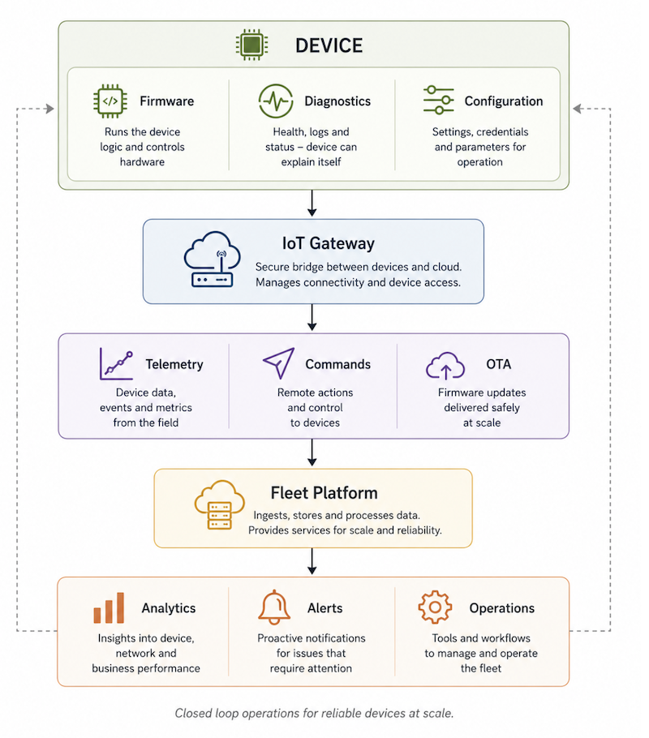

# 当软件遇上硬件
*发现新的"合理默认值"*

当软件遇上硬件，工程原则大体不变，但"合理默认值"（sensible defaults）往往会变。
本文讲述我们现代化改造一个大型电池供电传感器物联网（IoT）设备集群的经历 ——
在那里，熟悉的软件实践遭遇了物理限制、间歇性连接以及大规模部署。
我们把硬件视为开发环境的一部分、构建实验能力、让设备能够自我解释、
把能耗与断连当作软件层面的问题，并将部署与恢复一并设计。
快速反馈、自动化、测试、可观测性、安全部署与持续学习这些原则依然重要，
改变的是我们实践它们的方式。
这些做法诞生于实验、失败与运维经验之中 ——
每一次挑战都帮助我们用一个"合理假设"换来了一个"更明智的默认值"。

|作者| |
|:---|---:|
| |Kuldeep 是一位常驻印度的工程管理者，热衷于在多个技术领域探索和塑造工程实践与标准。他在 IoT、AR/VR、元宇宙、Web3 以及最近的 AI 领域建立了社区与卓越中心。  他是《Exploring the Metaverse》和《Jagjeevan》的作者，通过 ITU-T 与 IEEE 参与国际标准制定，并与印度各地的高校保持合作。他还拥有多项新兴技术领域的专利。|
| [原文](https://martinfowler.com/articles/software-meets-hardware.html) |2026/10/15|

内容
- [学习方式：先搭一个实验环境](#学习方式先搭一个实验环境)
- [把物理世界视为开发生命周期的一部分](#把物理世界视为开发生命周期的一部分)
- [每台设备都必须能自我解释](#每台设备都必须能自我解释)
- [像对待用户界面那样，刻意设计面向工程师的接口](#像对待用户界面那样刻意设计面向工程师的接口)
- [对物理上难以复现的部分进行模拟](#对物理上难以复现的部分进行模拟)
- [为断连而设计，而不只是为连接而设计](#为断连而设计而不只是为连接而设计)
- [把能耗当作软件设计问题](#把能耗当作软件设计问题)
- [把部署与恢复放在一起设计](#把部署与恢复放在一起设计)
- [让工程流程优化"规模化下的信心"](#让工程流程优化规模化下的信心)
- [面向设备机群设计可观测性，而不只是单台设备](#面向设备机群设计可观测性而不只是单台设备)
- [工程环境成为了系统的一部分](#工程环境成为了系统的一部分)
- [用 AI 缩短学习闭环，而不只是编码闭环](#用-ai-缩短学习闭环而不只是编码闭环)
- [记录发现，而不只是记录决策](#记录发现而不只是记录决策)
- [原则未变，默认值变了](#原则未变默认值变了)
- [为什么称之为"合理默认值"？](#为什么称之为合理默认值)
- [致谢](#致谢)

---
现代软件工程为我们提供了一套往往会被从一个项目带到另一个项目的实践：
AI 辅助开发、自动化测试、CI/CD、可观测性、自动化、模拟以及安全部署。
它们运转得足够好，以至于我们有时会忘记去质疑它们背后的假设。

当我们的团队开始现代化改造一个大型零售 IoT 系统时，我不得不质疑其中的一些假设。
这套系统在 3000 家门店中部署了约 80 万台电池供电的传感器。
既有的连接技术已接近生命周期终点，我们需要在不更换已安装设备的前提下迁移到更新的技术，
同时还要用下一代设备接入新开门店。

我们的团队对软件工程相当熟悉。我们有过 Web 应用、云平台、移动应用、IoT 以及其他分布式系统的经验。
我们欠缺的是嵌入式固件和大规模设备网络的深厚经验。
我们曾以为软件工程技能在这里同样适用 —— 事实确实如此，
工程原则没有改变，但默认的实践方式变了。

让我们来看看这种变化是如何被发现的。

## 学习方式：先搭一个实验环境
在对固件开发技术做了若干次初步探索（spike）之后，我们发现真正的挑战已经不再是写固件，
而是理解这套已经运行多年的 IoT 系统 ——
组织变动在既有固件、硬件和网络架构的知识上留下了空白。

文档有帮助，但还不够。有些东西从未被记录，
还有一些文档描述的硬件或行为我们已经无法复现。
有些答案只能通过亲手接触真实设备、并借助对生产系统的有限访问去不断试错才能获得。

于是我们开始动手做东西，并测量实际发生的结果。
我们搭建了一个包含物理传感器、线束与学习套件的 IoT 实验室。
我们创建了可以试验无线电行为的环境，用电池耗尽的传感器做测试复用，
并测量功耗与网络行为。

起初这一切看起来像是准备工作、试运行，但很快它就变成了我们的工程工作本身，
不久之后我们不再需要"等理解系统"才开始。
IoT 实验室成了我们学习和逆向工程的方式之一。

对于嵌入式系统而言，有时回答一个问题最快的方式不是再读一份文档，
而是把设备接上，看看会发生什么。

## 把物理世界视为开发生命周期的一部分
在传统软件中，开发环境通常由软件工具构成。
开发者可以克隆仓库、安装依赖并运行应用，不受物理位置限制，在任何地方工作。

我们这个项目的等效环境需要别的东西：它需要物理设备。
最终我们搭建了后来称之为"传感器农场"（sensor farm）的东西：
一组接入新网络的真实受控设备集合，周围配有监控。
这让工程师可以同时操作多台设备，观察它们在通信、休眠、唤醒或失去连接时发生了什么。
物理摆放、无线电条件与供电，全都成了开发与测试的一部分。

我们并不需要每位开发者桌面上都有一间实验室，
但我们的确需要开发流程能够提供对系统物理行为的访问能力，并带来快速反馈 ——
TDD、自动化、XP 这些工程实践依然适用，只不过是把硬件纳入了闭环。

## 每台设备都必须能自我解释
当我们有了可用的设备，并把它良好地集成进开发环境之后，另一个问题出现了：
"如果设备待在我们够不着的地方，会怎样？"
这听起来像是一个运维问题，但最终被证明是一个架构问题。

设想一位工程师收到报告说某台传感器行为异常。
传感器位于某家门店或某个开发环境中，而工程师在别处。
这种情况下没有调试器连接，可能没有人能帮忙打开设备，设备可能正处于休眠状态，网络甚至可能不可用。

传统应用通常能通过日志和链路追踪告诉我们发生了什么，
但物理设备并不会自动具备这种能力。
于是我们开始在设备固件本身中构建诊断能力，我们想知道的是：
运行的固件是哪个版本、设备是否健康、最近一次通信是什么时候、网络状态如何、
故障发生前发生了什么、设备是否在休眠、是否在反复重连、固件升级状态如何。

我们加入了健康检查与诊断信息，提供了在本地访问这些信息的方式，
并提供了 API，使同样的信息可以远程获取。
然后我们把这些信息接入了仪表盘和运维工具。

这改变了我们对可观测性的理解。
我们不再只是给应用加日志，而是在设计一个能够运维"看不见的设备"的系统 ——
其中每台设备都需要能自我解释。
对于少量设备，这很有用；对于数十万台设备，这就成为必需。

## 像对待用户界面那样，刻意设计面向工程师的接口
诊断能力只解决了问题的一部分。工程师还需要在不物理打开设备的情况下与设备交互的方式。

我们需要 NFC、BLE 这类本地接口，也需要经由网关与平台的远程接口。
它们让工程师可以检查配置、获取诊断信息、了解设备状态，并远程执行操作。

这让我们对工程接口有了不同的看法。
我们通常会花大量时间设计面向用户的接口，
而面向工程师和运维人员的接口却常常变成事后补充。

对于大型设备集群而言，它们本身就是系统的一部分。

## 对物理上难以复现的部分进行模拟
下一个意外出现在我们增加设备数量、并真正走进门店的时候。

一切都很顺利 —— 直到我们接入了几台设备、在较小的门店完成接入；
但当我们转向更大的门店时，网络基础设施出现了我们在小型实验室实验中从未遇到的限制。
有一刻我们发现，新的网络硬件只能支持有限数量的设备 ——
远低于某些较大门店所需的数量级。

测试几台设备与测试数千台设备完全是两回事。
网络行为、基础设施上限、消息速率、设备物理位置约束以及设备断连问题，
开始以难以在物理上复现的规模浮现出来。

于是我们构建了一个虚拟设备模拟器：
为同一款设备编写的特殊固件，可以模拟数百台独立设备，
每台都可以被配置为在不同网络与环境条件下表现出不同行为。
同时运行大量这样的虚拟设备，让我们得以模拟一个大型门店的环境，
并测试那些"规模本身就是问题"的系统部分。
这并未取代物理测试 —— 我们仍然需要真实设备来验证固件、硬件和无线电行为。

我们还构建了一个行为与真实门店一致的虚拟门店，
由网关向平台发布模拟的传感器读数。
这让我们无需为每次测试都准备数百台物理设备，就能在门店规模上压测下游系统。

## 为断连而设计，而不只是为连接而设计
企业级应用常常抱着一种舒适的假设：网络是可用的，
它被视为一项基础设施职责，应用只需要以一种对用户友好的方式处理断连，
让应用能够立刻重连即可。

电池供电设备与网络的关系则完全不同。

设备可能在空闲时休眠以节省电量，可能暂时失去连接，可能反复重连，
可能在平台想与它通信的那一刻恰好无法触达。
请记住：对设备而言，一次连接尝试是最重的操作。

因此我们必须小心翼翼地针对间歇性连接进行设计，而不是把它当作异常故障来处理。
这影响到了固件、网关通信、指令、遥测与设备管理。
一旦我们接受了"设备有时就是不可用"这一事实，许多设计决策就变得清晰了。

## 把能耗当作软件设计问题
还有一个容易被低估的约束：设备的能量有限，却需要在数年内持续运行。

在服务器应用中，一次低效的操作可能只是多消耗 CPU、内存，或者抬高云成本。
在电池供电的传感器里，不必要的计算或通信会缩短设备的有效寿命。

我们把功耗测量与性能剖析（profiling）引入了开发流程。
我们关注设备何时处于唤醒状态、通信频率如何，
以及不同操作对电池消耗意味着什么。

关键并不只是优化代码，
而是要理解每一个设计决策都可能带来物理后果 ——
哪怕小到一条日志语句，或几行看起来没被用到的代码。

我们也不得不重新审视一些关于内存管理的惯常假设。
我们没有在每次操作后都激进地清理已分配内存，
在某些情况下选择了一种更简单的做法：
让设备运行 24 小时后，作为正常运行周期的一部分重启它。

在设备上，最简单的软件方案有时并不是我们在服务器上会选择的那个。

## 把部署与恢复放在一起设计
固件部署带来了另一个挑战。

云应用在出问题后通常可以快速回滚。
而分布在数千家门店的物理设备无法给我们这种奢侈。

下载与安装固件所消耗的电池电量无法回滚；
设备可能在更新期间离线；
网络可能在下载中途失败；
固件可能无法正确校验；
或者某个问题可能只有在部署之后才显现。
所有这些都改变了"部署"与"恢复"的含义。

因此我们设计固件更新时，把恢复作为部署机制的一部分。
我们用安全下载、校验和分区切换（partition swapping）实现了 OTA 固件更新。
更新可以针对单台设备、一组设备或整家门店执行，
进度可通过网关查看，必要时也可通过 NFC 在本地查看。
设备还会记录自身的固件升级状态，
使得更新在因中断或故障而恢复之后可以从断点继续。

更重要的是，我们设计了分阶段发布（staged rollout），
因为我们希望在更新所有设备之前先知道更新之后发生了什么。
毕竟问题已经不再只是"我们如何部署新固件？"，
而是"我们如何安全地部署它，以及出问题时该怎么办？"

## 让工程流程优化"规模化下的信心"
到这时，某些微妙的东西已经发生了变化。

项目早期，我们说话的方式像软件工程师：
我们能多快把它构建出来？能多快部署？流水线能自动化到什么程度？

这些问题依然重要。但越来越多的时候，我们的对话变成了另一种样子：
我们能信任这次固件更新吗？出问题时我们能恢复吗？
我们能解释这台设备为什么失败吗？我们能理解一家门店里正在发生什么吗？
我们能安全地更新数千台设备吗？这对电池寿命有什么影响？升级一家门店需要多久？

我们优化的目标悄然变成了另一种东西：信心（confidence）。
这并不意味着放弃速度，而是认识到没有信心的速度未必是进步。
对于一个物理设备集群而言，一次"快速的部署"制造出数千台不健康的设备，
是制造一个巨大问题非常高效的方式。

## 面向设备机群设计可观测性，而不只是单台设备
让单台设备自我解释是必要的，但并不充分。
面对数十万台设备，没有人能一台一台地去检查。
问题从"这台设备在做什么？"变成了"整个机群正在发生什么？"

我们构建了仪表盘与分析能力，用于识别通信失败、异常行为、服务中断、
固件分发情况、模式以及其它机群层面的状况。
运维团队需要告警和工具，能够判断某个问题是孤立的，还是正在影响机群中更大的一部分。

## 工程环境成为了系统的一部分
到这时，若干起初只是工程或运维工具的东西，已经变成了整个系统的关键组成部分。

物理传感器农场帮助我们学习和测试；
虚拟设备模拟器帮助我们在规模上测试；
诊断接口让工程师可以远程理解设备；
网关提供了通信与管理能力；
仪表盘与分析让运维团队能够理解整个机群。

架构开始变成大致这样的形态：

设备 → 固件、诊断与配置 → IoT 网关 → 遥测、指令与 OTA → 机群平台 → 分析、告警与运维

 
<i>图 1：一个工程环境：硬件、软件与反馈。

自上而下四层，层与层之间以箭头相连，下游结果再通过虚线回路反馈到最上层的设备：
- **设备**：内含三块能力 —— 固件（运行设备逻辑并控制硬件）、诊断（健康状况、日志与状态，设备能自我解释）、配置（运行所需的设置、凭据与参数）；
- **IoT 网关**：设备与云之间的安全桥梁，负责管理连接性与设备访问；
- **遥测 / 指令 / OTA**：来自现场的遥测数据、事件与指标；面向设备的远程操作与控制；以及在大规模下安全交付的固件更新；
- **机群平台**：摄取、存储并处理数据，为规模与可靠性提供服务；
- **分析 / 告警 / 运维**：对设备、网络与业务表现的洞察；针对需要关注的问题的主动通知；用于管理和运维机群的工具与流程。

整个闭环的共同目标写在图底：为规模化下可靠的设备提供闭环运维。</i>

这些并不只是开发者的便利工具。
它们共同让我们得以构建、测试、运维、迁移和管理一个规模极为庞大的物理设备集群。
设备越多，这层周边平台就越有价值。

## 用 AI 缩短学习闭环，而不只是编码闭环
AI 也成为了我们工作方式的一部分，尽管并不是以我们最初预期的方式。

我们用 LLM 去探索陌生领域、原型化解决方案，
并缩短"提出问题"与"得到一次有用实验"之间的时间。
我们也用 AI 辅助开发来更快地构建仪表盘、迁移跟踪器、中断检测等工程工具。

重要的收益并不只是生成代码，而是降低了尝试某件事的成本。

## 记录发现，而不只是记录决策
我们通过实验、失败、测量和运维事故不断学习。
如果不把这些发现记录下来，下一个人就不得不把同样的课再上一遍。

因此，文档不再只是记录架构决策。
我们记录了关于设备、网络、测试、诊断、部署和运维的学习所得，
并通过技术文章、培训和工程社区把这些学习分享出去。

传统文档往往告诉我们"系统是什么"。
在一个陌生的领域里，记录"我们是如何发现它为什么是这样"同样有价值。

## 原则未变，默认值变了
回头看，我并不认为我们为 IoT 或嵌入式软件发明了一套新方法论。

我们依然想要快速反馈、自动化、良好的测试、可观测性、可维护性、安全部署和持续学习。
改变的是这些原则的实践方式。

随着时间推移，这些变化看起来就像一组新的默认值。

| 我们最初的假设 | 我们最终形成的合理默认值 |
| :--- | :--- |
| 文档应该告诉我们足够多的信息 | 通过搭建实验环境来学习 |
| 硬件可以稍后再测 | 把物理世界视为开发生命周期的一部分 |
| 设备完成它的功能，平台总能说明它的健康状况 | 每台设备都必须能自我解释 |
| 接口主要是给用户用的 | 像对待用户界面那样刻意设计面向工程师的接口 |
| 网络行为与物理环境可以在实验室用少量设备测试并复现 | 对物理上难以复现的部分进行模拟 |
| 设备通常应当是可触达的 | 为断连而设计，而不只是为连接而设计 |
| 电池主要是硬件层面的事 | 把能耗当作软件设计问题 |
| 部署意味着安装固件 | 把部署与恢复放在一起设计 |
| 主要优化交付速度 | 让工程流程优化"规模化下的信心" |
| 可观测性就是日志和指标 | 面向设备机群设计可观测性，而不只是单台设备 |
| 先做产品，再做支撑工具 | 工程环境成为了系统的一部分 |
| AI 帮助写代码 | 用 AI 缩短学习闭环，而不只是编码闭环 |
| 探索发生在开发之前，决策记录在最终设计里 | 记录发现，而不只是记录决策 |

这张表是一份"发生了什么"的记录。每一条默认值，都是以遇到一个问题为代价换来的。

## 为什么称之为"合理默认值"？
我刻意使用 [合理默认值（sensible defaults）](https://martinfowler.com/bliki/SensibleDefault.html) 这个说法。

这些实践没有一条是从第一性原理推导出来的。
大多数都源自我们遇到的问题：
我们从一个看起来合理的假设出发，撞上了挑战它的事实，做了实验，
然后逐步改变了工作方式。

真实项目中的工程实践往往就是这样演进的。
环境会告诉你，你的假设在哪里是错的。
如果你足够留意，那些失败会帮你发现一个更好的默认值。

这确实就是我们的经历。当软件遇上硬件，工程原则未必会改变，
但"合理默认值"会。

---
## 结束
### 致谢
感谢 Martin Fowler 鼓励我写下这个主题。
本文基于一份最初为 Thoughtworks "2025 年度最具创新项目"提交的草稿，该项目最终入围决选。
Martin 帮助我围绕"发现合理默认值"这一想法梳理了叙事脉络。
我也要感谢团队成员，他们的经验、想法与贡献共同塑造了这个叙事，以及我们一路上发现的那些合理默认值。

在整个过程中，我都把 AI 当作友好的写作助手：
用它审阅和打磨草稿、修正语法与格式、生成插图，
并帮助文章的风格与 martinfowler.com 的标准和基调保持一致。
我还请 AI 助手研究了几篇 Martin Fowler 的既有文章，以更好地理解其结构、风格与呈现方式。
文章中的想法、经验和技术内容均为我本人所有；
AI 主要被用作编辑、研究与创意支持工具。

### 重要修订
2026/10/15：发布
